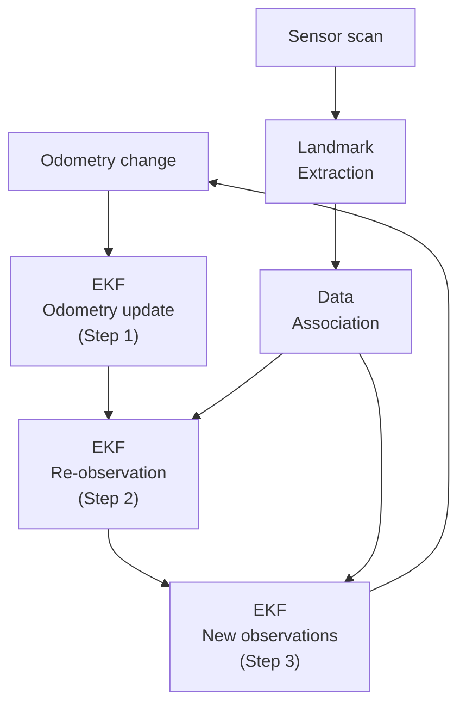

# Introduction to EKF SLAM

This is the first of a series of documents about EKF SLAM. It assumes no prior experience with Kalman filters: it builds up from a single noisy number, to a full filter that estimates a robot's pose and a map of landmarks together. Its structure follows the classic tutorial [*SLAM for Dummies*](#further-reading) by Riisgaard and Blas, working from what SLAM is, through the overall process, to the EKF itself: its matrices, and the three steps it repeats every time the robot moves and looks around. Further documents will work through a complete 2D example by hand and walk through this repository's MATLAB implementation, the way the [GraphSLAM series](../../Graph_SLAM/Documents/graphslam_introduction.md) does for its own method.

## About SLAM

A robot that moves through an unknown place needs two things at once: a **map** of the place, and its own **pose** in that map. Each one is needed to compute the other:

- To add an observation to the map, the robot must know where it was when it made it.
- To work out where it is, the robot must compare what it sees against a map.

**Simultaneous localization and mapping (SLAM)** solves both together. The robot has two kinds of information to work with: **odometry**, which measures how the robot moved but drifts over time, and **observations**, which measure where a landmark sits relative to the robot but are also noisy. Neither can be trusted exactly, and SLAM is the problem of combining them into the single most consistent estimate.

**EKF SLAM** is one way to solve this problem, built around the **extended Kalman filter (EKF)**. If you haven't met a Kalman filter before, the EKF section below builds one up from scratch, starting with a single noisy number and nothing else.

---

## The SLAM Process

Before looking at the EKF itself, it helps to see where it fits into the whole cycle the robot repeats, over and over, as it drives. At a high level:



When the odometry changes because the robot moves, the uncertainty in the robot's position is updated first — this is **Step 1**, the predict step. Separately, landmarks are extracted from whatever the robot's sensor currently sees, and each extracted landmark is compared against the ones already in the map — this is **data association**, deciding which previously-seen landmark (if any) a new observation belongs to. A landmark that matches an existing one feeds into **Step 2**, correcting the robot's position and the map using that re-observation. A landmark that doesn't match anything feeds into **Step 3**, adding it to the map for the first time. All three steps update the same running estimate, and the cycle repeats indefinitely.

Landmark extraction and data association are **front-end** problems: they depend entirely on the sensor being used, and a real implementation has to solve them with real, noisy data. This repository's simulation sidesteps most of that difficulty, since it simulates range-bearing measurements with *known* data association (the simulated sensor reports which real landmark it is looking at). This document, and the EKF itself, is the SLAM **back end** — the part that turns measurements, however they were produced and matched, into a consistent estimate. A future document will cover how this repository's simulation produces its measurements.

---

## The EKF

The EKF is the heart of the SLAM process. Whatever extracted and matched landmark data arrives, it is the EKF's job to fold it into the robot's position estimate and its growing map.

### Overview of the Process

Suppose you're trying to estimate some quantity — a position along a hallway, say — and all you have is a noisy sensor. A single reading is rarely something you should trust completely, so rather than keeping just one number, a Kalman filter keeps a **belief**: a best guess $\mu$ (the mean), and a **variance** $\sigma^2$ that says how sure it is of that guess. Together they describe a bell-shaped curve — a Gaussian — centered at $\mu$, and as wide as $\sigma^2$ says it should be.

#### Combining Two Beliefs

Suppose you already have a belief about this quantity, and a brand new, independent measurement arrives. You now have two separate guesses about the same thing — your prior belief, and the measurement — each with its own mean and variance. Intuitively, the right way to combine them is some kind of average, but not a plain 50/50 average: an estimate with a *small* variance is more trustworthy, so it should pull the combined answer harder toward itself.

That intuition turns out to be exactly correct. If you have two independent Gaussian estimates of the same quantity, with means $\mu_1,\mu_2$ and variances $\sigma_1^2,\sigma_2^2$, the single best combined estimate is a **variance-weighted average**:

```math
\mu_{\text{post}}=\frac{\sigma_2^2\mu_1+\sigma_1^2\mu_2}{\sigma_1^2+\sigma_2^2},
\qquad
\sigma_{\text{post}}^2=\frac{\sigma_1^2\sigma_2^2}{\sigma_1^2+\sigma_2^2}.
```

It's usually written a different, more convenient way, by first defining the **Kalman gain**,

```math
K=\frac{\sigma_1^2}{\sigma_1^2+\sigma_2^2},
```

which rewrites the combination as

```math
\boxed{\mu_{\text{post}}=\mu_1+K(\mu_2-\mu_1),\qquad \sigma_{\text{post}}^2=(1-K)\sigma_1^2.}
```

$K$ is always between $0$ and $1$. The posterior mean starts at $\mu_1$ and moves toward $\mu_2$ by a fraction $K$ of the distance between them — so a large $K$ pulls the estimate strongly toward the new measurement, and a small $K$ barely moves it at all. Notice what makes $K$ large: it grows whenever $\sigma_1^2$ (the prior's variance) is large relative to $\sigma_2^2$ (the measurement's variance). In other words, the estimate always shifts toward whichever of the two is *more confident* — exactly the behavior we wanted.

As a concrete example, say the prior belief is $\mu_1=0$ with variance $\sigma_1^2=5$, and a measurement arrives of $\mu_2=3$ with variance $\sigma_2^2=2$ — a more confident reading, since its variance is smaller. Then

```math
K=\frac{5}{5+2}\approx0.714,
\qquad
\mu_{\text{post}}=0+0.714(3-0)\approx2.14,
\qquad
\sigma_{\text{post}}^2=(1-0.714)(5)\approx1.43.
```

The posterior sits closer to the measurement than to the prior, because the measurement was more confident, and its variance is smaller than *either* input — combining two independent estimates always leaves you more certain than either one alone.


#### Predict, Then Correct

The example above fused two beliefs that already existed, but a real system is also *moving* or *changing* between measurements, and that has to be accounted for too. Every Kalman filter repeats a two-step cycle:

- **Predict.** Before a new measurement arrives, advance the belief forward using whatever you know about how the quantity changes over time (a **motion model**, or more generally a **process model**). Since the motion itself is never perfectly known, this step also *grows* the variance — you become a little less sure, simply because time has passed.
- **Correct.** When a measurement arrives, fuse it into the predicted belief using the weighted average above. This *shrinks* the variance again, because a new, independent piece of information has arrived.

Uncertainty grows during predict and shrinks during correct, and the filter's belief tracks the true quantity by repeating the cycle indefinitely: predict, correct, predict, correct, one time step at a time.

#### From One Number to Many

A robot's state is rarely just one number — a 2D pose has an $x$, a $y$, and a heading $\theta$, all at once. Generalizing the filter to several numbers means replacing the mean $\mu$ with a **state vector** $\mathbf{x}$, and replacing the variance $\sigma^2$ with a **covariance matrix** $P$: a square matrix whose diagonal holds the variance of each individual state variable, and whose off-diagonal entries capture how pairs of variables are correlated — how learning something about one tells you something about another.

The predict and correct steps generalize the same way:

```math
\textbf{Predict:}\quad
\mathbf{x}'=f(\mathbf{x},\mathbf{u}),
\qquad
P'=FPF^{\mathsf{T}}+R
```

```math
\textbf{Correct:}\quad
\mathbf{y}=\mathbf{z}-h(\mathbf{x}'),
\qquad
S=HP'H^{\mathsf{T}}+Q,
\qquad
K=P'H^{\mathsf{T}}S^{-1},
\qquad
\mathbf{x}=\mathbf{x}'+K\mathbf{y},
\qquad
P=(I-KH)P'
```

where:

- $f$ is the process model (how the state evolves given a control input $\mathbf{u}$), and $h$ is the measurement model (what a sensor reading should look like, given the state).
- $R$ and $Q$ are the process noise and measurement noise covariances — the multi-variable equivalents of $\sigma_1^2$ and $\sigma_2^2$ from before.
- $\mathbf{y}$, the difference between the actual and the predicted measurement, is called the **innovation** — the multi-variable equivalent of $\mu_2-\mu_1$.
- $K$ again decides how much the innovation should move the state estimate, exactly like before, just expressed with matrices instead of a single ratio.

For many real systems, $f$ and $h$ are **nonlinear** — a heading $\theta$ usually appears inside a $\sin$ or $\cos$, for instance. $F$ and $H$ above are the **Jacobians** of $f$ and $h$: matrices of partial derivatives that locally approximate the nonlinear functions with a linear one, evaluated at the current estimate. Using this local linear approximation instead of the exact nonlinear function is what makes this the **extended** Kalman filter.

The rest of this document is organized the way these equations suggest: first the matrices themselves — what each one holds, and why it has the shape it does — and then the three steps that use them, one per visit to the predict/correct cycle above.

### The Matrices

#### The System State: $\mathbf{x}$

Ordinary EKF localization only estimates the robot's own pose. EKF SLAM estimates the map as well, by folding every landmark's position directly into the same state vector:

```math
\mathbf{x}=
\begin{bmatrix}
x_r\\y_r\\\theta_r\\L_{0x}\\L_{0y}\\L_{1x}\\L_{1y}\\\vdots\\L_{Nx}\\L_{Ny}
\end{bmatrix}
```

For $N$ landmarks, this is a single vector of length $3+2N$: three entries for the robot pose, and two more for every landmark's $(x,y)$ position. In this repository's simulation (`SIMULATION_EKFSLAM.m`), this is literally the layout of the variable `x`, with every landmark slot allocated up front, whether or not it has been seen yet.

#### The Covariance Matrix: $P$

$P$ is $(3+2N)\times(3+2N)$ — one row and one column for every entry of $\mathbf{x}$ — and because it's symmetric, it's cleanest to understand by splitting it into blocks:

- $P_{rr}$, a $3\times3$ block in the top-left corner, is the robot's own pose covariance — exactly what ordinary EKF localization would track on its own.
- $P_{rl}$ and $P_{lr}=P_{rl}^{\mathsf{T}}$, each $3\times2N$, capture the correlation between the robot's pose and every landmark. This matters because every landmark's estimated position was computed from the robot's pose *at the time it was observed* — if that pose estimate later turns out to be off, the landmark's estimate should move too, and this block is what remembers that relationship.
- $P_{ll}$, the remaining $2N\times2N$ block, holds each landmark's own variance along its diagonal 2×2 blocks, and the correlation *between pairs of landmarks* everywhere else. These cross-landmark terms start at zero — two landmarks that have never been seen from the same uncertain pose have no reason to be correlated yet — but they fill in over time, which turns out to be the key to why SLAM works better than mapping each landmark independently.

![A 9 by 9 grid representing the covariance matrix for a robot pose and three landmarks, labeled x, y, theta, L0x, L0y, L1x, L1y, L2x, L2y along both axes. The top-left 3 by 3 block is colored blue for the robot-robot block. The row and column band for the robot against every landmark is colored purple for the robot-landmark cross blocks. Along the landmark-landmark region, the 2 by 2 blocks on the diagonal for each individual landmark are colored gold, and every remaining off-diagonal 2 by 2 block between two different landmarks is colored a muted blue-gray, representing correlation between landmarks.](images/ekf_slam_covariance_blocks.png)

#### The Kalman Gain: $K$

$K$ plays exactly the role it did for a single number: it decides how much to trust a re-observed landmark, and therefore how much it should move the robot's pose estimate and the map. A landmark re-observed with a precise sensor, from a pose the filter is already confident about, produces a large $K$ and a strong correction. A noisy observation, or one the filter already has little reason to trust, produces a small $K$ and a gentle nudge. Because $K=P'H^{\mathsf{T}}S^{-1}$ is built from the *entire* current $P'$, it doesn't just correct the robot pose and the one landmark being observed — as the next section on $H$ shows, that correction can spread to the rest of the map too.

#### The Jacobian of the Measurement Model: $H$

The measurement model $h$ predicts what range and bearing the robot should see to a landmark, given the current estimate of the robot's pose and that landmark's position. Its Jacobian $H$ says how that predicted range and bearing would change for a small change in any part of the state — and almost all of that change comes from just two places: the robot's own pose, and the one landmark currently being observed. Every other column of $H$, belonging to every other landmark, is zero.

This repository's simulation builds $H$ in exactly this two-piece way. A small $2\times5$ Jacobian, `H_low`, holds the derivatives of range and bearing with respect to the robot pose and the single observed landmark's $(x,y)$:

```math
H_{\text{low}}=\frac{1}{q}
\begin{bmatrix}
-\sqrt{q}\,\delta_x & -\sqrt{q}\,\delta_y & 0 & \sqrt{q}\,\delta_x & \sqrt{q}\,\delta_y\\
\delta_y & -\delta_x & -q & -\delta_y & \delta_x
\end{bmatrix}
```

where $\boldsymbol{\delta}=(\delta_x,\delta_y)$ is the vector from the robot to the landmark and $q=\boldsymbol{\delta}\cdot\boldsymbol{\delta}$ is its squared range. A second matrix, the selection matrix `F_j`, is mostly zeros, with a $3\times3$ identity block picking out the robot's columns and two single $1$s picking out that one landmark's columns. Multiplying $H=H_{\text{low}}F_j$ expands the small $2\times5$ Jacobian back out into the full $2\times(3+2N)$ matrix, with every other landmark's columns left at zero.

#### The Jacobian of the Prediction Model: $F$

The prediction model only moves the robot — landmarks don't move on their own — so $F$ is the identity matrix everywhere except in the $3\times3$ block belonging to the robot's own pose, where it holds the motion model's own Jacobian, call it $F_x$. In the simulation, this is the matrix `G`, built as `G = eye(n)` with `G(1:3,1:3)` replaced by the motion Jacobian:

```math
F_x=
\begin{bmatrix}
1 & 0 & -v\sin\theta\,\Delta t\\
0 & 1 & v\cos\theta\,\Delta t\\
0 & 0 & 1
\end{bmatrix}
```

for a robot commanded with linear velocity $v$ and heading $\theta$ over a time step $\Delta t$.

#### The Process and Measurement Noise: $R$ and $Q$

$R$ and $Q$ play the same role they did for a single number, just as covariance matrices instead of single variances. $R$ describes how much the robot's own motion is trusted — in the simulation, it's built from the commanded velocity noise and only ever touches the robot's $3\times3$ block, since nothing else is moving. $Q$ describes how much a single range-bearing measurement is trusted, and is a small, fixed $2\times2$ matrix, since every observation only ever reports two numbers regardless of how large the map has grown.

---

### Step 1: Predict Using the Odometry Data

Every time the robot moves, its pose estimate is advanced using the commanded (and noisy) odometry, and the robot's $3\times3$ block of $P$ is updated to reflect the fact that this motion was not known perfectly:

```math
P_{rr}'=F_xP_{rr}F_x^{\mathsf{T}}+R_x,
\qquad
P_{rl}'=F_xP_{rl},
\qquad
P_{ll}'=P_{ll}.
```

The robot block changes the most — it's transformed by $F_x$ on both sides and gains new process noise $R_x$. The cross-correlation blocks change too, but more gently, scaled by $F_x$ on one side only. The landmark-landmark block is completely untouched: landmarks don't move, so nothing new happens to how they relate to each other during a predict step. Only the state's first three entries and $P$'s robot-related rows and columns are touched at all — every landmark already in the map is left exactly as it was until it is re-observed.

### Step 2: Correct Using Re-Observed Landmarks

When the robot observes a landmark it has already matched to one in the map, the measurement model $h$ predicts the range and bearing it should see, the innovation $\mathbf{y}=\mathbf{z}-h(\mathbf{x}')$ captures how wrong that prediction was, and the full correct step

```math
S=HP'H^{\mathsf{T}}+Q,\qquad K=P'H^{\mathsf{T}}S^{-1},\qquad \mathbf{x}=\mathbf{x}'+K\mathbf{y},\qquad P=(I-KH)P'
```

folds that information back in. As the section on $H$ explained, $H$ is only directly nonzero in the robot's columns and the one re-observed landmark's columns — but $K=P'H^{\mathsf{T}}S^{-1}$ multiplies through *every column* of $P'$, not just the ones $H$ reads from directly. Because the robot is already correlated with every landmark through $P_{rl}$, and the re-observed landmark may already be correlated with other landmarks through $P_{ll}$, the correction ripples outward through those correlations and can adjust the entire map — including landmarks the robot isn't even looking at right now.

![Two side-by-side 9 by 9 grids for the same state as before. The left grid, titled predict, highlights only the robot block in blue and the robot-landmark cross blocks in purple, leaving the landmark-landmark block a flat unchanged dark gray. The right grid, titled correct observing L1, highlights the robot block in blue and the L1 diagonal block in gold as the two directly observed blocks, while every remaining block of the matrix, including landmarks other than L1 and their correlations, is colored blue-gray to show it is still updated indirectly through correlation.](images/ekf_slam_predict_correct.png)

This is the central mechanism that makes EKF SLAM more than just independently tracking each landmark: once two landmarks have both been seen from the same uncertain robot pose, they become linked, and correcting one tends to improve the other, even without observing it directly.

### Step 3: Add New Landmarks to the State

A landmark that data association fails to match to anything already in the map is a landmark the filter has never seen before. Classically, this means growing $\mathbf{x}$ and $P$ by one landmark's worth of entries: seeding the new landmark's position from the robot's current pose estimate and the fresh measurement, and computing new covariance blocks for it — its own variance, and its correlation with the robot and every existing landmark — from dedicated Jacobians of that seeding step.

This repository's simulation takes a simpler, commonly used shortcut: every landmark slot is allocated in $\mathbf{x}$ and $P$ from the very start, long before it's ever been seen, with an enormous placeholder variance (`largeInitialVariance`, $10^6$) on its diagonal and zero correlation with everything else — in effect, "this landmark exists somewhere, but we have no idea where." The first time that landmark is actually observed, its position is seeded directly from the current pose and the measurement:

```math
L_x = x_r + z_{\text{range}}\cos(z_{\text{bearing}}+\theta_r),
\qquad
L_y = y_r + z_{\text{range}}\sin(z_{\text{bearing}}+\theta_r),
```

and then the *ordinary* Step 2 correct step runs immediately afterward, using that seeded position as the prediction. Because the landmark's placeholder variance is so large, the Kalman gain for it is large too: the correction all but replaces the placeholder with a position anchored by the real measurement, and the same $P=(I-KH)P'$ update that ripples corrections across the map in Step 2 also writes in that landmark's very first correlations with the robot and the rest of the map. No separate formulas are needed — the first correction a new landmark ever receives does the same job the classical insertion formulas do, just by reusing the correct step that already exists.

---

## Filtering vs. Batch Estimation

EKF SLAM is a **filter**: it keeps only the current pose and map, folding every past measurement into $P$ and then discarding it. This is the same distinction the [Introduction to GraphSLAM](../../Graph_SLAM/Documents/graphslam_introduction.md#an-offline-batch-solver) draws between filtering and batch, offline solvers like GraphSLAM, which keep every pose ever visited and can revise the whole trajectory at once:

| | Filtering (EKF SLAM) | GraphSLAM |
|---|---|---|
| Estimates | The current pose and the map | Every pose and the map |
| Past poses | Summarized and discarded | Kept and re-estimated |
| New information | Updates the current estimate | Can change the whole trajectory |
| Typical use | Online, as the robot moves | Offline, over a collected data set |

EKF SLAM's cost grows with the *size of the map*: $P$ is $(3+2N)^2$ entries, and updating it at every step is at least that expensive, which is why the number of landmarks a plain EKF SLAM implementation can track is limited in practice. Its advantage is that it runs online, producing an estimate after every single measurement, with no need to store the robot's whole history.

## Final Remarks

This document covers a basic, complete EKF SLAM: enough to fold odometry and landmark observations into a single consistent estimate of a robot's pose and its map, the same way the simulation in [SIMULATION_EKFSLAM.m](../SIMULATION_EKFSLAM.m) does. There is more to the full problem that it doesn't touch:

- **Loop closure** — recognizing that the robot has returned to an already-mapped place, and using that to correct drift built up along the way — isn't handled specially here. It falls out naturally if the revisited landmarks are re-observed and matched correctly, but nothing in this document adds the extra care that a real system needs to detect and trust a loop closure confidently. See [Loop Closure in GraphSLAM](../../Graph_SLAM/Documents/graphslam_loop_closure.md) for how the batch alternative handles it.
- **Landmark extraction and data association** depend entirely on the sensor in use, and this document deferred them to future work, the way *SLAM for Dummies* devotes several of its own chapters to exactly this problem for a laser scanner.

Future documents in this series will work through a full 2D example by hand — building $\mathbf{x}$, $P$, and the Jacobians $F$ and $H$ explicitly with real numbers — and then walk through how [SIMULATION_EKFSLAM.m](../SIMULATION_EKFSLAM.m) puts all of it into code.

### Further Reading

- Søren Riisgaard and Morten Rufus Blas, *SLAM for Dummies: A Tutorial Approach to Simultaneous Localization and Mapping* — the tutorial this document's structure follows, with a complete walkthrough of landmark extraction (spikes and RANSAC) and data association for a real laser-scanner robot.
- [Introduction to GraphSLAM](../../Graph_SLAM/Documents/graphslam_introduction.md) — this repository's introduction to the batch alternative to EKF SLAM.
