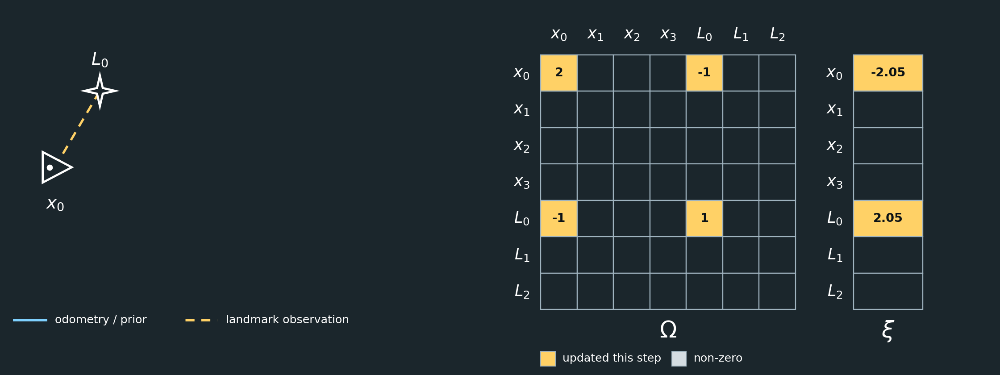
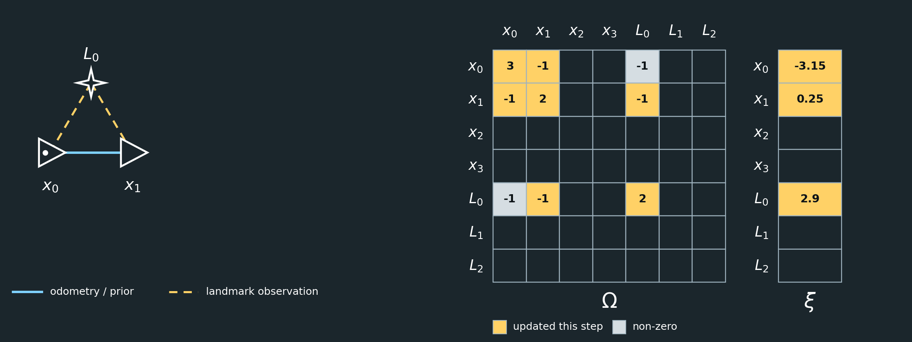
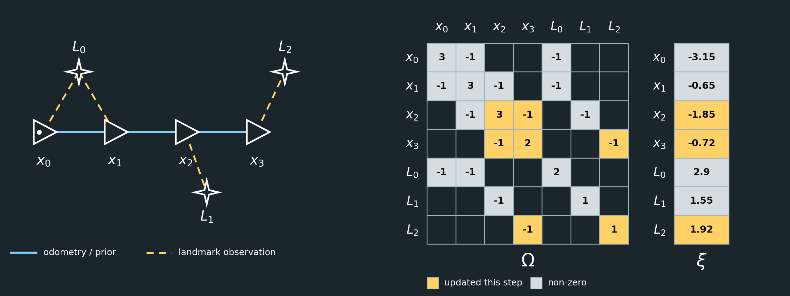

# 1D GraphSLAM Example

This example continues the [Introduction to GraphSLAM](graphslam_introduction.md). It assumes you have read that document, which explains what GraphSLAM is and why it works.

## Introduction

The introduction described GraphSLAM in general terms: poses and landmarks are nodes in a graph, measurements are edges between them, and the best estimate of everything is found at once by solving $\Omega\mu=\xi$. This document turns that description into equations and numbers.

We do it in one dimension. Every pose and every landmark is a single number, so the equations can be written explicitly and the information matrix can be inspected directly. The same graph structure extends to practical two- and three-dimensional SLAM systems, where the constraints are usually nonlinear and are solved through repeated linearization and optimization. The [2D GraphSLAM Example](graphslam_2d_example.md) continues from here and shows how poses with a heading change the matrices.

---

## 1D Example

Consider a robot moving along a straight line. We will estimate four robot poses and three landmark positions.

The unknown state is

```math
\mu =
\begin{bmatrix}
x_0\\
x_1\\
x_2\\
x_3\\
L_0\\
L_1\\
L_2
\end{bmatrix}
```

where:

- $x_0,x_1,x_2,x_3$ are robot poses.
- $L_0,L_1,L_2$ are landmark positions.

The GraphSLAM problem is written in information form as

```math
\boxed{\Omega \mu = \xi}
```

where:

- $\mu$ contains the unknown node values.
- $\Omega$ is the **information matrix**, describing which variables are constrained together and how strongly.
- $\xi$ is the **information vector**, containing the measurement values after they have been incorporated into the system.

---

## Measurement Model

Suppose a sensor measurement says

```math
v_j-v_i=z.
```

For example,

```math
x_1-x_0=1.1
```

means odometry measured a motion of $1.1\text{ m}$.

That measurement contributes

```math
\Delta\Omega
=
\begin{bmatrix}
1&-1\\
-1&1
\end{bmatrix}
```

to the rows and columns associated with $v_i$ and $v_j$, and

```math
\Delta\xi
=
\begin{bmatrix}
-z\\
z
\end{bmatrix}.
```

Every measurement in this example is treated as equally trustworthy, so each one is added with the same strength. We will revisit that assumption in [Weighting the Measurements](#weighting-the-measurements) after the full system has been solved.

So:

> $\Omega$ records which variables are related.

> $\xi$ records the numerical measurement information.

---

## Step 1: Anchor the First Pose

Each step begins with a literal **1D world view**. Every pose and landmark is placed on a single metre axis at the position its measurements imply. Blue arrows below the axis are odometry measurements, and yellow arrows above it are landmark observations, each spanning the distance it measures. Landmarks are drawn slightly above the axis only so they do not overlap poses at nearly the same position; the dotted guide lines show where they sit on the axis. A red arrow marks an observation that disagrees with an earlier one.


SLAM only determines relative positions unless we choose a reference frame.

We therefore define

```math
x_0=0.
```

Suppose the prior is added to the system like any other measurement, with strength $1$.

The initial system is

```math
\Omega=
\begin{bmatrix}
1&0&0&0&0&0&0\\
0&0&0&0&0&0&0\\
0&0&0&0&0&0&0\\
0&0&0&0&0&0&0\\
0&0&0&0&0&0&0\\
0&0&0&0&0&0&0\\
0&0&0&0&0&0&0
\end{bmatrix}
```

and

```math
\xi=
\begin{bmatrix}
1(0)\\
0\\
0\\
0\\
0\\
0\\
0
\end{bmatrix}
=
\begin{bmatrix}
0\\
0\\
0\\
0\\
0\\
0\\
0
\end{bmatrix}.
```

The value $1$ is **not** the pose.

It means:

```math
\boxed{\text{the system is anchored so that }x_0=0}
```


After the 1D view and the math, each step ends with a figure showing the graph on the left and the system $\Omega\mu=\xi$ on the right. Triangles are poses, stars are landmarks, solid edges are odometry or the prior, and dashed edges are landmark observations. In $\Omega$ and $\xi$, light cells are non-zero entries and yellow cells are the entries changed in that step. Blank dark cells are zero. All figures are generated by [generate_step_figures.py](images/generate_step_figures.py).

---

## Step 2: Observe Landmark $L_0$


At $x_0$, the robot measures

```math
L_0-x_0=2.05.
```

The measurement contributes

```math
\Delta\Omega=
\begin{bmatrix}
1&-1\\
-1&1
\end{bmatrix}
```

to $x_0$ and $L_0$.

It also contributes

```math
\Delta\xi=
\begin{bmatrix}
-2.05\\
2.05
\end{bmatrix}.
```

Therefore,

```math
\Omega=
\begin{bmatrix}
2&0&0&0&-1&0&0\\
0&0&0&0&0&0&0\\
0&0&0&0&0&0&0\\
0&0&0&0&0&0&0\\
-1&0&0&0&1&0&0\\
0&0&0&0&0&0&0\\
0&0&0&0&0&0&0
\end{bmatrix}
```

and

```math
\xi=
\begin{bmatrix}
-2.05\\
0\\
0\\
0\\
2.05\\
0\\
0
\end{bmatrix}.
```



---

## Step 3: Move to $x_1$


Odometry measures

```math
x_1-x_0=1.10.
```

This adds

```math
\begin{bmatrix}
1&-1\\
-1&1
\end{bmatrix}
```

between $x_0$ and $x_1$, and

```math
\begin{bmatrix}
-1.10\\
1.10
\end{bmatrix}
```

to the information vector.

Now suppose the robot sees $L_0$ again:

```math
L_0-x_1=0.85.
```

This is where inconsistency appears.

The first observation and odometry suggest approximately

```math
L_0-x_1
=
2.05-1.10
=
0.95,
```

but the second landmark observation says

```math
0.85.
```

These cannot all be exactly correct.

GraphSLAM will therefore find a compromise.

After adding both measurements,

```math
\Omega=
\begin{bmatrix}
3&-1&0&0&-1&0&0\\
-1&2&0&0&-1&0&0\\
0&0&0&0&0&0&0\\
0&0&0&0&0&0&0\\
-1&-1&0&0&2&0&0\\
0&0&0&0&0&0&0\\
0&0&0&0&0&0&0
\end{bmatrix}
```

and

```math
\xi=
\begin{bmatrix}
-3.15\\
0.25\\
0\\
0\\
2.90\\
0\\
0
\end{bmatrix}.
```



---

## Step 4: Move to $x_2$


Suppose odometry reports

```math
x_2-x_1=0.90.
```

At $x_2$, the robot observes a new landmark:

```math
L_1-x_2=1.55.
```

After incorporating both,

```math
\Omega=
\begin{bmatrix}
3&-1&0&0&-1&0&0\\
-1&3&-1&0&-1&0&0\\
0&-1&2&0&0&-1&0\\
0&0&0&0&0&0&0\\
-1&-1&0&0&2&0&0\\
0&0&-1&0&0&1&0\\
0&0&0&0&0&0&0
\end{bmatrix}
```

and

```math
\xi=
\begin{bmatrix}
-3.15\\
-0.65\\
-0.65\\
0\\
2.90\\
1.55\\
0
\end{bmatrix}.
```


Notice that $L_1$ has only been seen once.

That observation places $L_1$ relative to $x_2$, but it does not yet provide redundancy.

---

## Step 5: Move to $x_3$


Suppose odometry reports

```math
x_3-x_2=1.20.
```

At $x_3$, the robot observes

```math
L_2-x_3=1.92.
```

The final system is

```math
\boxed{
\Omega=
\begin{bmatrix}
3&-1&0&0&-1&0&0\\
-1&3&-1&0&-1&0&0\\
0&-1&3&-1&0&-1&0\\
0&0&-1&2&0&0&-1\\
-1&-1&0&0&2&0&0\\
0&0&-1&0&0&1&0\\
0&0&0&-1&0&0&1
\end{bmatrix}
}
```

and

```math
\boxed{
\xi=
\begin{bmatrix}
-3.15\\
-0.65\\
-1.85\\
-0.72\\
2.90\\
1.55\\
1.92
\end{bmatrix}
}.
```



---

## What Does This Matrix Mean?

The state vector is

```math
\mu=
\begin{bmatrix}
x_0\\
x_1\\
x_2\\
x_3\\
L_0\\
L_1\\
L_2
\end{bmatrix}.
```

Each row and column of $\Omega$ corresponds to one state variable.

A nonzero off-diagonal value means:

```math
\boxed{\text{those two variables are connected by a measurement}}
```

For example,

```math
\Omega_{01}=-1
```

exists because odometry connects $x_0$ and $x_1$.

Similarly,

```math
\Omega_{04}=-1
```

exists because $x_0$ observed $L_0$.

Because every measurement is added with the same strength, each diagonal entry simply counts the measurements that involve that variable. For example,

```math
\Omega_{00}=3
```

because $x_0$ is involved in the prior, the odometry to $x_1$, and the observation of $L_0$.

---

## Solving the System

We now have

```math
\Omega\mu=\xi.
```

Writing

```math
\mu=\Omega^{-1}\xi
```

is mathematically valid, but in practice we normally solve the linear system directly.

That is, the computer asks:

> What values of $\mu$ make $\Omega\mu$ equal to $\xi$?

It does not normally calculate $\Omega^{-1}$ explicitly.

A sparse linear solver might instead use Cholesky or another factorization.

For a small classroom example, however, computing

```math
\Omega^{-1}\xi
```

would give the same result, aside from numerical precision.

Solving the system above gives

```math
\boxed{
\mu=
\begin{bmatrix}
x_0\\
x_1\\
x_2\\
x_3\\
L_0\\
L_1\\
L_2
\end{bmatrix}
\approx
\begin{bmatrix}
0.000\\
1.133\\
2.033\\
3.233\\
2.017\\
3.583\\
5.153
\end{bmatrix}
}.
```


Compare this with the positions implied by dead reckoning, such as $x_1=1.10$ and $L_0=2.05$. Only the loop formed by $x_0$, $x_1$, and $L_0$ contained an inconsistency, so only that part of the map moved much.

The three measurements in that loop disagreed by $0.10\text{ m}$. The solution spreads that error evenly:

```math
\begin{aligned}
x_1-x_0&=1.133&&\text{(measured }1.10\text{, off by }+0.033\text{)}\\
L_0-x_0&=2.017&&\text{(measured }2.05\text{, off by }-0.033\text{)}\\
L_0-x_1&=0.883&&\text{(measured }0.85\text{, off by }+0.033\text{)}
\end{aligned}
```

Every measurement was given equal strength, so every measurement in the loop absorbs an equal share of the error.

---

## What Repeated Landmarks Do

The graph currently looks roughly like

```text
        L0
       /  \
     x0 -- x1 -- x2 -- x3
                 |      |
                 L1     L2
```

$L_0$ is observed twice.

That gives two independent ways of relating $x_0$, $x_1$, and $L_0$.

Therefore, if the measurements disagree, GraphSLAM can detect the inconsistency and redistribute the error.

But $L_1$ and $L_2$ are each observed only once.

For example,

```math
L_2-x_3=1.92
```

can always be satisfied simply by moving $L_2$ along with $x_3$.

So a landmark seen only once does not independently correct pose drift.

---

## Weighting the Measurements

So far, every measurement was added to the system with the same strength. That is equivalent to assuming that every sensor reading is equally trustworthy, which is why the $0.10\text{ m}$ inconsistency was shared equally by the measurements in the loop.

Real sensors are not equally reliable. Wheel odometry might be quite precise over a short step, while a landmark detection might be noisier. GraphSLAM accounts for this by giving each measurement a **weight**.

If a measurement has standard deviation $\sigma$, its information weight is

```math
w=\frac{1}{\sigma^2}.
```

A precise measurement has a small $\sigma$ and therefore a large weight. A noisy measurement has a large $\sigma$ and a small weight.

The weight simply scales that measurement's contribution. A measurement $v_j-v_i=z$ with weight $w$ now contributes

```math
\Delta\Omega
=
w
\begin{bmatrix}
1&-1\\
-1&1
\end{bmatrix}
\qquad\text{and}\qquad
\Delta\xi
=
w
\begin{bmatrix}
-z\\
z
\end{bmatrix}.
```

Everything we did earlier is the special case $w=1$.

Solving $\Omega\mu=\xi$ finds the poses and landmarks that minimize the total weighted inconsistency between all measurements:

```math
J(\mu)=\sum_k w_k\left(v_{j,k}-v_{i,k}-z_k\right)^2.
```

This is a **weighted least-squares problem**. With every $w_k=1$ it reduces to ordinary least squares, which is what we solved above.

### Example: Weights in the Equations

Suppose the prior and the odometry are precise, while the landmark observations are noisier:

```math
\sigma_{\text{prior}}=0.1,\qquad
\sigma_{\text{odometry}}=0.1,\qquad
\sigma_{\text{landmark}}=0.2.
```

Then the weights are

```math
w_{\text{prior}}=\frac{1}{0.1^2}=100,\qquad
w_{\text{odometry}}=\frac{1}{0.1^2}=100,\qquad
w_{\text{landmark}}=\frac{1}{0.2^2}=25.
```

The odometry measurement $x_1-x_0=1.10$ now contributes

```math
\Delta\Omega=
100
\begin{bmatrix}
1&-1\\
-1&1
\end{bmatrix}
,\qquad
\Delta\xi=
100
\begin{bmatrix}
-1.10\\
1.10
\end{bmatrix}
=
\begin{bmatrix}
-110\\
110
\end{bmatrix},
```

while the landmark observation $L_0-x_1=0.85$ contributes

```math
\Delta\Omega=
25
\begin{bmatrix}
1&-1\\
-1&1
\end{bmatrix}
,\qquad
\Delta\xi=
25
\begin{bmatrix}
-0.85\\
0.85
\end{bmatrix}
=
\begin{bmatrix}
-21.25\\
21.25
\end{bmatrix}.
```

The same pattern of rows and columns is filled in as before. Only the amounts change. For example, consider the entries for $x_0$ after the measurements in Steps 1 through 3 have been added. The prior, the odometry to $x_1$, and the observation of $L_0$ each contribute their own weight:

```math
\Omega_{00}
=
w_{\text{prior}}+w_{\text{odometry}}+w_{\text{landmark}}
=
100+100+25
=
225,
```

```math
\xi_0
=
100(0)+100(-1.10)+25(-2.05)
=
-161.25.
```

Without weights, the same entries were $\Omega_{00}=3$ and $\xi_0=-3.15$.

The entries for $x_1$ show the same effect:

```math
\Omega_{11}=100+25=125,
\qquad
\xi_1=100(1.10)+25(-0.85)=88.75.
```

The odometry coupling $\Omega_{01}=-100$ is now four times stronger than each landmark coupling $\Omega_{04}=\Omega_{14}=-25$. When the solver resolves the disagreement about $L_0$, the more heavily weighted odometry is moved less, and the less trusted landmark observations absorb more of the correction.

---

## Overall Interpretation

The three major quantities are:

```math
\boxed{
\mu=
\text{unknown poses and landmarks}
}
```

```math
\boxed{
\Omega=
\text{which variables constrain each other, and how strongly}
}
```

```math
\boxed{
\xi=
\text{measurement values accumulated into information form}
}
```

and GraphSLAM solves

```math
\boxed{\Omega\mu=\xi}
```

to find the set of poses and landmarks that best satisfies all measurements. When measurements are weighted by their uncertainty, the best solution trusts the more precise measurements more.

---

## Next: 2D

Real robots move in a plane and have a heading as well as a position. The [2D GraphSLAM Example](graphslam_2d_example.md) repeats this walkthrough with poses $(x,\ y,\ \theta)$ and landmarks $(x,\ y)$, so $\Omega$ and $\xi$ become block matrices, scalar weights become noise matrices, and the measurements must be linearized.
