# 1D GraphSLAM Example

This example continues the [Introduction to GraphSLAM](graphslam_introduction.md). It assumes you have read that document, which explains what GraphSLAM is and why it works.

## Introduction

The introduction described GraphSLAM in general terms: poses and landmarks are nodes in a graph, measurements are edges between them, and the best estimate of everything is found at once by solving $\Omega\mu=\xi$. This document turns that description into equations and numbers.

We do it in one dimension. Every pose and every landmark is a single number, so the equations can be written explicitly and the information matrix can be inspected directly. The same graph structure extends to practical two- and three-dimensional SLAM systems, where the constraints are usually nonlinear and are solved through repeated linearization and optimization. The [2D GraphSLAM Example](graphslam_2d_example.md) continues from here and shows how poses with a heading change the matrices.

---

## 1D Example

Consider a robot moving along a straight line. In this example, we'll say that we've measured four poses of the robot and three landmark positions. 

We will add these measurements to the system one at a time, in the order the robot would actually encounter them: an odometry reading, then whatever the robot observes from its new pose, then the next odometry reading, and so on. The robot first drives from $x_0$ to $x_1$ and sights landmark $L_0$ from there. It then drives on to $x_2$, where it sights $L_0$ a second time (revealing whether the two sightings agree) and separately sights a new landmark, $L_1$. Finally it drives to $x_3$ and sights a third landmark, $L_2$. The order is only for teaching. Every measurement is simply added into $\Omega$ and $\xi$, so adding them in a different order gives the same final system.

We can organize these poses and landmarks in a state vector $\mu$.

```math
\mu =
\begin{bmatrix}
x_0\\
x_1\\
x_2\\
x_3\\
L_0\\
L_1\\
L_2
\end{bmatrix}
```

where:

- $x_0,x_1,x_2,x_3$ are robot poses.
- $L_0,L_1,L_2$ are landmark positions.

Each entry in this vector represents a node in the graph (this is true only for our 1D example — as more dimensions are introduced in later examples, a single node will be represented by a small collection of entries instead of just one).

Relationships, or edges, between nodes are represented in the $\Omega$ matrix. For this example, $\Omega$ is a $7\times7$ matrix: one row and one column per node.

```math
\Omega=
\begin{bmatrix}
\omega_{x_0x_0} & \omega_{x_0x_1} & \omega_{x_0x_2} & \omega_{x_0x_3} & \omega_{x_0L_0} & \omega_{x_0L_1} & \omega_{x_0L_2} \\
\omega_{x_1x_0} & \omega_{x_1x_1} & \omega_{x_1x_2} & \omega_{x_1x_3} & \omega_{x_1L_0} & \omega_{x_1L_1} & \omega_{x_1L_2} \\
\omega_{x_2x_0} & \omega_{x_2x_1} & \omega_{x_2x_2} & \omega_{x_2x_3} & \omega_{x_2L_0} & \omega_{x_2L_1} & \omega_{x_2L_2} \\
\omega_{x_3x_0} & \omega_{x_3x_1} & \omega_{x_3x_2} & \omega_{x_3x_3} & \omega_{x_3L_0} & \omega_{x_3L_1} & \omega_{x_3L_2} \\
\omega_{L_0x_0} & \omega_{L_0x_1} & \omega_{L_0x_2} & \omega_{L_0x_3} & \omega_{L_0L_0} & \omega_{L_0L_1} & \omega_{L_0L_2} \\
\omega_{L_1x_0} & \omega_{L_1x_1} & \omega_{L_1x_2} & \omega_{L_1x_3} & \omega_{L_1L_0} & \omega_{L_1L_1} & \omega_{L_1L_2} \\
\omega_{L_2x_0} & \omega_{L_2x_1} & \omega_{L_2x_2} & \omega_{L_2x_3} & \omega_{L_2L_0} & \omega_{L_2L_1} & \omega_{L_2L_2}
\end{bmatrix}
\qquad
```

$\Omega$ describes how nodes are connected and how strongly, but not the literal measured values themselves. An additional vector, $\xi$, is needed for that: it holds the actual measured values (e.g., a distance from odometry between two poses, or a range from LiDAR to a landmark). 
```math
\xi =
\begin{bmatrix}
\xi_{x_0}\\
\xi_{x_1}\\
\xi_{x_2}\\
\xi_{x_3}\\
\xi_{L_0}\\
\xi_{L_1}\\
\xi_{L_2}
\end{bmatrix}
```

Each entry of $\xi$ accumulates the measurements between the corresponding node in $\mu$ and every other node it's connected to, so it isn't simply a single measurement, but the sum of every measurement that touches that node. Like $\Omega$, $\xi$ has one entry per node, so it is also 7 elements long.

The GraphSLAM problem is written in information form as

```math
\boxed{\Omega \mu = \xi}
```

where:

- $\mu$ contains the unknown node values.
- $\Omega$ is the **information matrix**, describing which variables are constrained together and how strongly.
- $\xi$ is the **information vector**, containing the measurement values after they have been incorporated into the system.

By solving this system, we can determine the unknown values of the state vector. 

---

## Measurement Model

The measurement model generates a connection, or edge, between two nodes in the graph from a single sensor reading. A sensor produces a value $z$ that describes the motion or distance between two generic nodes $v_i$ and $v_j$ — this applies equally whether $v_i,v_j$ are two poses (an odometry reading) or a pose and a landmark (an observation reading).

In general, the measurement model is:

```math
v_j-v_i=z.
```

For example, suppose the robot moves from pose $x_0$ to $x_1$, and the odometry sensors measure a motion of $1.1\text{ m}$. Plugging these into the measurement model gives:

```math
x_1-x_0=1.1
```

This measurement model can be represented as a matrix equation. We can write:

```math
\begin{bmatrix}
1&-1\\
-1&1
\end{bmatrix}
\begin{bmatrix}
v_i\\
v_j
\end{bmatrix}
=
\begin{bmatrix}
-z\\
z
\end{bmatrix}.
```

Applying this to our example gives:

```math
\begin{bmatrix}
1&-1\\
-1&1
\end{bmatrix}
\begin{bmatrix}
x_0\\
x_1
\end{bmatrix}
=
\begin{bmatrix}
-1.1\\
1.1
\end{bmatrix}.
```

Carrying out the matrix multiplication gives two equations:

```math
\begin{aligned}
x_0-x_1&=-1.1\\
x_1-x_0&=1.1
\end{aligned}
```

Notice both rows reduce to the same equation, just with opposite signs — a single relative measurement can only constrain the difference between two nodes, not their absolute values. These two equations demonstrate the relationship between $x_0$ and $x_1$, and this redundant pair is exactly the shape needed to build $\Omega$'s contribution.

This local 2x2 matrix is the piece that gets added into the full $\Omega$ matrix. Recall that $\Omega$ describes how nodes are connected to one another:

```math
\Delta\Omega
=
\begin{bmatrix}
1&-1\\
-1&1
\end{bmatrix}
```

This matrix is applied to the rows and columns associated with $v_i$ and $v_j$. In the example presented here, assuming $\Omega$ was empty, this $\Delta\Omega$ matrix would modify the $\Omega$ matrix as follows:

```math
\Omega=
\begin{bmatrix}
1&-1&0&0&0&0&0\\
-1&1&0&0&0&0&0\\
0&0&0&0&0&0&0\\
0&0&0&0&0&0&0\\
0&0&0&0&0&0&0\\
0&0&0&0&0&0&0\\
0&0&0&0&0&0&0
\end{bmatrix}
\qquad
```

Rows and columns $1$ through $7$ correspond, in order, to $x_0,x_1,x_2,x_3,L_0,L_1,L_2$, the same order used in $\mu$. As more measurements are added, more of $\Omega$ fill in, but most of a large system stays at zero, since any single measurement only ever touches two nodes.


Additionally, the entries in the $\xi$ vector associated with these nodes are modified using the measurement value:

```math
\Delta\xi
=
\begin{bmatrix}
-z\\
z
\end{bmatrix}.
```
When applied to the $\xi$ vector, it would appear as follows:

```math
\xi=
\begin{bmatrix}
-1.1\\
1.1\\
0\\
0\\
0\\
0\\
0
\end{bmatrix}
```

Every measurement in this example is treated as equally trustworthy, so each one is added with the same strength. We will revisit that assumption in [Weighting the Measurements](#weighting-the-measurements) after the full system has been solved.

So:

> $\Omega$ records which variables are related.

> $\xi$ records the numerical measurement information.

---

## Step 1: Anchor the First Pose

Steps 1 to 8 build up the system one measurement at a time: the prior, then odometry and observations in the order the robot actually makes them. Each step begins with a literal **1D world view**. Every pose and landmark is placed on a single metre axis at the position its measurements imply. Blue arrows below the axis are odometry measurements, and yellow arrows above it are landmark observations, each spanning the distance it measures. Landmarks are drawn slightly above the axis only so they do not overlap poses at nearly the same position; the dotted guide lines show where they sit on the axis. A red arrow marks an observation that disagrees with an earlier one.

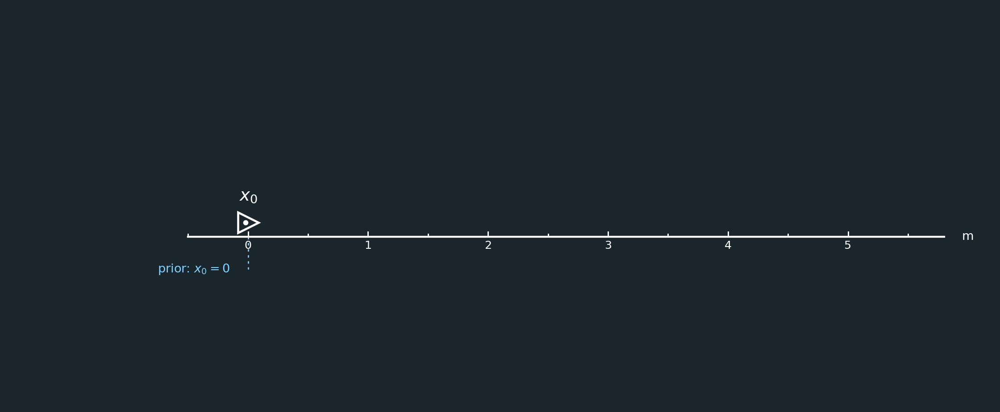

SLAM only determines relative positions unless we choose a reference frame.

We therefore define

```math
x_0=0.
```

Suppose the prior is added to the system like any other measurement, with strength $1$.

The initial system is

```math
\Omega=
\begin{bmatrix}
1&0&0&0&0&0&0\\
0&0&0&0&0&0&0\\
0&0&0&0&0&0&0\\
0&0&0&0&0&0&0\\
0&0&0&0&0&0&0\\
0&0&0&0&0&0&0\\
0&0&0&0&0&0&0
\end{bmatrix}
```

and

```math
\xi=
\begin{bmatrix}
1(0)\\
0\\
0\\
0\\
0\\
0\\
0
\end{bmatrix}
=
\begin{bmatrix}
0\\
0\\
0\\
0\\
0\\
0\\
0
\end{bmatrix}.
```

The value $1$ is **not** the pose.

It means:

```math
\boxed{\text{the system is anchored so that }x_0=0}
```

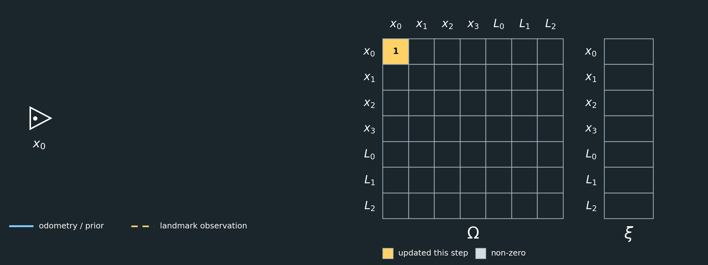

After the 1D view and the math, each step ends with a figure showing the graph on the left and the system $\Omega\mu=\xi$ on the right. Triangles are poses, stars are landmarks, solid edges are odometry or the prior, and dashed edges are landmark observations. In $\Omega$ and $\xi$, light cells are non-zero entries and yellow cells are the entries changed in that step. Blank dark cells are zero. All figures are generated by [generate_step_figures.py](images/generate_step_figures.py).

---

## Step 2: Move to $x_1$

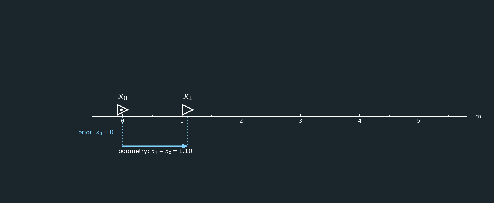

The robot drives forward, and odometry measures

```math
x_1-x_0=1.10.
```

This is the same measurement used in the measurement model above. It contributes

```math
\Delta\Omega=
\begin{bmatrix}
1&-1\\
-1&1
\end{bmatrix}
```

to $x_0$ and $x_1$, and

```math
\Delta\xi=
\begin{bmatrix}
-1.10\\
1.10
\end{bmatrix}
```

to the information vector.

The prior from Step 1 already contributed $1$ to $\Omega_{00}$, so after adding the odometry, $\Omega_{00}=1+1=2$.

Therefore,

```math
\Omega=
\begin{bmatrix}
2&-1&0&0&0&0&0\\
-1&1&0&0&0&0&0\\
0&0&0&0&0&0&0\\
0&0&0&0&0&0&0\\
0&0&0&0&0&0&0\\
0&0&0&0&0&0&0\\
0&0&0&0&0&0&0
\end{bmatrix}
```

and

```math
\xi=
\begin{bmatrix}
-1.10\\
1.10\\
0\\
0\\
0\\
0\\
0
\end{bmatrix}.
```

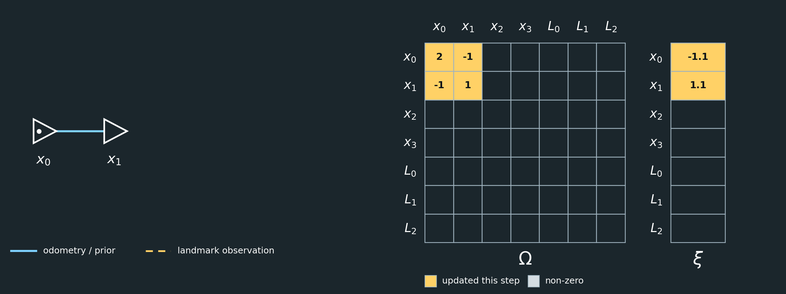

With only this one measurement, $x_1$ is simply $x_0$ plus the measured motion — this is **dead reckoning**. There is nothing yet to check it against: a single edge between two nodes can always be satisfied exactly, no matter what the measurement says. To catch an inconsistency, the robot needs a second, independent way to relate its poses. Landmark observations provide it.

---

## Step 3: Observe Landmark $L_0$ from $x_1$

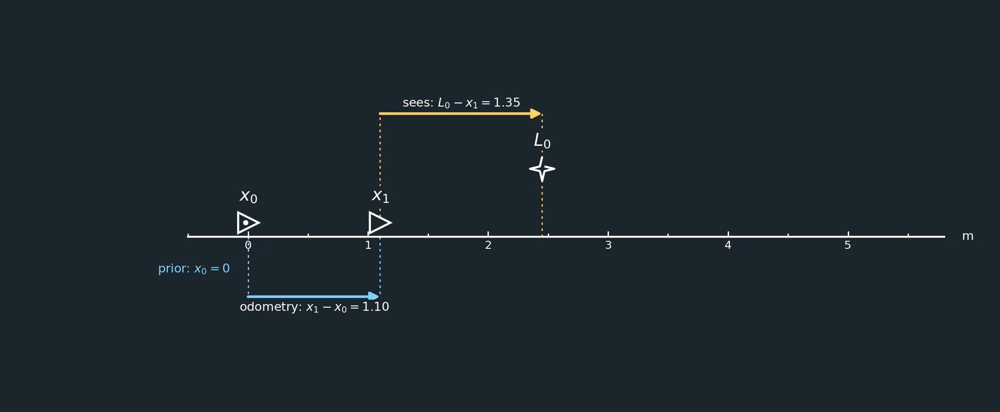

An observation uses the same measurement model as odometry, $v_j-v_i=z$, except that $v_i$ is a pose and $v_j$ is a landmark. It contributes the same $\Delta\Omega$ and $\Delta\xi$ as before, but it adds a new row and column to the graph instead of extending the chain.

From $x_1$, the robot measures landmark $L_0$:

```math
L_0-x_1=1.35.
```

It contributes

```math
\Delta\Omega=
\begin{bmatrix}
1&-1\\
-1&1
\end{bmatrix}
```

to $x_1$ and $L_0$, and

```math
\Delta\xi=
\begin{bmatrix}
-1.35\\
1.35
\end{bmatrix}.
```

The $x_1$ entries now count two measurements: the odometry from $x_0$, and this observation. So $\Omega_{11}=1+1=2$ and $\xi_1=1.10-1.35=-0.25$.

Therefore,

```math
\Omega=
\begin{bmatrix}
2&-1&0&0&0&0&0\\
-1&2&0&0&-1&0&0\\
0&0&0&0&0&0&0\\
0&0&0&0&0&0&0\\
0&-1&0&0&1&0&0\\
0&0&0&0&0&0&0\\
0&0&0&0&0&0&0
\end{bmatrix}
```

and

```math
\xi=
\begin{bmatrix}
-1.10\\
-0.25\\
0\\
0\\
1.35\\
0\\
0
\end{bmatrix}.
```

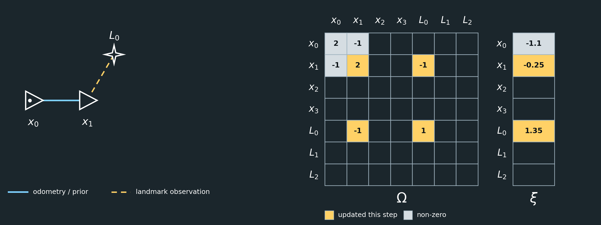

At this point the graph is still a tree, so $L_0$ can simply sit wherever $x_1$ says it is. Nothing contradicts it yet.

---

## Step 4: Move to $x_2$

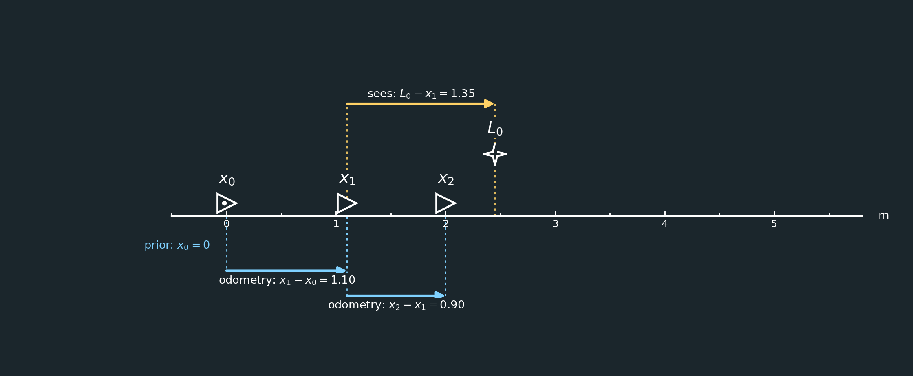

The robot keeps driving, and odometry reports

```math
x_2-x_1=0.90.
```

This adds

```math
\begin{bmatrix}
1&-1\\
-1&1
\end{bmatrix}
```

between $x_1$ and $x_2$, and

```math
\begin{bmatrix}
-0.90\\
0.90
\end{bmatrix}
```

to the information vector. $x_1$ is now touched by three measurements — the odometry from $x_0$, the observation of $L_0$, and this odometry to $x_2$ — so $\Omega_{11}=2+1=3$ and $\xi_1=-0.25-0.90=-1.15$.

After adding the measurement,

```math
\Omega=
\begin{bmatrix}
2&-1&0&0&0&0&0\\
-1&3&-1&0&-1&0&0\\
0&-1&1&0&0&0&0\\
0&0&0&0&0&0&0\\
0&-1&0&0&1&0&0\\
0&0&0&0&0&0&0\\
0&0&0&0&0&0&0
\end{bmatrix}
```

and

```math
\xi=
\begin{bmatrix}
-1.10\\
-1.15\\
0.90\\
0\\
1.35\\
0\\
0
\end{bmatrix}.
```

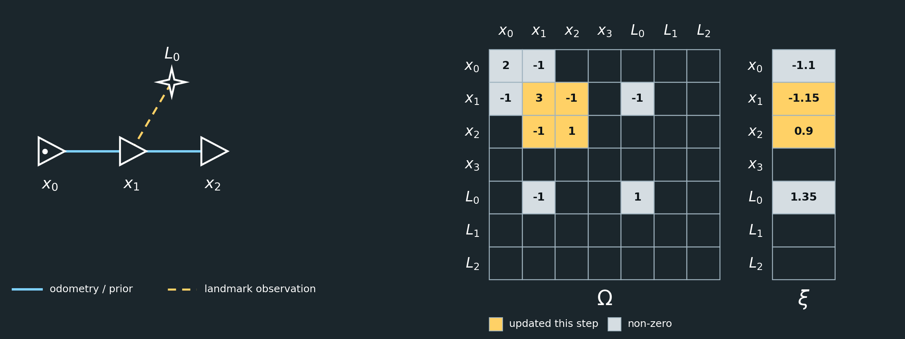

The graph is still a tree: a chain from $x_0$ to $x_2$, with $L_0$ hanging off $x_1$. Nothing has checked this odometry reading yet.

---

## Step 5: Observe $L_0$ Again from $x_2$

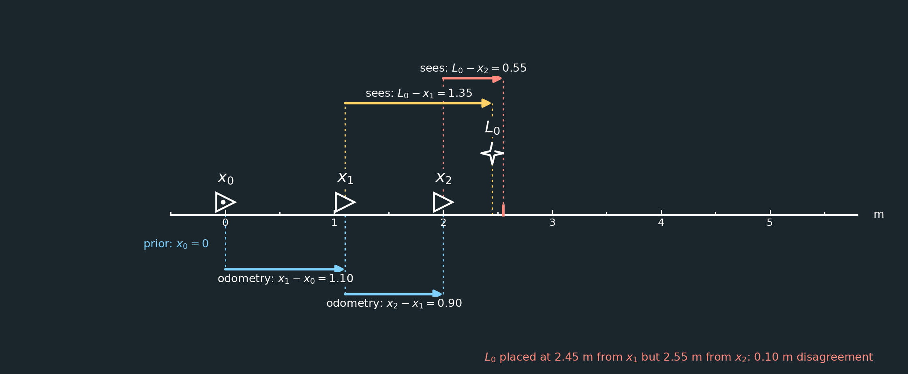

From $x_2$, the robot sees $L_0$ again:

```math
L_0-x_2=0.55.
```

This is where inconsistency appears.

The first observation and odometry suggest approximately

```math
L_0-x_2
=
1.35-0.90
=
0.45,
```

but the second landmark observation says

```math
0.55.
```

These cannot all be exactly correct.

GraphSLAM will therefore find a compromise.

The new observation adds $\Delta\Omega$ between $x_2$ and $L_0$ and $\begin{bmatrix}-0.55&0.55\end{bmatrix}^T$ to the information vector. After adding it,

```math
\Omega=
\begin{bmatrix}
2&-1&0&0&0&0&0\\
-1&3&-1&0&-1&0&0\\
0&-1&2&0&-1&0&0\\
0&0&0&0&0&0&0\\
0&-1&-1&0&2&0&0\\
0&0&0&0&0&0&0\\
0&0&0&0&0&0&0
\end{bmatrix}
```

and

```math
\xi=
\begin{bmatrix}
-1.10\\
-1.15\\
0.35\\
0\\
1.90\\
0\\
0
\end{bmatrix}.
```

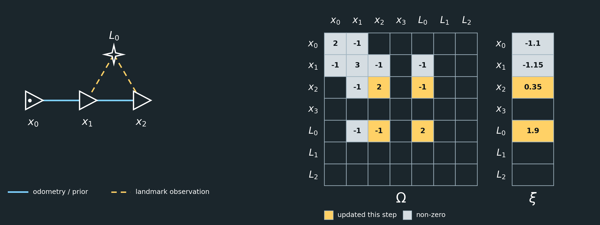

The graph now contains a loop: $x_1\to x_2$ by odometry, $x_2\to L_0$ by the second observation, and $L_0\to x_1$ by the first. Before this second sighting, the chain had no way to disagree with itself. With the loop, it does.

---

## Step 6: Observe Landmark $L_1$ from $x_2$

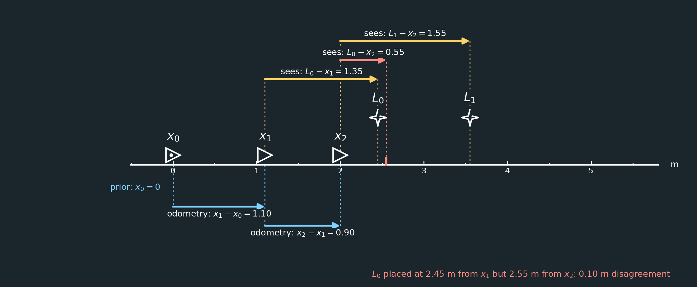

Separately, and in its own step, the robot also observes a new landmark from $x_2$:

```math
L_1-x_2=1.55.
```

This adds $\Delta\Omega$ between $x_2$ and $L_1$ and $\begin{bmatrix}-1.55&1.55\end{bmatrix}^T$ to the information vector. We could have folded this into Step 5, since both observations are made from $x_2$, but keeping each measurement in its own step keeps the pattern easy to follow: one new piece of $\Omega$ and $\xi$ at a time.

After adding it,

```math
\Omega=
\begin{bmatrix}
2&-1&0&0&0&0&0\\
-1&3&-1&0&-1&0&0\\
0&-1&3&0&-1&-1&0\\
0&0&0&0&0&0&0\\
0&-1&-1&0&2&0&0\\
0&0&-1&0&0&1&0\\
0&0&0&0&0&0&0
\end{bmatrix}
```

and

```math
\xi=
\begin{bmatrix}
-1.10\\
-1.15\\
-1.20\\
0\\
1.90\\
1.55\\
0
\end{bmatrix}.
```

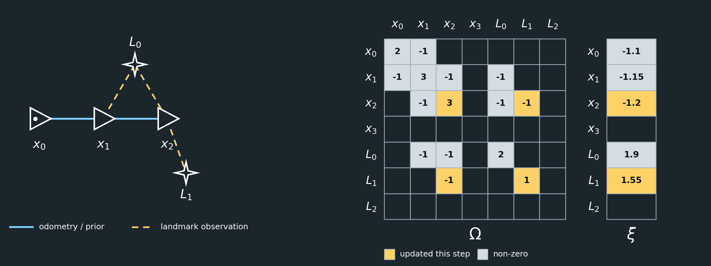

Notice that $L_1$ has only been seen once. That observation places $L_1$ relative to $x_2$, but it does not yet provide redundancy.

---

## Step 7: Move to $x_3$


Odometry reports

```math
x_3-x_2=1.20.
```

This adds the same $2\times2$ pattern between $x_2$ and $x_3$, and $\begin{bmatrix}-1.20&1.20\end{bmatrix}^T$ to the information vector. $x_2$ is now touched by four measurements — odometry on both sides, and observations of both $L_0$ and $L_1$ — so $\Omega_{22}=3+1=4$ and $\xi_2=-1.20-1.20=-2.40$.

After adding the measurement,

```math
\Omega=
\begin{bmatrix}
2&-1&0&0&0&0&0\\
-1&3&-1&0&-1&0&0\\
0&-1&4&-1&-1&-1&0\\
0&0&-1&1&0&0&0\\
0&-1&-1&0&2&0&0\\
0&0&-1&0&0&1&0\\
0&0&0&0&0&0&0
\end{bmatrix}
```

and

```math
\xi=
\begin{bmatrix}
-1.10\\
-1.15\\
-2.40\\
1.20\\
1.90\\
1.55\\
0
\end{bmatrix}.
```

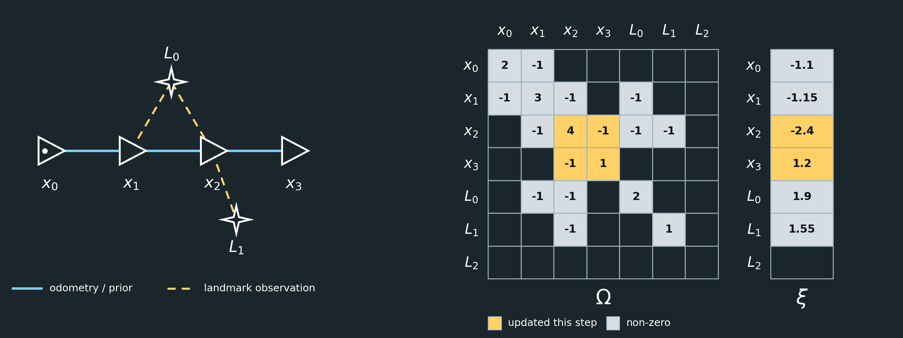

---

## Step 8: Observe Landmark $L_2$ from $x_3$

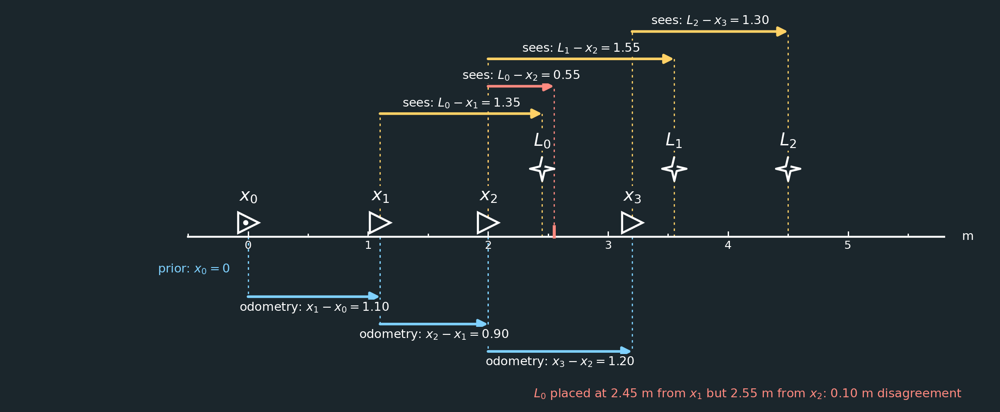

At $x_3$, the robot observes

```math
L_2-x_3=1.30.
```

The final system is

```math
\boxed{
\Omega=
\begin{bmatrix}
2&-1&0&0&0&0&0\\
-1&3&-1&0&-1&0&0\\
0&-1&4&-1&-1&-1&0\\
0&0&-1&2&0&0&-1\\
0&-1&-1&0&2&0&0\\
0&0&-1&0&0&1&0\\
0&0&0&-1&0&0&1
\end{bmatrix}
}
```

and

```math
\boxed{
\xi=
\begin{bmatrix}
-1.10\\
-1.15\\
-2.40\\
-0.10\\
1.90\\
1.55\\
1.30
\end{bmatrix}
}.
```

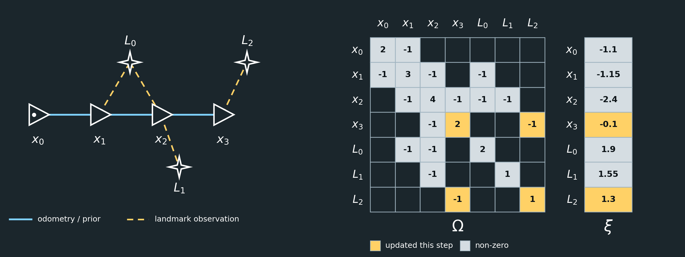

Notice that $L_2$, like $L_1$, has only been seen once.

---

## What Does This Matrix Mean?

The state vector is

```math
\mu=
\begin{bmatrix}
x_0\\
x_1\\
x_2\\
x_3\\
L_0\\
L_1\\
L_2
\end{bmatrix}.
```

Each row and column of $\Omega$ corresponds to one state variable.

A nonzero off-diagonal value means:

```math
\boxed{\text{those two variables are connected by a measurement}}
```

For example,

```math
\Omega_{01}=-1
```

exists because odometry connects $x_0$ and $x_1$.

Similarly,

```math
\Omega_{14}=-1
```

exists because $x_1$ observed $L_0$.

Because every measurement is added with the same strength, each diagonal entry simply counts the measurements that involve that variable. For example,

```math
\Omega_{22}=4
```

because $x_2$ is involved in the odometry from $x_1$, the odometry to $x_3$, the observation of $L_0$, and the observation of $L_1$.

---

## Solving the System

We now have

```math
\Omega\mu=\xi.
```

Writing

```math
\mu=\Omega^{-1}\xi
```

is mathematically valid, but in practice we normally solve the linear system directly.

That is, the computer asks:

> What values of $\mu$ make $\Omega\mu$ equal to $\xi$?

It does not normally calculate $\Omega^{-1}$ explicitly.

A sparse linear solver might instead use Cholesky or another factorization.

For a small classroom example, however, computing

```math
\Omega^{-1}\xi
```

would give the same result, aside from numerical precision.

Solving the system above gives

```math
\boxed{
\mu=
\begin{bmatrix}
x_0\\
x_1\\
x_2\\
x_3\\
L_0\\
L_1\\
L_2
\end{bmatrix}
\approx
\begin{bmatrix}
0.000\\
1.100\\
1.967\\
3.167\\
2.483\\
3.517\\
4.467
\end{bmatrix}
}.
```

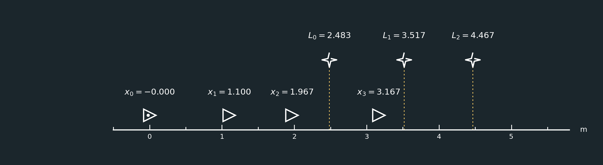

Compare this with dead reckoning: chaining the odometry readings alone, ignoring the landmarks entirely, would give $x_1=1.10$, $x_2=2.00$, and $x_3=3.20$. Only the loop formed by $x_1$, $x_2$, and $L_0$ contained an inconsistency, and that is where the correction was made. $x_1$ comes out unchanged from its dead-reckoning value, because it sits right next to the anchored $x_0$ and has nothing else pulling on it from that side. The correction instead falls on $x_2$, and carries through to everything that chains off it: $x_3$, $L_1$, and $L_2$ are each shifted by $0.033\text{ m}$ from where dead reckoning, or a single observation, would have placed them.

The three measurements in that loop disagreed by $0.10\text{ m}$. The solution spreads that error evenly:

```math
\begin{aligned}
x_2-x_1&=0.867&&\text{(measured }0.90\text{, off by }-0.033\text{)}\\
L_0-x_1&=1.383&&\text{(measured }1.35\text{, off by }+0.033\text{)}\\
L_0-x_2&=0.517&&\text{(measured }0.55\text{, off by }-0.033\text{)}
\end{aligned}
```

Every measurement was given equal strength, so every measurement in the loop absorbs an equal share of the error.

---

## What Repeated Landmarks Do

The graph currently looks roughly like

```text
             L0
            /  \
x0 -- x1 -- x2 -- x3
            |      |
            L1     L2
```

$L_0$ is observed twice.

That gives two independent ways of relating $x_1$, $x_2$, and $L_0$.

Therefore, if the measurements disagree, GraphSLAM can detect the inconsistency and redistribute the error.

But $L_1$ and $L_2$ are each observed only once.

For example,

```math
L_2-x_3=1.30
```

can always be satisfied simply by moving $L_2$ along with $x_3$.

So a landmark seen only once does not independently correct pose drift.

---

## Weighting the Measurements

So far, every measurement was added to the system with the same strength. That is equivalent to assuming that every sensor reading is equally trustworthy, which is why the $0.10\text{ m}$ inconsistency was shared equally by the measurements in the loop.

Real sensors are not equally reliable. Wheel odometry might be quite precise over a short step, while a landmark detection might be noisier. GraphSLAM accounts for this by giving each measurement a **weight**.

If a measurement has standard deviation $\sigma$, its information weight is

```math
w=\frac{1}{\sigma^2}.
```

A precise measurement has a small $\sigma$ and therefore a large weight. A noisy measurement has a large $\sigma$ and a small weight.

The weight simply scales that measurement's contribution. A measurement $v_j-v_i=z$ with weight $w$ now contributes

```math
\Delta\Omega
=
w
\begin{bmatrix}
1&-1\\
-1&1
\end{bmatrix}
\qquad\text{and}\qquad
\Delta\xi
=
w
\begin{bmatrix}
-z\\
z
\end{bmatrix}.
```

Everything we did earlier is the special case $w=1$.

Solving $\Omega\mu=\xi$ finds the poses and landmarks that minimize the total weighted inconsistency between all measurements:

```math
J(\mu)=\sum_k w_k\left(v_{j,k}-v_{i,k}-z_k\right)^2.
```

This is a **weighted least-squares problem**. With every $w_k=1$ it reduces to ordinary least squares, which is what we solved above.

### Example: Weights in the Equations

Suppose the prior and the odometry are precise, while the landmark observations are noisier:

```math
\sigma_{\text{prior}}=0.1,\qquad
\sigma_{\text{odometry}}=0.1,\qquad
\sigma_{\text{landmark}}=0.2.
```

Then the weights are

```math
w_{\text{prior}}=\frac{1}{0.1^2}=100,\qquad
w_{\text{odometry}}=\frac{1}{0.1^2}=100,\qquad
w_{\text{landmark}}=\frac{1}{0.2^2}=25.
```

The odometry measurement $x_1-x_0=1.10$ now contributes

```math
\Delta\Omega=
100
\begin{bmatrix}
1&-1\\
-1&1
\end{bmatrix}
,\qquad
\Delta\xi=
100
\begin{bmatrix}
-1.10\\
1.10
\end{bmatrix}
=
\begin{bmatrix}
-110\\
110
\end{bmatrix},
```

while the landmark observation $L_0-x_1=1.35$ contributes

```math
\Delta\Omega=
25
\begin{bmatrix}
1&-1\\
-1&1
\end{bmatrix}
,\qquad
\Delta\xi=
25
\begin{bmatrix}
-1.35\\
1.35
\end{bmatrix}
=
\begin{bmatrix}
-33.75\\
33.75
\end{bmatrix}.
```

The same pattern of rows and columns is filled in as before. Only the amounts change. For example, consider the entries for $x_0$ in the final system. The prior and the odometry to $x_1$ each contribute their own weight:

```math
\Omega_{00}
=
w_{\text{prior}}+w_{\text{odometry}}
=
100+100
=
200,
```

```math
\xi_0
=
100(0)+100(-1.10)
=
-110.
```

Without weights, the same entries were $\Omega_{00}=2$ and $\xi_0=-1.10$.

The entries for $x_1$ show the mix of weight types. It has odometry on both sides and one observation of $L_0$:

```math
\Omega_{11}=100+100+25=225,
\qquad
\xi_1=100(1.10)+100(-0.90)+25(-1.35)=-13.75.
```

Without weights, these were $\Omega_{11}=3$ and $\xi_1=-1.15$.
The odometry coupling $\Omega_{01}=-100$ is now four times stronger than each landmark coupling to $L_0$, $\Omega_{14}=\Omega_{24}=-25$. When the solver resolves the disagreement about $L_0$ — a disagreement between $x_1$, $x_2$, and $L_0$ — the more heavily weighted odometry is moved less, and the less trusted landmark observations absorb more of the correction.

---

## Overall Interpretation

The three major quantities are:

```math
\boxed{
\mu=
\text{unknown poses and landmarks}
}
```

```math
\boxed{
\Omega=
\text{which variables constrain each other, and how strongly}
}
```

```math
\boxed{
\xi=
\text{measurement values accumulated into information form}
}
```

and GraphSLAM solves

```math
\boxed{\Omega\mu=\xi}
```

to find the set of poses and landmarks that best satisfies all measurements. When measurements are weighted by their uncertainty, the best solution trusts the more precise measurements more.

---

## Next: 2D

Real robots move in a plane and have a heading as well as a position. The [2D GraphSLAM Example](graphslam_2d_example.md) repeats this walkthrough with poses $(x,\ y,\ \theta)$ and landmarks $(x,\ y)$, so $\Omega$ and $\xi$ become block matrices, scalar weights become noise matrices, and the measurements must be linearized.
