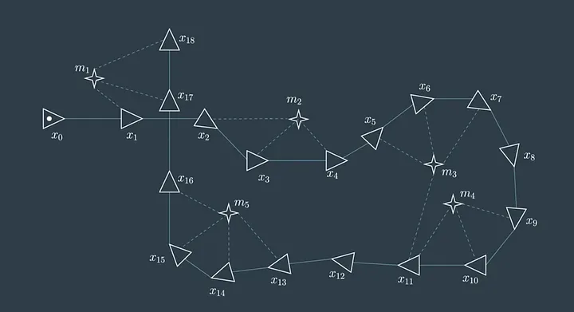

# Introduction to GraphSLAM

This is the first of a series of documents about GraphSLAM. It explains what the method is and why it works. The [1D GraphSLAM Example](graphslam_1d_example.md) then works through all of the equations on a problem small enough to follow by hand.

## What Is SLAM?

A robot that moves through an unknown place needs two things at once: a **map** of the place, and its own **pose** in that map. Each one is needed to compute the other:

- To add an observation to the map, the robot must know where it was when it made it.
- To work out where it is, the robot must compare what it sees against a map.

**Simultaneous localization and mapping (SLAM)** solves both together.

The robot has two kinds of information to work with:

- **Odometry** measures how the robot moved from one pose to the next, for example from wheel encoders or an inertial sensor. It is available all the time, but every measurement has a small error, and the errors add up. This accumulated error is called **drift**.
- **Observations of the environment**, such as a laser scanner or camera detecting a landmark. They give the position of something relative to the robot. They are what tie the robot's estimate to the world, but each one is also noisy.

None of these measurements can be trusted exactly, and they disagree with each other. SLAM is the problem of combining them into the single most consistent picture.

---

## Two Parts of a SLAM System

Most SLAM systems have two parts:

- The **front end** works with raw sensor data. It extracts measurements, such as relative motion between two poses or the position of a landmark relative to a pose. It also decides **which landmark** each observation belongs to, and whether the robot has returned to a place it has been before.
- The **back end** takes the measurements, with a description of how uncertain each one is, and computes the best estimate of every pose and landmark.

GraphSLAM is a **back end**. These documents assume that the front end has done its job and handed over a set of measurements. The only exception is the [loop closure document](graphslam_loop_closure.md), which describes where the front end's work ends and the back end's begins.

---

## SLAM as a Graph

GraphSLAM represents the whole problem as a **graph**:

- Each **node** is something we want to estimate: a robot pose at one moment in time, or the position of a landmark.
- Each **edge** is a measurement that relates two nodes. Odometry connects two successive poses. A landmark observation connects a pose to a landmark.



*Image source: [A Brief Introduction to GraphSLAM](https://shivachandrachary.medium.com/a-brief-introduction-to-graphslam-4204b4fce2f0) by shivachandrachary on Medium.*

In this example graph, the triangles labeled $x_0$ through $x_{18}$ are robot poses at different times, and the stars labeled $m_1$ through $m_5$ are mapped landmarks. Solid edges connect successive poses through motion constraints, while dashed edges show landmark observations. Because observations can connect distant parts of the trajectory through the same landmark, the graph captures information that can correct accumulated drift.

Together, these constraints provide a complete SLAM solution: the robot trajectory and the map are solved as one connected estimation problem. Odometry relates successive poses, landmark observations relate poses to landmarks, and repeated observations create the redundancy needed to detect inconsistent measurements and distribute error across the trajectory.

---

## Edges Are Soft Constraints

An edge does not say "$x_1$ is exactly $1.1\text{ m}$ ahead of $x_0$". It says that the measurement **suggests** that, with some uncertainty. When all the measurements are consistent, a solution can satisfy every edge. In practice they never are, and a loop in the graph forces a disagreement.

The solution to this is to make the nodes fit the edges as well as possible. For each measurement $z_k$ we compare it with what the current estimate $\mu$ predicts, $h_k(\mu)$. The difference is the **residual**. Each residual is scaled by how much we trust that measurement, which is its weight $W_k$, and the total is

```math
F(\mu)=\sum_k\big(z_k-h_k(\mu)\big)^\top W_k\,\big(z_k-h_k(\mu)\big).
```

GraphSLAM finds the poses and landmarks $\mu$ that make $F$ as small as possible. This is a **weighted least-squares** problem:

- A measurement that the current estimate contradicts has a large residual, so it adds a lot to $F$.
- A precise measurement has a large weight, so its residual is penalized heavily. The solution is pulled toward it.
- A noisy measurement has a small weight, so it is allowed to be wrong.

The weights are introduced in the [1D example](graphslam_1d_example.md#weighting-the-measurements) and explained with matrices in the [2D example](graphslam_2d_example.md).

---

## The Information Form

There is a convenient way to write and solve this problem. Each measurement contributes a small amount to two quantities that are shared by the whole graph:

- The **information matrix** $\Omega$, which records which nodes are connected by a measurement and how strongly.
- The **information vector** $\xi$, which records the measurement values themselves.

Adding up the contributions of every edge gives a single linear system,

```math
\boxed{\Omega\mu=\xi,}
```

and solving it gives the best estimate of all the poses and landmarks at once.

A measurement involves only two nodes, so it changes only a few entries of $\Omega$ and $\xi$. A pose connected to just a few others leaves most of $\Omega$ zero. This **sparsity** is what makes it possible to solve very large problems, and the [last document](graphslam_sparse_solvers.md) in the series explains how.

When the measurements are linear functions of the nodes, as they are in 1D, one solve gives the answer. When they are not, as in 2D, where headings appear inside sines and cosines, the problem is **linearized** around the current estimate, solved, and repeated.

---

## An Offline, Batch Solver

GraphSLAM is typically an **offline, batch solver**. Rather than estimating only the current pose from the previous estimate, it considers all poses and measurements collected over the entire time history at once. When a later observation reveals that an earlier pose or landmark estimate was inaccurate, the solution can adjust the earlier poses, later poses, and landmarks together. This global optimization generally produces a more consistent map and trajectory, at the cost of storing and solving a larger system.

This is the main difference from **filtering** approaches such as the extended Kalman filter (EKF) SLAM in the [EKF_SLAM](../../EKF_SLAM) folder of this repository. A filter keeps only the current pose and the map, and summarizes the rest of the history in an uncertainty estimate. Once a measurement has been folded in, it is not revisited. GraphSLAM keeps every pose, so it can go back and revise them.

| | Filtering (EKF SLAM) | GraphSLAM |
|---|---|---|
| Estimates | The current pose and the map | Every pose and the map |
| Past poses | Summarized and discarded | Kept and re-estimated |
| New information | Updates the current estimate | Can change the whole trajectory |
| Typical use | Online, as the robot moves | Offline, over a collected data set |

Incremental versions of graph-based SLAM exist that update the solution as new data arrives. They are a refinement of the same idea. These documents describe the offline version, because it shows the structure of the problem most clearly.

---

## Strengths and Costs

**Why use a graph:**

- **Global consistency.** Because everything is solved together, the trajectory and the map agree with all of the measurements.
- **Loop closure is natural.** A loop closure is one more edge in the graph, and the solver takes care of the rest. See [Loop Closure in GraphSLAM](graphslam_loop_closure.md).
- **Sparse structure.** Each measurement links only two nodes, so very large problems can still be solved efficiently.
- **Flexible.** Any measurement that relates nodes can be added as an edge, with its own uncertainty.

**What it costs:**

- **Memory and computation** grow with the length of the trajectory, since every pose is kept.
- **A good starting point.** When the measurements are nonlinear, the solver is only as reliable as the initial estimate that it is linearized around.
- **Correct data association.** A wrong edge, such as a false loop closure, damages the whole solution.

---

## How These Documents Are Organized

Read them in order. Each one assumes the ones before it.

| Document | What it covers |
|---|---|
| **Introduction to GraphSLAM** (this document) | What the method is and why it works |
| [1D GraphSLAM Example](graphslam_1d_example.md) | The full method on a robot that moves along a line: building $\Omega$ and $\xi$, solving, and weights |
| [2D GraphSLAM Example](graphslam_2d_example.md) | Poses with a heading, block matrices, noise matrices, and linearization |
| [Loop Closure in GraphSLAM](graphslam_loop_closure.md) | How revisiting a place corrects drift across the whole trajectory |
| [Solving the System Efficiently](graphslam_sparse_solvers.md) | Using the sparsity of $\Omega$: Cholesky factorization, fill-in, and eliminating landmarks |
| [GraphSLAM in Code](graphslam_code_walkthrough.md) | How the MATLAB simulation in this repository implements all of the above, with listings and figures from a real run |

The next document, the [1D GraphSLAM Example](graphslam_1d_example.md), begins by building the system for a robot on a line.
