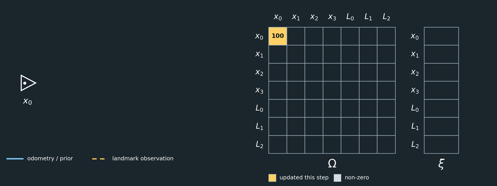
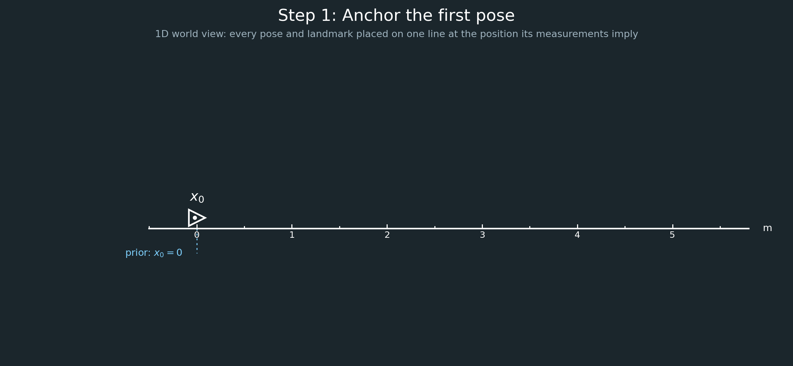
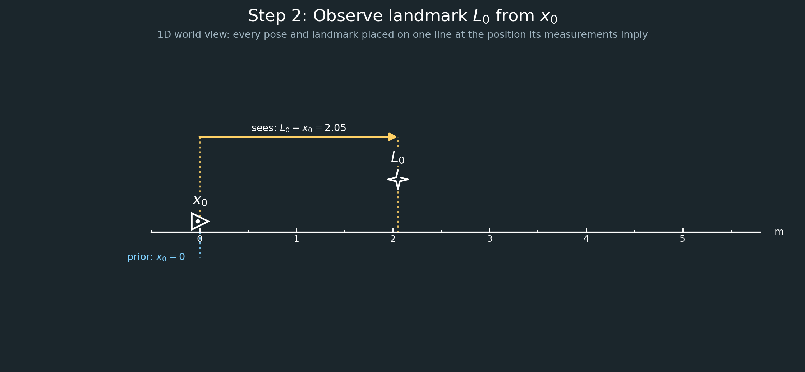
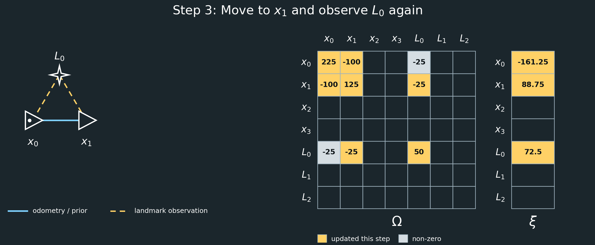
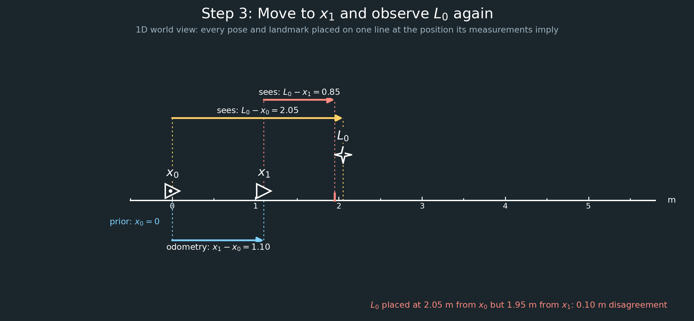
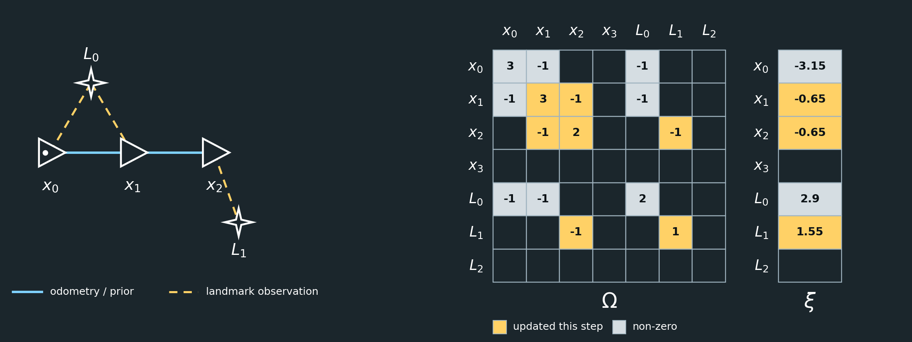
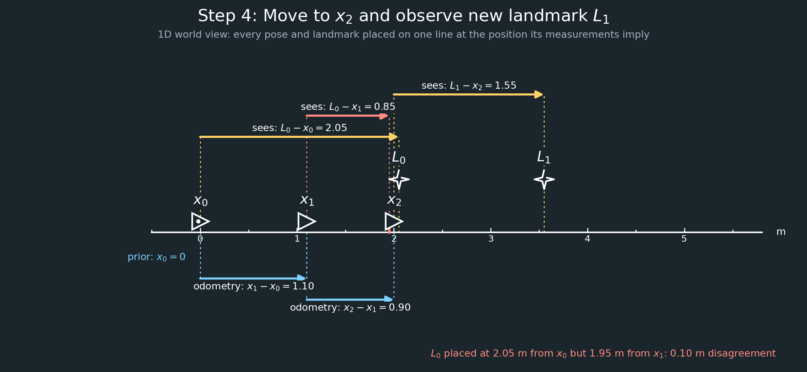
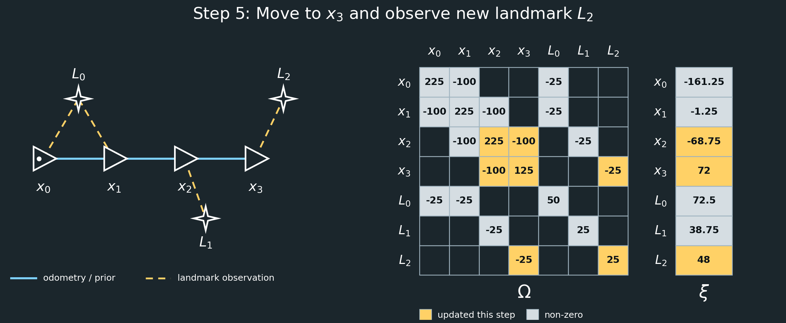
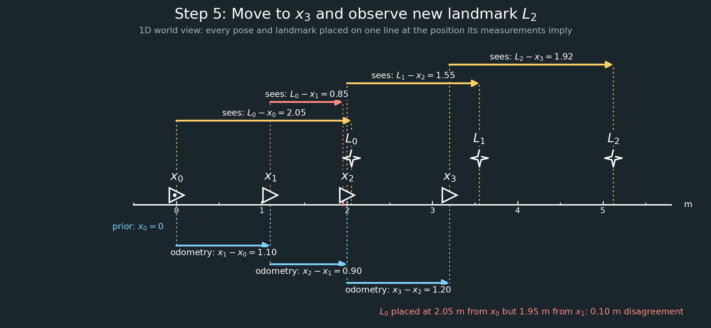

# 1D GraphSLAM Example

## Introduction

GraphSLAM is a graph-based approach to **simultaneous localization and mapping (SLAM)**. It estimates both the robot's poses over time and the positions of landmarks in the environment. Each pose and landmark is represented as a node in a graph, while sensor observations and motion measurements become constraints, or edges, between those nodes.


*Image source: [A Brief Introduction to GraphSLAM](https://shivachandrachary.medium.com/a-brief-introduction-to-graphslam-4204b4fce2f0) by shivachandrachary on Medium.*

In this example graph, the triangles labeled $x_0$ through $x_{18}$ are robot poses at different times, and the stars labeled $m_1$ through $m_5$ are mapped landmarks. Solid edges connect successive poses through motion constraints, while dashed edges show landmark observations. Because observations can connect distant parts of the trajectory through the same landmark, the graph captures information that can correct accumulated drift.

Together, these constraints provide a complete SLAM solution: the robot trajectory and the map are solved as one connected estimation problem. Odometry relates successive poses, landmark observations relate poses to landmarks, and repeated observations create the redundancy needed to detect inconsistent measurements and distribute error across the trajectory.

GraphSLAM is typically an **offline, batch solver**. Rather than estimating only the current pose from the previous estimate, it considers all poses and measurements collected over the entire time history at once. When a later observation reveals that an earlier pose or landmark estimate was inaccurate, the solution can adjust the earlier poses, later poses, and landmarks together. This global optimization generally produces a more consistent map and trajectory, at the cost of storing and solving a larger system.

This example introduces those ideas in one dimension, where the equations can be written explicitly and the information matrix can be inspected directly. The same graph structure extends to practical two- and three-dimensional SLAM systems, where the constraints are usually nonlinear and are solved through repeated linearization and optimization.

---

## 1D Example

Consider a robot moving along a straight line. We will estimate four robot poses and three landmark positions.

The unknown state is

```math
\mu =
\begin{bmatrix}
x_0\\
x_1\\
x_2\\
x_3\\
L_0\\
L_1\\
L_2
\end{bmatrix}
```

where:

- $x_0,x_1,x_2,x_3$ are robot poses.
- $L_0,L_1,L_2$ are landmark positions.

The GraphSLAM problem is written in information form as

```math
\boxed{\Omega \mu = \xi}
```

where:

- $\mu$ contains the unknown node values.
- $\Omega$ is the **information matrix**, describing which variables are constrained together and how strongly.
- $\xi$ is the **information vector**, containing the measurement values after they have been incorporated into the system.

---

## Measurement Model

Suppose a sensor measurement says

```math
v_j-v_i=z.
```

For example,

```math
x_1-x_0=1.1
```

means odometry measured a motion of $1.1\text{ m}$.

If the measurement has standard deviation $\sigma$, its information weight is

```math
w=\frac{1}{\sigma^2}.
```

That measurement contributes

```math
\Delta\Omega
=
w
\begin{bmatrix}
1&-1\\
-1&1
\end{bmatrix}
```

to the rows and columns associated with $v_i$ and $v_j$, and

```math
\Delta\xi
=
w
\begin{bmatrix}
-z\\
z
\end{bmatrix}.
```

So:

> $\Omega$ records the relationship and confidence.

> $\xi$ records the numerical measurement information.

---

## Step 1: Anchor the First Pose

SLAM only determines relative positions unless we choose a reference frame.

We therefore define

```math
x_0=0.
```

Suppose we are very confident in this prior:

```math
\sigma_0=0.1.
```

Then

```math
w_0=\frac{1}{0.1^2}=100.
```

The initial system is

```math
\Omega=
\begin{bmatrix}
100&0&0&0&0&0&0\\
0&0&0&0&0&0&0\\
0&0&0&0&0&0&0\\
0&0&0&0&0&0&0\\
0&0&0&0&0&0&0\\
0&0&0&0&0&0&0\\
0&0&0&0&0&0&0
\end{bmatrix}
```

and

```math
\xi=
\begin{bmatrix}
100(0)\\
0\\
0\\
0\\
0\\
0\\
0
\end{bmatrix}
=
\begin{bmatrix}
0\\
0\\
0\\
0\\
0\\
0\\
0
\end{bmatrix}.
```

The value $100$ is **not** the pose.

It means:

```math
\boxed{\text{high confidence that }x_0=0}
```





Each figure in this walkthrough shows the graph on the left and the system $\Omega\mu=\xi$ on the right. Triangles are poses, stars are landmarks, solid edges are odometry or the prior, and dashed edges are landmark observations. In $\Omega$ and $\xi$, light cells are non-zero entries and yellow cells are the entries changed in that step. Blank dark cells are zero. The figures are generated by [generate_step_figures.py](generate_step_figures.py).

Because the graph layout is only a diagram of connectivity, each step also has a literal **1D world view**. Every pose and landmark is placed on a single metre axis at the position its measurements imply. Blue arrows below the axis are odometry measurements, and yellow arrows above it are landmark observations, each spanning the distance it measures. Landmarks are drawn slightly above the axis only so they do not overlap poses at nearly the same position; the dotted guide lines show where they sit on the axis. A red arrow marks an observation that disagrees with an earlier one.

---

## Step 2: Observe Landmark $L_0$

At $x_0$, the robot measures

```math
L_0-x_0=2.05.
```

Suppose this measurement has

```math
\sigma=0.2.
```

Then

```math
w=\frac{1}{0.2^2}=25.
```

The measurement contributes

```math
\Delta\Omega=
25
\begin{bmatrix}
1&-1\\
-1&1
\end{bmatrix}
=
\begin{bmatrix}
25&-25\\
-25&25
\end{bmatrix}
```

to $x_0$ and $L_0$.

It also contributes

```math
\Delta\xi=
25
\begin{bmatrix}
-2.05\\
2.05
\end{bmatrix}
=
\begin{bmatrix}
-51.25\\
51.25
\end{bmatrix}.
```

Therefore,

```math
\Omega=
\begin{bmatrix}
125&0&0&0&-25&0&0\\
0&0&0&0&0&0&0\\
0&0&0&0&0&0&0\\
0&0&0&0&0&0&0\\
-25&0&0&0&25&0&0\\
0&0&0&0&0&0&0\\
0&0&0&0&0&0&0
\end{bmatrix}
```

and

```math
\xi=
\begin{bmatrix}
-51.25\\
0\\
0\\
0\\
51.25\\
0\\
0
\end{bmatrix}.
```




---

## Step 3: Move to $x_1$

Odometry measures

```math
x_1-x_0=1.10.
```

Suppose odometry is somewhat more precise:

```math
\sigma=0.1
```

so

```math
w=100.
```

This adds

```math
100
\begin{bmatrix}
1&-1\\
-1&1
\end{bmatrix}
```

between $x_0$ and $x_1$, and

```math
100
\begin{bmatrix}
-1.10\\
1.10
\end{bmatrix}
=
\begin{bmatrix}
-110\\
110
\end{bmatrix}.
```

Now suppose the robot sees $L_0$ again:

```math
L_0-x_1=0.85.
```

Let this landmark measurement also have

```math
\sigma=0.2,\qquad w=25.
```

This is where inconsistency appears.

The first observation and odometry suggest approximately

```math
L_0-x_1
=
2.05-1.10
=
0.95,
```

but the second landmark observation says

```math
0.85.
```

These cannot all be exactly correct.

GraphSLAM will therefore find a weighted compromise.

After adding both measurements,

```math
\Omega=
\begin{bmatrix}
225&-100&0&0&-25&0&0\\
-100&125&0&0&-25&0&0\\
0&0&0&0&0&0&0\\
0&0&0&0&0&0&0\\
-25&-25&0&0&50&0&0\\
0&0&0&0&0&0&0\\
0&0&0&0&0&0&0
\end{bmatrix}
```

and

```math
\xi=
\begin{bmatrix}
-161.25\\
88.75\\
0\\
0\\
72.50\\
0\\
0
\end{bmatrix}.
```





---

## Step 4: Move to $x_2$

Suppose odometry reports

```math
x_2-x_1=0.90
```

with

```math
\sigma=0.1,\qquad w=100.
```

At $x_2$, the robot observes a new landmark:

```math
L_1-x_2=1.55
```

with

```math
\sigma=0.2,\qquad w=25.
```

After incorporating both,

```math
\Omega=
\begin{bmatrix}
225&-100&0&0&-25&0&0\\
-100&225&-100&0&-25&0&0\\
0&-100&125&0&0&-25&0\\
0&0&0&0&0&0&0\\
-25&-25&0&0&50&0&0\\
0&0&-25&0&0&25&0\\
0&0&0&0&0&0&0
\end{bmatrix}
```

and

```math
\xi=
\begin{bmatrix}
-161.25\\
-1.25\\
51.25\\
0\\
72.50\\
38.75\\
0
\end{bmatrix}.
```





Notice that $L_1$ has only been seen once.

That observation places $L_1$ relative to $x_2$, but it does not yet provide redundancy.

---

## Step 5: Move to $x_3$

Suppose odometry reports

```math
x_3-x_2=1.20
```

again with

```math
\sigma=0.1,\qquad w=100.
```

At $x_3$, the robot observes

```math
L_2-x_3=1.92
```

with

```math
\sigma=0.2,\qquad w=25.
```

The final system is

```math
\boxed{
\Omega=
\begin{bmatrix}
225&-100&0&0&-25&0&0\\
-100&225&-100&0&-25&0&0\\
0&-100&225&-100&0&-25&0\\
0&0&-100&125&0&0&-25\\
-25&-25&0&0&50&0&0\\
0&0&-25&0&0&25&0\\
0&0&0&-25&0&0&25
\end{bmatrix}
}
```

and

```math
\boxed{
\xi=
\begin{bmatrix}
-161.25\\
-1.25\\
-68.75\\
72.00\\
72.50\\
38.75\\
48.00
\end{bmatrix}
}.
```





---

## What Does This Matrix Mean?

The state vector is

```math
\mu=
\begin{bmatrix}
x_0\\
x_1\\
x_2\\
x_3\\
L_0\\
L_1\\
L_2
\end{bmatrix}.
```

Each row and column of $\Omega$ corresponds to one state variable.

A nonzero off-diagonal value means:

```math
\boxed{\text{those two variables are connected by a measurement}}
```

For example,

```math
\Omega_{01}=-100
```

exists because odometry connects $x_0$ and $x_1$.

Similarly,

```math
\Omega_{04}=-25
```

exists because $x_0$ observed $L_0$.

---

## Solving the System

We now have

```math
\Omega\mu=\xi.
```

Writing

```math
\mu=\Omega^{-1}\xi
```

is mathematically valid, but in practice we normally solve the linear system directly.

That is, the computer asks:

> What values of $\mu$ make $\Omega\mu$ equal to $\xi$?

It does not normally calculate $\Omega^{-1}$ explicitly.

A sparse linear solver might instead use Cholesky or another factorization.

For a small classroom example, however, computing

```math
\Omega^{-1}\xi
```

would give the same result, aside from numerical precision.

The treatment of noise is already contained in $\Omega$ and $\xi$.

---

## Why Noise Is Accounted For

Suppose two measurements disagree.

A highly precise measurement has

```math
\sigma \text{ small}
```

so

```math
w=\frac{1}{\sigma^2}
```

is large.

Its contribution to $\Omega$ and $\xi$ is therefore large.

A noisy measurement has a lower weight and has less influence on the final estimate.

Thus GraphSLAM solves a **weighted least-squares problem**.

The solver finds the poses and landmarks that minimize the total weighted inconsistency between all measurements.

---

## What Repeated Landmarks Do

The graph currently looks roughly like

```text
        L0
       /  \
     x0 -- x1 -- x2 -- x3
                 |      |
                 L1     L2
```

$L_0$ is observed twice.

That gives two independent ways of relating $x_0$, $x_1$, and $L_0$.

Therefore, if the measurements disagree, GraphSLAM can detect the inconsistency and redistribute the error.

But $L_1$ and $L_2$ are each observed only once.

For example,

```math
L_2-x_3=1.92
```

can always be satisfied simply by moving $L_2$ along with $x_3$.

So a landmark seen only once does not independently correct pose drift.

---

## Overall Interpretation

The three major quantities are:

```math
\boxed{
\mu=
\text{unknown poses and landmarks}
}
```

```math
\boxed{
\Omega=
\text{which variables constrain each other and how strongly}
}
```

```math
\boxed{
\xi=
\text{measurement values accumulated into information form}
}
```

and GraphSLAM solves

```math
\boxed{\Omega\mu=\xi}
```

to find the set of poses and landmarks that best satisfies all noisy measurements according to their uncertainty.
