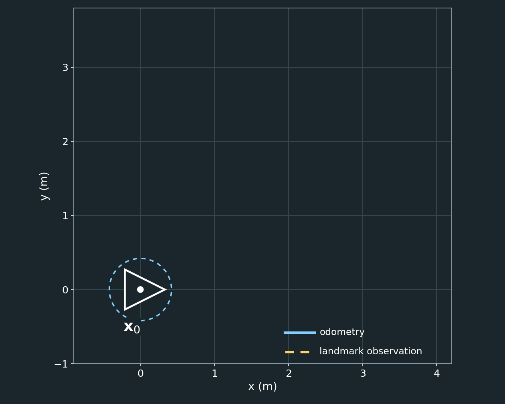
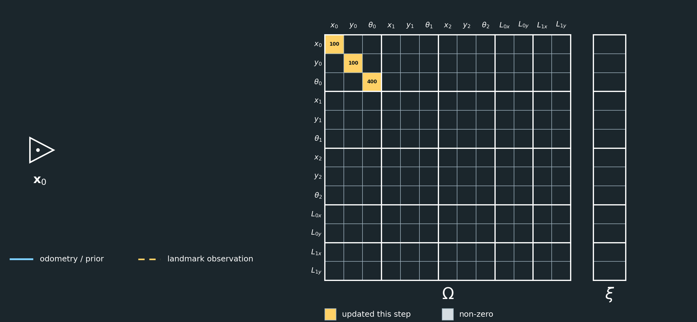
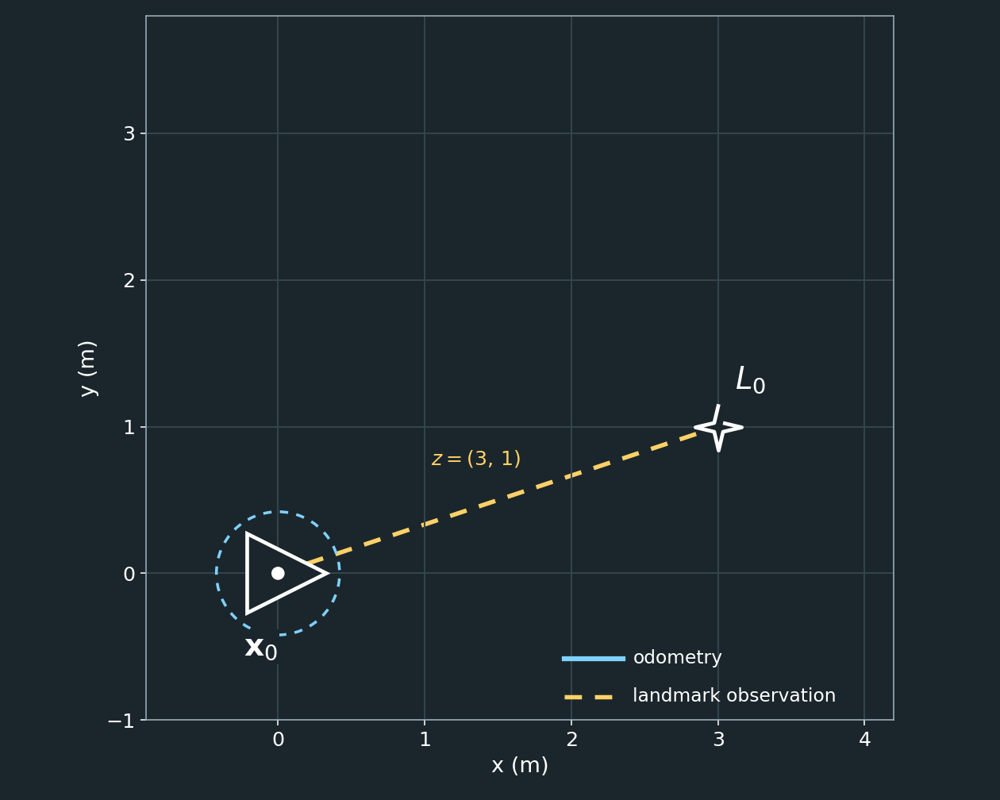
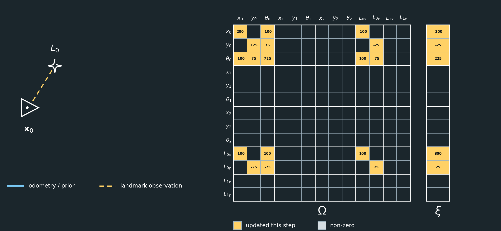
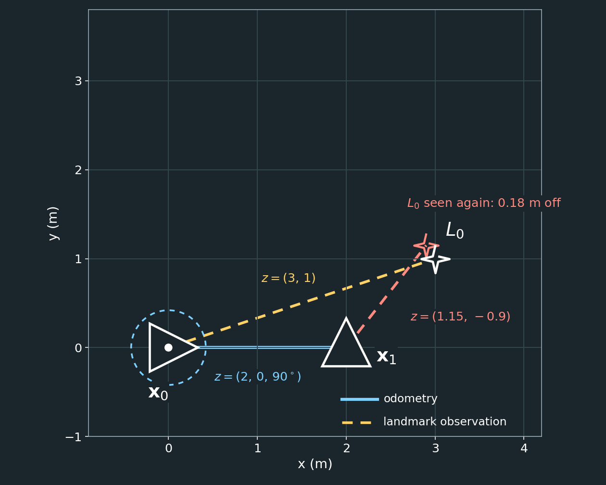
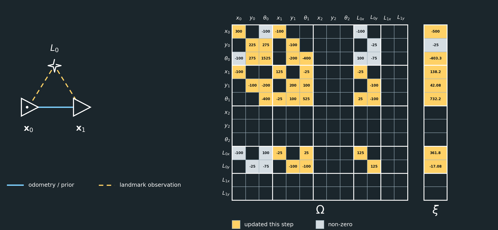
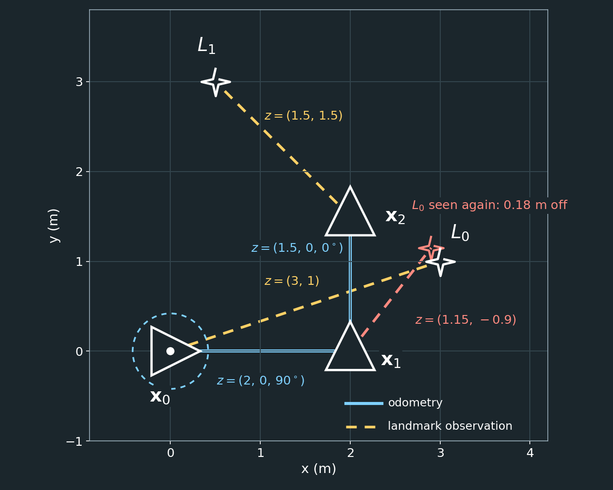
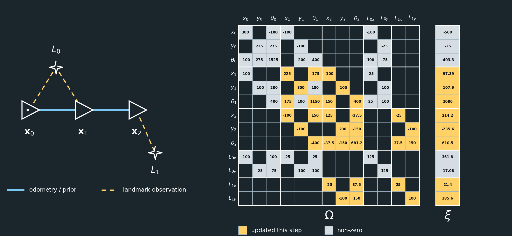
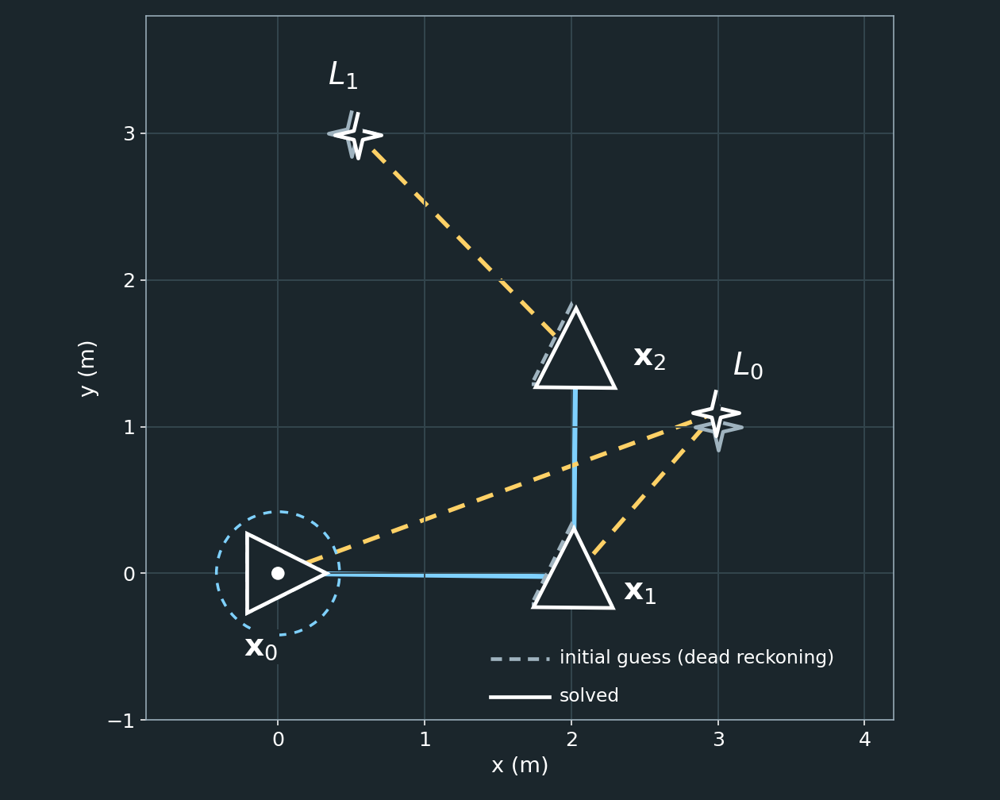

# 2D GraphSLAM Example

This example continues the [1D GraphSLAM Example](graphslam_1d_example.md). It assumes you have read that document, including the section on weights.

## Introduction

In the 1D example, every node in the graph was a single number. A robot moving on a plane needs more than that. To say where it is, we need its position $x$ and $y$ **and** the direction it is facing, $\theta$. A landmark is just a point, so it needs only $x$ and $y$.

Everything else about GraphSLAM stays the same:

- Poses and landmarks are nodes in a graph, and measurements are edges.
- Every measurement adds a small contribution to the information matrix $\Omega$ and information vector $\xi$.
- We solve $\Omega\mu=\xi$ for all the poses and landmarks at once.
- Measurements are weighted by how much we trust them.

Three things change:

1. **Each node holds several variables.** $\Omega$ and $\xi$ become block matrices and block vectors.
2. **Measurements are vectors, and their weights are matrices.** A scalar weight $w=1/\sigma^2$ becomes a noise matrix.
3. **Measurements depend on the heading $\theta$ through $\sin\theta$ and $\cos\theta$.** The relationship between the state and the measurement is no longer linear, so we linearize it with Jacobians and repeat the solve.

---

## The State Vector

A 2D pose has three variables and a 2D landmark has two:

```math
\mathbf{x}_k=
\begin{bmatrix}
x_k\\
y_k\\
\theta_k
\end{bmatrix},
\qquad
L_k=
\begin{bmatrix}
L_{k,x}\\
L_{k,y}
\end{bmatrix}.
```

The bold $\mathbf{x}_k$ is the whole pose, while $x_k$ is only its $x$ coordinate. Angles are in radians and are kept in the range $[-\pi,\pi]$.

This example has three poses and two landmarks:

```math
\mu=
\begin{bmatrix}
x_0\\
y_0\\
\theta_0\\
x_1\\
y_1\\
\theta_1\\
x_2\\
y_2\\
\theta_2\\
L_{0,x}\\
L_{0,y}\\
L_{1,x}\\
L_{1,y}
\end{bmatrix}.
```

That is $3\cdot3+2\cdot2=13$ unknowns. A 1D problem with the same five nodes would have had only five.

$\Omega$ is therefore a $13\times13$ matrix and $\xi$ has 13 entries. They are easiest to think of as blocks, one block row and one block column per node:

```math
\Omega=
\begin{bmatrix}
\Omega_{x_0x_0}&\Omega_{x_0x_1}&\Omega_{x_0x_2}&\Omega_{x_0L_0}&\Omega_{x_0L_1}\\
\Omega_{x_1x_0}&\Omega_{x_1x_1}&\Omega_{x_1x_2}&\Omega_{x_1L_0}&\Omega_{x_1L_1}\\
\Omega_{x_2x_0}&\Omega_{x_2x_1}&\Omega_{x_2x_2}&\Omega_{x_2L_0}&\Omega_{x_2L_1}\\
\Omega_{L_0x_0}&\Omega_{L_0x_1}&\Omega_{L_0x_2}&\Omega_{L_0L_0}&\Omega_{L_0L_1}\\
\Omega_{L_1x_0}&\Omega_{L_1x_1}&\Omega_{L_1x_2}&\Omega_{L_1L_0}&\Omega_{L_1L_1}
\end{bmatrix}
,\qquad
\xi=
\begin{bmatrix}
\xi_{x_0}\\
\xi_{x_1}\\
\xi_{x_2}\\
\xi_{L_0}\\
\xi_{L_1}
\end{bmatrix}.
```

The subscripts name the nodes. The size of each block depends on the kinds of node it connects:


A measurement between two nodes still touches only the blocks where those nodes meet. For example, an observation of $L_0$ from $x_1$ changes only $\Omega_{x_1x_1}$, $\Omega_{x_1L_0}$, $\Omega_{L_0x_1}$, $\Omega_{L_0L_0}$, $\xi_{x_1}$, and $\xi_{L_0}$. That is the same pattern as in 1D, where a measurement touched four scalar entries. It is why $\Omega$ stays sparse.

---

## Measurement Models

Both kinds of measurement are expressed in the robot's own frame, with $x$ pointing **forward** and $y$ pointing **left**. To convert between the robot frame and the world frame we need the rotation matrix

```math
R(\theta)=
\begin{bmatrix}
\cos\theta&-\sin\theta\\
\sin\theta&\cos\theta
\end{bmatrix}.
```

**Odometry** measures the motion from pose $i$ to pose $j$ as seen from pose $i$. It is a relative pose $z=(\Delta x,\Delta y,\Delta\theta)$. If the current estimate of the poses is $\mathbf{x}_i,\mathbf{x}_j$, the measurement we would expect is

```math
h_{\text{odom}}(\mathbf{x}_i,\mathbf{x}_j)=
\begin{bmatrix}
R(\theta_i)^\top
\begin{bmatrix}
x_j-x_i\\
y_j-y_i
\end{bmatrix}\\[4pt]
\theta_j-\theta_i
\end{bmatrix}.
```

**A landmark observation** measures where landmark $k$ is relative to pose $i$, in the robot frame (forward, left):

```math
h_{\text{lm}}(\mathbf{x}_i,L_k)=
R(\theta_i)^\top
\begin{bmatrix}
L_{k,x}-x_i\\
L_{k,y}-y_i
\end{bmatrix}.
```

> Many sensors report range and bearing instead. The simulation in [SIMULATION_GraphSLAM.m](SIMULATION_GraphSLAM.m) works that way. Only the function $h$ and its derivatives change. Everything else in this example is identical.

**The prior** simply says $h(\mathbf{x}_0)=\mathbf{x}_0$.

In 1D, the expected measurement was just $h=v_j-v_i$. Here, $h$ contains $R(\theta_i)^\top$, which is made of sines and cosines, so $h$ is **nonlinear**.

---

## Linearization and the Information Form

Near a current estimate $\bar\mu$, we can approximate the measurement function by its tangent:

```math
h(\mu)\approx h(\bar\mu)+J\,(\mu-\bar\mu),
\qquad
J=\frac{\partial h}{\partial\mu}\bigg|_{\bar\mu}.
```

$J$ is the **Jacobian**. It is zero everywhere except in the columns of the nodes involved in the measurement, so we only ever write down the small pieces.

If the measurement is $z$ and its weight is $W$ (introduced below), the contribution to the system is

```math
\boxed{
\Delta\Omega=J^\top W J,
\qquad
\Delta\xi=J^\top W\,\hat z,
\qquad
\hat z=z-h(\bar\mu)+J\bar\mu.
}
```

Here $\hat z$ is the measurement re-expressed around the linearization point. It contains the residual $z-h(\bar\mu)$, which says how far the measurement is from what the current estimate predicts, plus $J\bar\mu$.

Compare this with 1D. There, $h=v_j-v_i$ is already linear, so $J=\begin{bmatrix}-1&1\end{bmatrix}$ and $\hat z=z$. The formulas become

```math
J^\top wJ=w\begin{bmatrix}1&-1\\-1&1\end{bmatrix},
\qquad
J^\top w z=w\begin{bmatrix}-z\\z\end{bmatrix},
```

which are exactly the contributions from the 1D Measurement Model.

For reference, here are the Jacobians used below. Let $d=(x_j-x_i,\ y_j-y_i)$ be the position difference between the two poses, and let

```math
\frac{\partial R(\theta)^\top}{\partial\theta}=
\begin{bmatrix}
-\sin\theta&\cos\theta\\
-\cos\theta&-\sin\theta
\end{bmatrix}.
```

For odometry, the Jacobian with respect to pose $i$ is $J_i$ and with respect to pose $j$ is $J_j$:

```math
J_i=
\begin{bmatrix}
-R(\theta_i)^\top&\dfrac{\partial R(\theta_i)^\top}{\partial\theta_i}\,d\\[8pt]
0\ \ 0&-1
\end{bmatrix},
\qquad
J_j=
\begin{bmatrix}
R(\theta_i)^\top&0\\
0\ \ 0&1
\end{bmatrix}.
```

For a landmark observation, $d=(L_{k,x}-x_i,\ L_{k,y}-y_i)$:

```math
J_{\text{pose}}=
\begin{bmatrix}
-R(\theta_i)^\top&\dfrac{\partial R(\theta_i)^\top}{\partial\theta_i}\,d
\end{bmatrix},
\qquad
J_{L}=R(\theta_i)^\top.
```

Because the Jacobians depend on the estimate $\bar\mu$, a single solve is not the final answer. We will solve, move $\bar\mu$ to the new estimate, rebuild $\Omega$ and $\xi$, and repeat.

---

## The Example

The robot starts at the origin facing along $+x$. It drives forward and turns left, drives forward again, and sees two landmarks along the way. As in 1D, we add the measurements in a few steps. Each measurement has its own noise, which we describe as we meet it.

| Measurement | Value $z$ | Noise standard deviations |
|---|---|---|
| Prior on $\mathbf{x}_0$ | $(0,\ 0,\ 0)$ | $(0.1\text{ m},\ 0.1\text{ m},\ 0.05\text{ rad})$ |
| $L_0$ seen from $\mathbf{x}_0$ | $(3.0,\ 1.0)$ m | $(0.1,\ 0.2)$ m |
| Odometry $\mathbf{x}_0\to\mathbf{x}_1$ | $(2.0\text{ m},\ 0,\ 90^\circ)$ | $(0.1\text{ m},\ 0.1\text{ m},\ 0.05\text{ rad})$ |
| $L_0$ seen from $\mathbf{x}_1$ | $(1.15,\ -0.90)$ m | $(0.1,\ 0.2)$ m |
| Odometry $\mathbf{x}_1\to\mathbf{x}_2$ | $(1.5\text{ m},\ 0,\ 0^\circ)$ | $(0.1\text{ m},\ 0.1\text{ m},\ 0.05\text{ rad})$ |
| $L_1$ seen from $\mathbf{x}_2$ | $(1.5,\ 1.5)$ m | $(0.1,\ 0.2)$ m |

Because the Jacobians need a linearization point, we start from a dead-reckoned guess. Each pose comes from composing the odometry, and each landmark comes from its first observation:

```math
\bar{\mathbf{x}}_0=\begin{bmatrix}0\\0\\0\end{bmatrix},\quad
\bar{\mathbf{x}}_1=\begin{bmatrix}2\\0\\\pi/2\end{bmatrix},\quad
\bar{\mathbf{x}}_2=\begin{bmatrix}2\\1.5\\\pi/2\end{bmatrix},\quad
\bar L_0=\begin{bmatrix}3\\1\end{bmatrix},\quad
\bar L_1=\begin{bmatrix}0.5\\3\end{bmatrix}.
```

From $\bar{\mathbf{x}}_1$, which faces $+y$, the landmark $\bar L_0$ should appear $1\text{ m}$ forward and $1\text{ m}$ to the right, that is $(1,\ -1)$. The second observation, $(1.15,\ -0.90)$, disagrees slightly. This is the 2D version of the inconsistency in the 1D example.

Every step starts with a top-down view of the world, where poses are drawn as triangles that point in the direction the robot is facing. It ends with a figure that shows the graph and the system $\Omega\mu=\xi$. In the figure, yellow cells are the entries changed in that step and numbers are rounded.

All figures and all numbers in this document are generated by [generate_2d_figures.py](generate_2d_figures.py).

---

## Step 1: Anchor the First Pose



As in 1D, SLAM only determines relative positions unless we choose a reference frame. In 2D there are three degrees of freedom to fix: the position in $x$, the position in $y$, and the heading $\theta$. A prior on $\mathbf{x}_0$ fixes all three:

```math
\mathbf{x}_0=\begin{bmatrix}0\\0\\0\end{bmatrix}.
```

### Noise matrices

In 1D, we described the uncertainty of a measurement with one number $\sigma$. Here a measurement has several components, so we describe its uncertainty with a **covariance matrix** $\Sigma$:

- The diagonal entries are the variances of each component, $\sigma^2$.
- The off-diagonal entries are the covariances between pairs of components. A zero means the errors in two components are independent.
- $\Sigma$ is always symmetric and positive definite, and it has the same ordering and units as the measurement.

The weight of the measurement is the inverse of its covariance, which is called the **information matrix**:

```math
W=\Sigma^{-1}.
```

This is the matrix version of $w=1/\sigma^2$.

For the prior, the components are $(x,\ y,\ \theta)$ with standard deviations $(0.1\text{ m},\ 0.1\text{ m},\ 0.05\text{ rad})$. If the errors are independent, $\Sigma$ is diagonal:

```math
\Sigma_{\text{prior}}=
\begin{bmatrix}
0.1^2&0&0\\
0&0.1^2&0\\
0&0&0.05^2
\end{bmatrix}
=
\begin{bmatrix}
0.01&0&0\\
0&0.01&0\\
0&0&0.0025
\end{bmatrix},
```

```math
W_{\text{prior}}=\Sigma_{\text{prior}}^{-1}=
\begin{bmatrix}
100&0&0\\
0&100&0\\
0&0&400
\end{bmatrix}.
```

The units differ between components. The first two are in $\text{m}^2$ and the last is in $\text{rad}^2$, and $0.05\text{ rad}$ is about $2.9^\circ$. For each component, a smaller standard deviation means a larger weight.

If two components are correlated, $\Sigma$ gets off-diagonal entries. For example, suppose the errors in $x$ and $y$ tend to move together:

```math
\Sigma=
\begin{bmatrix}
0.010&0.004&0\\
0.004&0.010&0\\
0&0&0.0025
\end{bmatrix}
\quad\Longrightarrow\quad
W=\Sigma^{-1}=
\begin{bmatrix}
119.05&-47.62&0\\
-47.62&119.05&0\\
0&0&400
\end{bmatrix}.
```

The off-diagonal terms carry over to $W$. We will use diagonal matrices in this example, but the equations work the same way with any valid $\Sigma$.

### The first contribution

For the prior, $h(\mathbf{x}_0)=\mathbf{x}_0$, so $J=I$ and

```math
\Delta\Omega=W_{\text{prior}},
\qquad
\Delta\xi=W_{\text{prior}}\begin{bmatrix}0\\0\\0\end{bmatrix}
=\begin{bmatrix}0\\0\\0\end{bmatrix}.
```

Only the block $\Omega_{x_0x_0}$ is non-zero. All other blocks of $\Omega$, and all of $\xi$, are still zero:

```math
\Omega_{x_0x_0}=
\begin{bmatrix}
100&0&0\\
0&100&0\\
0&0&400
\end{bmatrix},
\qquad
\xi_{x_0}=
\begin{bmatrix}
0\\
0\\
0
\end{bmatrix}.
```

The value $100$ is not a position. It means we are confident that $x_0=0$, and the larger entry $400$ corresponds to the smaller standard deviation on the heading.



---

## Step 2: Observe Landmark $L_0$



At $\mathbf{x}_0$, the robot sees $L_0$ at $3.0\text{ m}$ forward and $1.0\text{ m}$ to the left:

```math
z=\begin{bmatrix}3.0\\1.0\end{bmatrix}.
```

### Landmark noise matrix

A landmark observation has two components, $(\text{forward},\ \text{left})$, so its noise matrix is $2\times2$. Suppose the sensor is better at judging how far ahead a landmark is than how far to the side, with standard deviations $0.1\text{ m}$ and $0.2\text{ m}$:

```math
\Sigma_{L}=
\begin{bmatrix}
0.1^2&0\\
0&0.2^2
\end{bmatrix}
=
\begin{bmatrix}
0.01&0\\
0&0.04
\end{bmatrix},
\qquad
W_{L}=\Sigma_{L}^{-1}=
\begin{bmatrix}
100&0\\
0&25
\end{bmatrix}.
```

### Accounting for the pose

This weight is defined in the **robot's** frame. The state, however, is in the **world** frame. The Jacobian is what connects them. It is computed from the current estimate of the pose, so the weight that ends up in $\Omega$ depends on where the robot is and which way it is facing.

At the linearization point, $\bar\theta_0=0$ and the landmark is at $d=\bar L_0-\bar p_0=(3,\ 1)$. The expected observation equals the measurement, so $\hat z=J\bar\mu=(3,\ 1)$. The Jacobian $J=\begin{bmatrix}J_{\text{pose}}&J_L\end{bmatrix}$ is

```math
J=
\begin{bmatrix}
-1&0&1&1&0\\
0&-1&-3&0&1
\end{bmatrix}.
```

The two columns on the right are $R(0)^\top=I$, because the robot is facing along $x$. The third column is $\frac{\partial R^\top}{\partial\theta}d=(1,\ -3)$. It says that if the heading of $\mathbf{x}_0$ were off by a small angle, the landmark would appear to move, and by more the farther away it is.

The contribution of this measurement is

```math
\Delta\Omega=J^\top W_LJ=
\begin{bmatrix}
100&0&-100&-100&0\\
0&25&75&0&-25\\
-100&75&325&100&-75\\
-100&0&100&100&0\\
0&-25&-75&0&25
\end{bmatrix},
\qquad
\Delta\xi=J^\top W_L\hat z=
\begin{bmatrix}
-300\\
-25\\
225\\
300\\
25
\end{bmatrix}.
```

In every matrix from here on, the rows and columns are ordered by node, with three entries for each pose followed by two for each landmark. Here they are $x_0,\ y_0,\ \theta_0,\ L_{0,x},\ L_{0,y}$, so the top-left $3\times3$ block belongs to $\mathbf{x}_0$ and the bottom-right $2\times2$ block belongs to $L_0$. The figures at the end of each step show the block boundaries. A few things to notice:

- The $L_0$ block is $\mathrm{diag}(100,\ 25)$. In the world frame, the landmark's $x$ position is well known and its $y$ position less so, because the robot is facing along $x$.
- The $\theta_0\theta_0$ entry is $325=100\cdot1^2+25\cdot(-3)^2$. Heading is strongly tied to this observation, because a landmark $3\text{ m}$ away swings a long way for a small heading error.
- The pose and landmark are linked by off-diagonal blocks, like the $-25$ in the 1D example.

Adding this to the prior, the non-zero rows and columns of the system, ordered $(\mathbf{x}_0,\ L_0)$, are

```math
\Omega=
\begin{bmatrix}
200&0&-100&-100&0\\
0&125&75&0&-25\\
-100&75&725&100&-75\\
-100&0&100&100&0\\
0&-25&-75&0&25
\end{bmatrix},
\qquad
\xi=
\begin{bmatrix}
-300\\
-25\\
225\\
300\\
25
\end{bmatrix}.
```

All the other rows and columns are still zero.



---

## Step 3: Move to $\mathbf{x}_1$



### Odometry

The robot moves $2.0\text{ m}$ forward and turns $90^\circ$ left. As seen from $\mathbf{x}_0$, the relative pose is

```math
z=\begin{bmatrix}2.0\\0\\\pi/2\end{bmatrix}.
```

The odometry noise is also described in the frame of the starting pose, so it uses the same kind of matrix as the prior: $3\times3$, ordered $(\Delta x,\ \Delta y,\ \Delta\theta)$. We use $(0.1\text{ m},\ 0.1\text{ m},\ 0.05\text{ rad})$, so

```math
W_{\text{odom}}=
\begin{bmatrix}
100&0&0\\
0&100&0\\
0&0&400
\end{bmatrix}.
```

At the linearization point, $\bar\theta_0=0$ and $d=\bar p_1-\bar p_0=(2,\ 0)$. The Jacobian $J=\begin{bmatrix}J_0&J_1\end{bmatrix}$ is

```math
J=
\begin{bmatrix}
-1&0&0&1&0&0\\
0&-1&-2&0&1&0\\
0&0&-1&0&0&1
\end{bmatrix}.
```

The $-2$ is again a lever arm. If $\mathbf{x}_0$ were rotated slightly, a pose $2\text{ m}$ ahead would appear to be shifted sideways. This gives

```math
\Delta\Omega=
\begin{bmatrix}
100&0&0&-100&0&0\\
0&100&200&0&-100&0\\
0&200&800&0&-200&-400\\
-100&0&0&100&0&0\\
0&-100&-200&0&100&0\\
0&0&-400&0&0&400
\end{bmatrix},
\qquad
\Delta\xi=
\begin{bmatrix}
-200\\
0\\
-628.32\\
200\\
0\\
628.32
\end{bmatrix},
```

with rows and columns for $\mathbf{x}_0$ and $\mathbf{x}_1$. The $628.32$ is $400\cdot\frac{\pi}{2}$, the angle term weighted by $400$.

### Second observation of $L_0$

From $\mathbf{x}_1$, the robot sees $L_0$ again:

```math
z=\begin{bmatrix}1.15\\-0.90\end{bmatrix}.
```

It uses the same noise matrix $W_L=\mathrm{diag}(100,\ 25)$ as before. But now the robot is facing along $+y$, with $\bar\theta_1=\pi/2$. The current estimate predicts

```math
h(\bar\mu)=R(\pi/2)^\top(\bar L_0-\bar p_1)=
\begin{bmatrix}1\\-1\end{bmatrix},
\qquad
z-h(\bar\mu)=\begin{bmatrix}0.15\\0.10\end{bmatrix}.
```

This residual is the inconsistency, and it makes $\hat z=(-0.4208,\ -2.4708)$ differ from the first observation. The Jacobian $J=\begin{bmatrix}J_{\text{pose}}&J_L\end{bmatrix}$ is

```math
J=
\begin{bmatrix}
0&-1&-1&0&1\\
1&0&-1&-1&0
\end{bmatrix},
```

and the contribution, with rows and columns for $\mathbf{x}_1$ and $L_0$, is

```math
\Delta\Omega=
\begin{bmatrix}
25&0&-25&-25&0\\
0&100&100&0&-100\\
-25&100&125&25&-100\\
-25&0&25&25&0\\
0&-100&-100&0&100
\end{bmatrix},
\qquad
\Delta\xi=
\begin{bmatrix}
-61.77\\
42.08\\
103.85\\
61.77\\
-42.08
\end{bmatrix}.
```

This is where the pose matters most. Because the robot now faces $+y$, the same noise matrix lands differently in the world frame. The $L_0$ block is

```math
J_L^\top W_LJ_L=R\!\left(\tfrac{\pi}{2}\right)W_L\,R\!\left(\tfrac{\pi}{2}\right)^\top=
\begin{bmatrix}
25&0\\
0&100
\end{bmatrix}.
```

The roles of $x$ and $y$ are swapped, because "forward" for this robot is now the world $y$ direction. The first observation constrained $L_0$'s $x$ position strongly, and this one constrains its $y$ position strongly. Added together, $\Omega_{L_0L_0}=\mathrm{diag}(125,\ 125)$.

### The system so far

The non-zero rows and columns, ordered $(\mathbf{x}_0,\ \mathbf{x}_1,\ L_0)$, are now

```math
\Omega=
\begin{bmatrix}
300&0&-100&-100&0&0&-100&0\\
0&225&275&0&-100&0&0&-25\\
-100&275&1525&0&-200&-400&100&-75\\
-100&0&0&125&0&-25&-25&0\\
0&-100&-200&0&200&100&0&-100\\
0&0&-400&-25&100&525&25&-100\\
-100&0&100&-25&0&25&125&0\\
0&-25&-75&0&-100&-100&0&125
\end{bmatrix},
\qquad
\xi=
\begin{bmatrix}
-500\\
-25\\
-403.32\\
138.23\\
42.08\\
732.17\\
361.77\\
-17.08
\end{bmatrix}.
```

The rows and columns for $\mathbf{x}_2$ and $L_1$ are still zero. The graph now has a loop through $\mathbf{x}_0$, $\mathbf{x}_1$, and $L_0$, which is where the redundancy and the inconsistency come from.



---

## Step 4: Move to $\mathbf{x}_2$



### Odometry

The robot drives $1.5\text{ m}$ forward without turning, so $z=(1.5,\ 0,\ 0)$, with the same $W_{\text{odom}}$. The pose $\mathbf{x}_1$ faces $+y$, so the linearization uses $\bar\theta_1=\pi/2$:

```math
J=
\begin{bmatrix}
0&-1&0&0&1&0\\
1&0&-1.5&-1&0&0\\
0&0&-1&0&0&1
\end{bmatrix},
```

```math
\Delta\Omega=
\begin{bmatrix}
100&0&-150&-100&0&0\\
0&100&0&0&-100&0\\
-150&0&625&150&0&-400\\
-100&0&150&100&0&0\\
0&-100&0&0&100&0\\
0&0&-400&0&0&400
\end{bmatrix},
\qquad
\Delta\xi=
\begin{bmatrix}
-235.62\\
-150\\
353.43\\
235.62\\
150\\
0
\end{bmatrix}.
```

Compare this with Step 3. There, the motion was along the world $x$ axis, so the lever arm coupled the heading to $y$ (the $200$ entries). Here the robot is facing $+y$, so the motion is along the world $y$ axis, and the lever arm couples the heading to $x$ instead (the $-150$ entries).

### New landmark

At $\mathbf{x}_2$, the robot sees a new landmark $L_1$ at $1.5\text{ m}$ forward and $1.5\text{ m}$ to the left, with the same $W_L$:

```math
z=\begin{bmatrix}1.5\\1.5\end{bmatrix},
\qquad
J=
\begin{bmatrix}
0&-1&1.5&0&1\\
1&0&-1.5&-1&0
\end{bmatrix},
```

```math
\Delta\Omega=
\begin{bmatrix}
25&0&-37.5&-25&0\\
0&100&-150&0&-100\\
-37.5&-150&281.25&37.5&150\\
-25&0&37.5&25&0\\
0&-100&150&0&100
\end{bmatrix},
\qquad
\Delta\xi=
\begin{bmatrix}
-21.40\\
-385.62\\
610.54\\
21.40\\
385.62
\end{bmatrix}.
```

Its rows and columns are for $\mathbf{x}_2$ and $L_1$. Since $L_1$ was initialized from this very observation, there is no residual to correct yet. As with $L_1$ in the 1D example, a landmark seen once has no redundancy.

### The complete system

Adding everything together gives the complete $13\times13$ system, ordered $(\mathbf{x}_0,\ \mathbf{x}_1,\ \mathbf{x}_2,\ L_0,\ L_1)$:

```math
\Omega=
\begin{bmatrix}
300&0&-100&-100&0&0&0&0&0&-100&0&0&0\\
0&225&275&0&-100&0&0&0&0&0&-25&0&0\\
-100&275&1525&0&-200&-400&0&0&0&100&-75&0&0\\
-100&0&0&225&0&-175&-100&0&0&-25&0&0&0\\
0&-100&-200&0&300&100&0&-100&0&0&-100&0&0\\
0&0&-400&-175&100&1150&150&0&-400&25&-100&0&0\\
0&0&0&-100&0&150&125&0&-37.5&0&0&-25&0\\
0&0&0&0&-100&0&0&200&-150&0&0&0&-100\\
0&0&0&0&0&-400&-37.5&-150&681.25&0&0&37.5&150\\
-100&0&100&-25&0&25&0&0&0&125&0&0&0\\
0&-25&-75&0&-100&-100&0&0&0&0&125&0&0\\
0&0&0&0&0&0&-25&0&37.5&0&0&25&0\\
0&0&0&0&0&0&0&-100&150&0&0&0&100
\end{bmatrix},
```

```math
\xi=
\begin{bmatrix}
-500\\
-25\\
-403.32\\
-97.39\\
-107.92\\
1085.60\\
214.21\\
-235.62\\
610.54\\
361.77\\
-17.08\\
21.40\\
385.62
\end{bmatrix}.
```

The block pattern is the same as in the 1D example: a chain of couplings along the trajectory ($\mathbf{x}_0$–$\mathbf{x}_1$–$\mathbf{x}_2$), links from each pose to the landmarks it saw ($\mathbf{x}_0$ and $\mathbf{x}_1$ to $L_0$, and $\mathbf{x}_2$ to $L_1$), and nothing between $L_0$ and $L_1$, because no pose saw both.



---

## Solving the System

Solving $\Omega\mu=\xi$ gives a new estimate of every pose and landmark. But we built $\Omega$ and $\xi$ at the dead-reckoned guess $\bar\mu$, and the true relationship is nonlinear. So we move the linearization point to the new estimate, rebuild $\Omega$ and $\xi$, and solve again. After the second solve, the estimate no longer changes at the precision shown here.

| Node | Initial guess | After 1st solve | Converged |
|---|---|---|---|
| $\mathbf{x}_0$ | (0, 0, 0) | (0, 0, 0) | (0, 0, 0) |
| $\mathbf{x}_1$ | (2.0000, 0.0000, 1.5708) | (2.0151, -0.0234, 1.5612) | (2.0147, -0.0234, 1.5610) |
| $\mathbf{x}_2$ | (2.0000, 1.5000, 1.5708) | (2.0295, 1.4766, 1.5612) | (2.0294, 1.4765, 1.5610) |
| $L_0$ | (3.0000, 1.0000) | (2.9849, 1.0936) | (2.9853, 1.0938) |
| $L_1$ | (0.5000, 3.0000) | (0.5439, 2.9910) | (0.5441, 2.9911) |

Poses are $(x,\ y,\ \theta)$ in metres and radians, and landmarks are $(x,\ y)$ in metres.



The only inconsistency was the second observation of $L_0$, which was about $0.18\text{ m}$ from the first. The solver resolved it with small adjustments everywhere, and the weights decided who moved:

- The first observation measured $L_0$'s $x$ position precisely (forward) and its $y$ position loosely (left). The second observation measured the opposite, because the robot had turned.
- The solution therefore keeps $L_{0,x}\approx2.985$, close to the first observation's $3.0$, and moves $L_{0,y}$ to $\approx1.094$, toward the second observation's $1.15$.

This is the 2D version of weighted least squares. The noise matrices say which direction each measurement is reliable in, and the pose determines how those directions map onto the world.

---

## From 1D to 2D

| | 1D | 2D |
|---|---|---|
| Pose | $x$ (1 variable) | $(x,\ y,\ \theta)$ (3 variables) |
| Landmark | $L$ (1 variable) | $(L_x,\ L_y)$ (2 variables) |
| Blocks of $\Omega$ | $1\times1$ | $3\times3$, $3\times2$, $2\times3$, $2\times2$ |
| Measurement | scalar $z$ | vector $z$ |
| Weight | $w=1/\sigma^2$ | $W=\Sigma^{-1}$ |
| Expected measurement | $v_j-v_i$ (linear) | involves $R(\theta)$ (nonlinear) |
| Contribution | $J^\top wJ$ | $J^\top WJ$ |
| Solving | once | solve, relinearize, repeat |

The graph, the sparsity, the idea of summing contributions into $\Omega$ and $\xi$, and the weighted least-squares solution are all unchanged. Only the size of each piece, and the need to account for the heading, are new.

---

## Next: Loop Closure and Efficient Solving

These examples were small and had no loops, so a chain of odometry never contradicted itself. [Loop Closure in GraphSLAM](graphslam_loop_closure.md) adds a loop, shows how a single closure corrects accumulated drift across the whole trajectory, and then [Solving the System Efficiently](graphslam_sparse_solvers.md) shows how to solve the larger system by exploiting its sparse structure.
