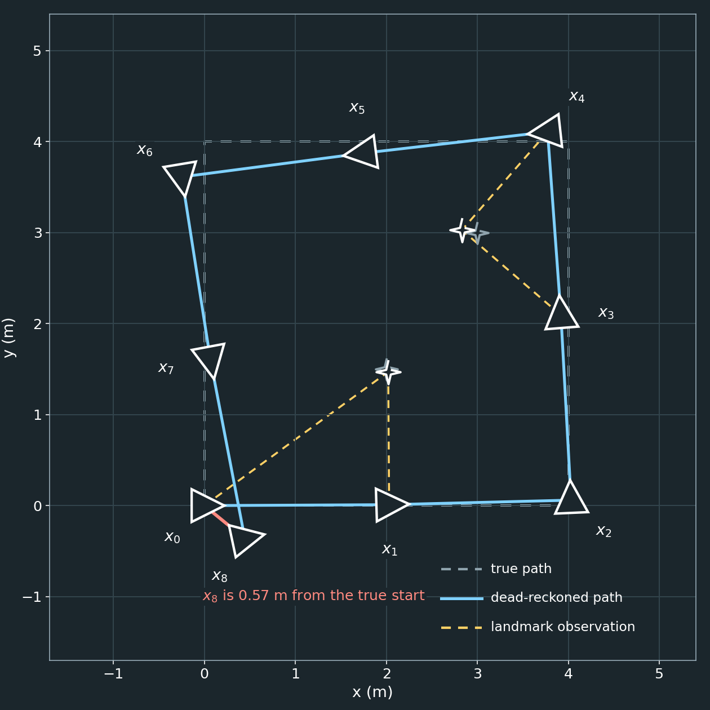
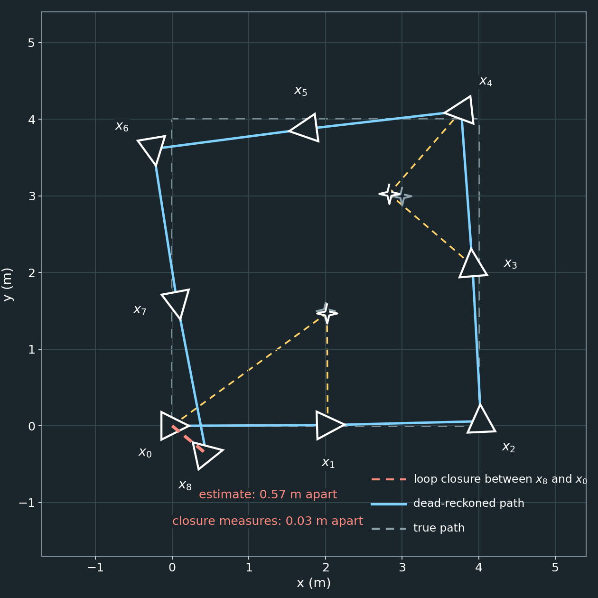
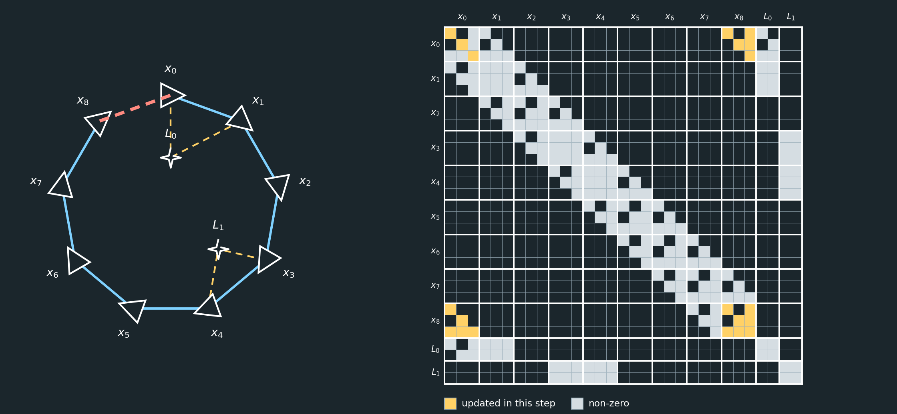
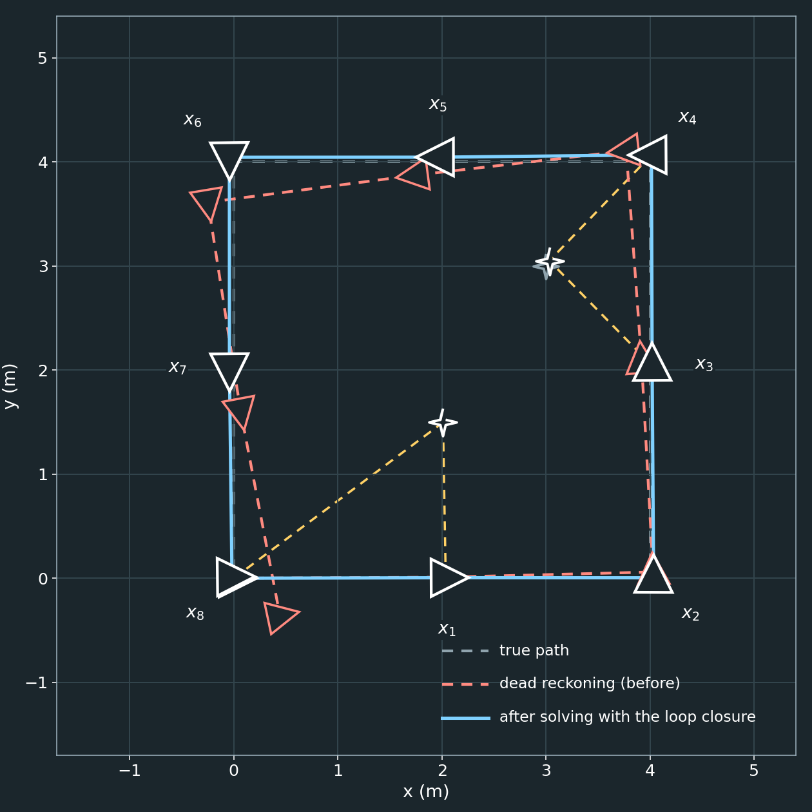
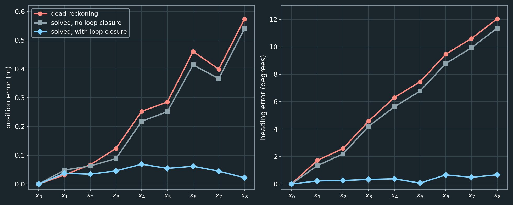
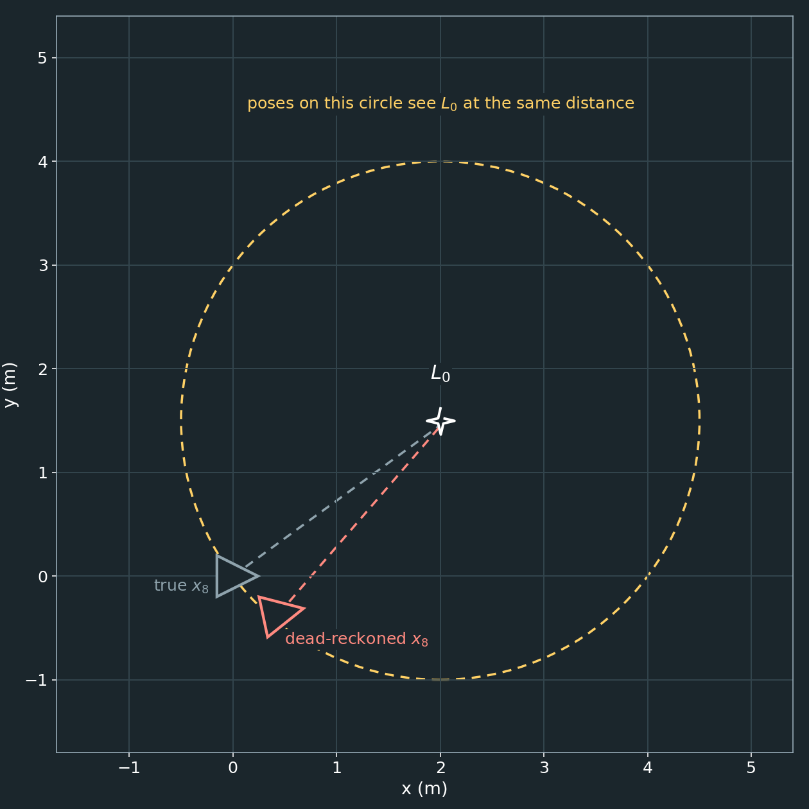

# Loop Closure in GraphSLAM

This example continues the [2D GraphSLAM Example](graphslam_2d_example.md). It assumes you have read that document, including how measurements are linearized and weighted with noise matrices.

## Introduction

Odometry only relates each pose to the one before it. Every step adds a little error, and nothing ever corrects it, so the error accumulates. This is called **drift**. After a long drive, the estimated path can be metres away from the real one.

The graph from the previous examples makes the problem easy to see. With only odometry, the graph is a **chain**: $\mathbf x_0 - \mathbf x_1 - \mathbf x_2 - \dots$ A chain has no redundancy, so there are no contradictions for the solver to resolve.

A **loop closure** is a measurement that connects the current pose to a much earlier part of the graph. It could come from recognizing a place that the robot has been before, or from seeing a landmark that was mapped a long time ago. The chain becomes a ring. The new measurement disagrees with the accumulated odometry, and that disagreement is exactly the information needed to correct the drift.

> **The key idea of this document.** A loop closure is two separate things:
>
> 1. **Identification:** deciding that the robot is at a previously visited pose, or is looking at a previously observed landmark. This is a perception and data-association problem. It happens *before* the solver, and it is where most of the difficulty of loop closure lies.
> 2. **Using the result:** once the identification has been made, the closure is just another measurement between two nodes of the graph. It adds a Jacobian and a noise matrix, and fills in a few more blocks of $\Omega$ and $\xi$, exactly like odometry or a landmark observation.
>
> The solver does not know or care which measurements are loop closures. It is the same $\Omega\mu=\xi$, solved the same way. The only thing that is special about a closure is **where** in the matrix its contribution lands: far from the diagonal, linking two nodes that are far apart in time.

This is where GraphSLAM being a batch solver over **all** poses pays off. The closure does not only fix the latest pose. The solver spreads the correction along the entire trajectory, including poses that were estimated long before the closure was observed.

---

## The Scenario

A robot drives once around a $4\text{ m}\times4\text{ m}$ square and ends where it started. It records nine poses, $\mathbf x_0,\dots,\mathbf x_8$. It turns $90^\circ$ left at each corner. Two landmarks, $L_0$ and $L_1$, stand inside the square.

| Pose | $\mathbf x_0$ | $\mathbf x_1$ | $\mathbf x_2$ | $\mathbf x_3$ | $\mathbf x_4$ | $\mathbf x_5$ | $\mathbf x_6$ | $\mathbf x_7$ | $\mathbf x_8$ |
|---|---|---|---|---|---|---|---|---|---|
| $x,\ y$ (m) | $0,\ 0$ | $2,\ 0$ | $4,\ 0$ | $4,\ 2$ | $4,\ 4$ | $2,\ 4$ | $0,\ 4$ | $0,\ 2$ | $0,\ 0$ |
| $\theta$ | $0^\circ$ | $0^\circ$ | $90^\circ$ | $90^\circ$ | $180^\circ$ | $180^\circ$ | $-90^\circ$ | $-90^\circ$ | $0^\circ$ |

This table is the **ground truth**. It is used only to measure how well the estimate does. The solver never sees it.

The measurements are:

- A prior on $\mathbf x_0$ that anchors it at the origin.
- Eight odometry measurements, one between each pair of consecutive poses. The odometry is **biased**: it reports each forward step $1\%$ too long, and each turn about $1.4^\circ$ too large, plus small random-looking errors. This is typical of wheel slip and calibration error.
- Four local landmark observations: $L_0$ from $\mathbf x_0$ and $\mathbf x_1$, and $L_1$ from $\mathbf x_3$ and $\mathbf x_4$. Each landmark is only seen by consecutive poses.

The noise matrices are those of the 2D example:

```math
W_{\text{odom}}=W_{\text{prior}}=
\begin{bmatrix}
100&0&0\\
0&100&0\\
0&0&400
\end{bmatrix},
\qquad
W_L=
\begin{bmatrix}
100&0\\
0&25
\end{bmatrix}.
```

As before, we linearize around a dead-reckoned estimate $\bar\mu$, which is built by composing the odometry and initializing each landmark from its first observation.

The system has $9\cdot3+2\cdot2=31$ unknowns. All figures and numbers in this document are generated by [generate_loop_and_sparse_figures.py](generate_loop_and_sparse_figures.py), using the model in [loop_example_model.py](loop_example_model.py).

---

## Step 1: Drive Around the Loop



The grey dashed square is where the robot really went. The blue path is what odometry says. The path drifts, and the final pose $\mathbf x_8$ ends up $0.57\text{ m}$ from the true start and $12^\circ$ off in heading.

The error grows with every step, because each pose inherits the errors of all of the poses before it:

| Pose | $\mathbf x_0$ | $\mathbf x_1$ | $\mathbf x_2$ | $\mathbf x_3$ | $\mathbf x_4$ | $\mathbf x_5$ | $\mathbf x_6$ | $\mathbf x_7$ | $\mathbf x_8$ |
|---|---|---|---|---|---|---|---|---|---|
| Position error (m) | 0 | 0.03 | 0.07 | 0.12 | 0.25 | 0.29 | 0.46 | 0.40 | 0.57 |
| Heading error ($^\circ$) | 0 | 1.7 | 2.6 | 4.6 | 6.3 | 7.4 | 9.5 | 10.6 | 12.0 |

### The system so far

None of the measurement equations are new. Each one contributes $J^\top WJ$ and $J^\top W\hat z$ exactly as in the 2D example. What is new is the overall picture of where those contributions land.


Because every constraint connects consecutive poses, or a landmark with the poses that saw it, $\Omega$ is **block-tridiagonal**: the non-zero blocks hug the diagonal. About $20\%$ of the $31\times31$ entries are non-zero.

### Can the solver fix the drift?

Solving this system does almost nothing. Nothing contradicts the odometry, so there is nothing to resolve:

- No pose moves by more than $0.05\text{ m}$ from the dead-reckoned estimate.
- The final position error only changes from $0.57\text{ m}$ to $0.54\text{ m}$.

The two landmarks do not help either. Each is seen by two consecutive poses, which only agrees with the local odometry. This is the same lesson as the landmark seen only once in the 1D example: a measurement that does not close a loop cannot correct drift.

---

## Step 2: Close the Loop



At $\mathbf x_8$, the robot recognizes that it is back at the place where it started. For example, the sensor data at $\mathbf x_8$ might match the data recorded at $\mathbf x_0$. Matching them gives a **relative pose**: where $\mathbf x_0$ is, as seen from $\mathbf x_8$:

```math
z=\begin{bmatrix}0.02\\-0.015\\0.01\end{bmatrix}.
```

In this example, the robot ends almost exactly where it started: within $0.03\text{ m}$ and well under a degree. This is a convenience for the example, and the side note below explains why a real robot would not need it.

The hard part of this step, deciding that $\mathbf x_8$ really is back at $\mathbf x_0$, is **identification**, and it happens outside the equations. We simply assume that it has been done correctly, and the rest of this step shows what happens once it has.

> **Side note: a loop closure does not need the robot to return to the same pose.**
>
> In this example, the true path ends exactly where it started, and the closure measurement is nearly zero. That is only a convenience for the walkthrough. A real robot almost never returns to exactly the same position and heading, and it does not need to.
>
> - **$\mathbf x_8$ is a new node.** It is not $\mathbf x_0$ revisited. The graph keeps both nodes, with their own estimates, and the closure is an **edge** between them. The measurement says how $\mathbf x_0$ is positioned relative to $\mathbf x_8$, and that relative pose can be anything: $0.3\text{ m}$ to one side, $1.5\text{ m}$ ahead, rotated by $20^\circ$. Our measurement $z\approx(0.02,\ -0.015,\ 0.01)$ was close to zero only because the true poses happen to coincide.
> - **The views only need to overlap.** What is required is that the robot sees enough of the same part of the world that the two sets of sensor data can be aligned. The alignment is typically done by scan matching, image feature matching, or a similar registration method. Its output is the relative pose, along with a covariance that describes how much to trust it. That covariance becomes the noise matrix $W$ of the closure.
> - **Finding candidates is part of identification.** The front end does not compare the current view against every old one. It uses the current estimate, with its uncertainty, to pick nearby candidate poses, or uses an appearance-based place-recognition method to propose them, and then verifies each candidate by registration. Only a verified match becomes a measurement.
> - **Landmark re-observation needs no matching pose at all.** Seeing an old landmark from a different position or direction is a perfectly good closure, as in the $L_0$ example later in this document. The observing pose can be anywhere that the landmark is visible.
>
> The equations do not change. The measurement is the relative pose between two distinct nodes, and the expected measurement $h_{\text{odom}}$ and its Jacobians work for any pair, however far apart they are, and whatever the relative pose between them is. The robot's returning to an identical pose is a special case of this, not a requirement.

### The equations

This is the same relative-pose measurement as odometry. The only difference is that it connects two poses that are far apart in time, $\mathbf x_8$ and $\mathbf x_0$, instead of consecutive ones. The expected measurement and the Jacobians are $h_{\text{odom}}(\mathbf x_8,\mathbf x_0)$, with $i=8$ and $j=0$, and its contribution is again $J^\top W J$ and $J^\top W\hat z$. We give it the same noise matrix $W_{\text{odom}}$.

Nothing else changes. The closure is added to the same system, the system is linearized the same way, and it is solved the same way as in the 2D example. Compare this with the 2D example's steps, where a measurement connected $\mathbf x_1$ and $L_0$, or $\mathbf x_1$ and $\mathbf x_2$. Here the measurement connects $\mathbf x_8$ and $\mathbf x_0$.

At the dead-reckoned estimate, the current poses predict

```math
h(\bar\mu)=\begin{bmatrix}-0.359\\0.447\\-0.210\end{bmatrix},
\qquad
z-h(\bar\mu)=\begin{bmatrix}0.379\\-0.462\\0.220\end{bmatrix}.
```

The estimate claims that $\mathbf x_0$ is $0.36\text{ m}$ behind and $0.45\text{ m}$ to the left of $\mathbf x_8$, and rotated by $-12^\circ$. The closure says they are at the same place. The residual is large, and this large residual is the drift, expressed as a single measurement.

### What changes in the matrix

The measurement connects $\mathbf x_8$ and $\mathbf x_0$, so it touches four blocks: $\Omega_{x_0x_0}$, $\Omega_{x_8x_8}$, and the pair $\Omega_{x_0x_8}$ and $\Omega_{x_8x_0}$. The new off-diagonal block is

```math
\Omega_{x_0x_8}=
\begin{bmatrix}
-100&0&36.2\\
0&-100&44.4\\
0&0&-400
\end{bmatrix}.
```



The graph is a ring now. In the matrix, the non-zero blocks are no longer all near the diagonal. There is a pair of blocks in the far corners connecting the first and last poses. The matrix is still sparse, but it is no longer banded. How this affects the cost of solving is the subject of the [next document](graphslam_sparse_solvers.md).

---

## Step 3: Solve



Because the measurements are nonlinear, we solve, relinearize, and repeat, as in the 2D example. It converges in six iterations. This is the same solver and the same procedure that the earlier examples used. There is no special loop-closure step, and no separate "correction" pass. The only thing that has changed is that one more measurement is in $\Omega$ and $\xi$.

The effect of the loop closure is large:

- The final position error drops from $0.57\text{ m}$ to $0.02\text{ m}$.
- The worst position error anywhere on the trajectory is $0.07\text{ m}$, at $\mathbf x_4$.
- The heading errors, which reached $12^\circ$, are all under $1^\circ$.



| Pose | $\mathbf x_0$ | $\mathbf x_1$ | $\mathbf x_2$ | $\mathbf x_3$ | $\mathbf x_4$ | $\mathbf x_5$ | $\mathbf x_6$ | $\mathbf x_7$ | $\mathbf x_8$ |
|---|---|---|---|---|---|---|---|---|---|
| Dead reckoning (m) | 0 | 0.03 | 0.07 | 0.12 | 0.25 | 0.29 | 0.46 | 0.40 | 0.57 |
| Solved without closure (m) | 0 | 0.05 | 0.06 | 0.09 | 0.22 | 0.25 | 0.41 | 0.37 | 0.54 |
| Solved with closure (m) | 0 | 0.04 | 0.03 | 0.05 | 0.07 | 0.05 | 0.06 | 0.04 | 0.02 |

### Where did the correction go?

The solver did not only move $\mathbf x_8$. It moved nearly every pose, by an amount that grows along the path:

| Pose | $\mathbf x_0$ | $\mathbf x_1$ | $\mathbf x_2$ | $\mathbf x_3$ | $\mathbf x_4$ | $\mathbf x_5$ | $\mathbf x_6$ | $\mathbf x_7$ | $\mathbf x_8$ |
|---|---|---|---|---|---|---|---|---|---|
| Distance moved (m) | 0 | 0.01 | 0.06 | 0.11 | 0.25 | 0.28 | 0.48 | 0.42 | 0.59 |

This matches how the drift built up: $\mathbf x_0$ is anchored by the prior and does not move, and the later poses carry more accumulated error, so they are moved the most.

This is the 2D version of the 1D example, where a $0.10\text{ m}$ disagreement in a small loop was shared among the measurements around it. Here the ring has nine relative-pose constraints with the same weight, eight odometry measurements and the closure, so the misclosure is shared among all of them.

The weights decide how the error is shared. If the closure were given a much larger weight (a much smaller noise matrix), the solver would trust it more and push more of the error into the odometry. If it were given a smaller weight, the closure would be less able to correct the drift.

---

## Not Every Closure Is Equally Informative

The loop closure above came from recognizing a place, which gives a full relative pose with three constraints. A different kind of closure is to **see an old landmark again**. Suppose that, instead, $\mathbf x_8$ re-observes $L_0$, the landmark that $\mathbf x_0$ and $\mathbf x_1$ saw at the start.

This is also a loop closure, and it adds edges between $\mathbf x_8$ and a landmark that is tied to the start of the trajectory. But it barely helps:

| | Final position error (m) |
|---|---|
| Dead reckoning | 0.57 |
| Solved with the place-recognition closure | 0.02 |
| Solved after re-observing $L_0$ | 0.51 |

The reason is that one landmark observation is only **two** equations, while a pose has **three** unknowns $(x,\ y,\ \theta)$. It cannot pin down the pose by itself. Any pose on the circle around the landmark, with a matching heading, sees the landmark in the same place in its own frame:



In this scene, the drift happens to be almost along that circle. The dead-reckoned $\mathbf x_8$ sees $L_0$ nearly where the true $\mathbf x_8$ does, so the new observation has almost no residual and nothing to correct.

How much a loop closure helps depends on how many of the pose's degrees of freedom it constrains, and in which directions. Re-observing two landmarks at once, or one landmark together with a heading measurement, would constrain all three.

---

## Things to Watch For

- **Data association.** This is the identification half of loop closure, and it is where the real difficulty lies. A loop closure is only helpful if it is **correct**. If the robot decides that it is back at a place it has never been, the false closure contradicts the true odometry, and a solver that trusts it will bend the whole map to satisfy it. Real systems verify closures geometrically and use robust cost functions that reduce the influence of measurements with large residuals.
- **Weights.** The noise matrix of a closure should be honest. An overconfident closure distorts the trajectory, and an underconfident one wastes the information.
- **The matrix is no longer banded.** The corner blocks that a closure adds are exactly what makes solving the system more interesting. See [Solving the System Efficiently](graphslam_sparse_solvers.md).

---

## Summary

- Loop closure has two parts. **Identification** decides that the robot is at a previously visited pose, or is seeing a previously observed landmark. **Using it** means adding one more ordinary measurement between those two nodes.
- The solver is unchanged. Loop closure only populates the matrix in a particular way, with blocks far from the diagonal, and the same $\Omega\mu=\xi$ is solved the same way.
- Odometry alone forms a chain, and a chain cannot correct drift.
- A loop closure connects the current pose to an earlier one, which turns the chain into a ring.
- The closure has a Jacobian and a noise matrix like any other measurement, but its residual carries the accumulated drift.
- Because GraphSLAM solves for all poses at once, the correction is spread along the whole trajectory.
- A closure only helps in the directions it constrains, and only when it is correct.
