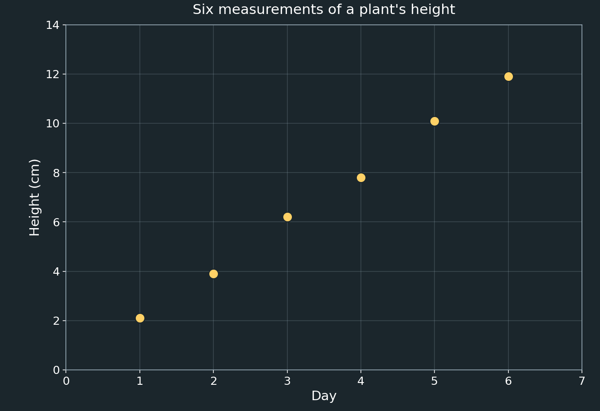
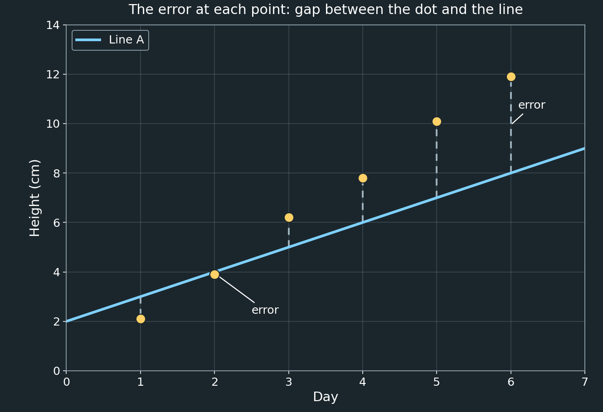
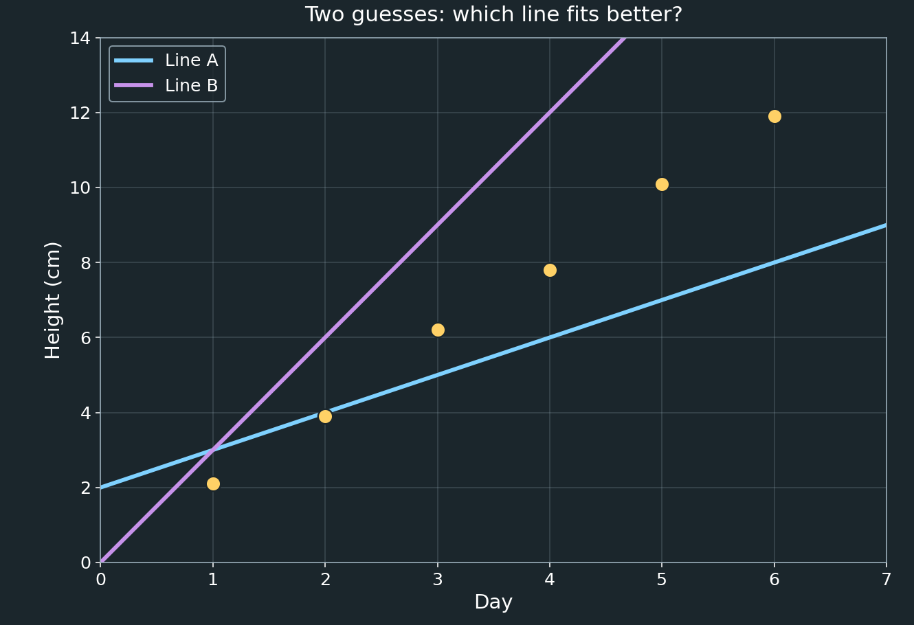
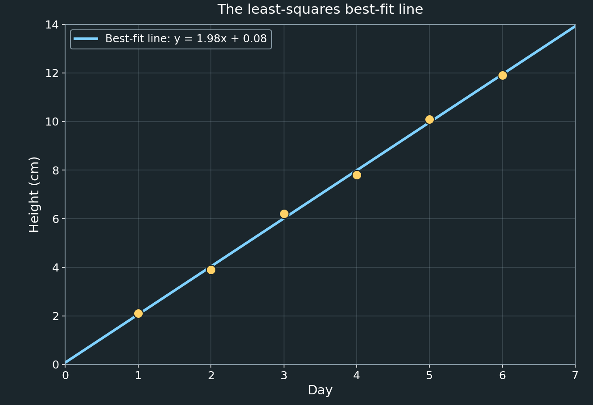

# Introduction to Least Squares

This is the first of a series of documents about **least squares**, a method for finding the best possible answer when you have more information than you strictly need, and that information doesn't quite agree with itself.

This document assumes only ordinary algebra: graphing a line, what a slope and an intercept are, and how to compute an average. If you have heard terms like "column space," "projection," or "matrix" before, you will not need them here — later documents in this series build up to them, but this one is written so that none of that is necessary yet.

---

## Why Do We Need This at All?

Suppose you measure your own height with a tape measure. You do it once and get $162\text{ cm}$. Good enough, right? But suppose you measure it again a minute later, a little more carefully, and get $163\text{ cm}$. You measure a third time and get $161.5\text{ cm}$.

Nothing is wrong with you. The tape measure slipped slightly, the lighting made the markings hard to read, you stood up a little straighter the second time — real measurements always have small, unavoidable errors in them. This is true whether you are measuring your height, weighing a bag of rice on a kitchen scale, or timing how long it takes a ball to fall with a stopwatch.

So which number is the "right" one? None of them exactly, and all of them a little. The most reasonable thing to do with three slightly different measurements of the same thing is to combine them. The simplest way to combine them is to average them:

```math
\frac{162+163+161.5}{3}=162.1\overline{6}\text{ cm}.
```

That is already an example of the idea this whole series is about: when no single measurement is perfectly trustworthy, we don't throw away the extra measurements or pick a favorite. We combine all of them into one answer that fits everything as well as possible. Later in this document we will see exactly why averaging is the right thing to do here, and not just a convenient guess.

Most real problems are more interesting than repeating one measurement, though. Usually we are measuring how **two things relate to each other**, and that is where least squares really earns its keep.

---

## A Problem With More Points Than a Line Can Hold

Imagine you are growing a bean plant for a science project. Every day, you measure its height with a ruler. After six days, you have six data points:

| Day | Height (cm) |
|---|---|
| 1 | 2.1 |
| 2 | 3.9 |
| 3 | 6.2 |
| 4 | 7.8 |
| 5 | 10.1 |
| 6 | 11.9 |

Plotted on a graph, with day on the horizontal axis and height on the vertical axis, it looks like this:



The plant is clearly growing at a fairly steady rate — the points roughly climb in a straight line. If you had only **two** measurements, you could draw a single straight line through them exactly; two points always determine exactly one line. But here we have **six** measurements, and if you look closely, no single straight line can pass through all six dots at once. They are close to a line, but not exactly on one, because every measurement — the ruler, how carefully you lined it up, whether the plant was standing perfectly straight — has a little bit of error in it.

This is the situation least squares was invented for: you have more data than a simple shape (here, a line) can satisfy exactly, and you want the shape that comes **closest** to all of it, overall.

---

## What Does "Good Fit" Mean?

Before we can find the best line, we need a way to measure how good a candidate line is. Here is one idea to test: pick any line, and look at how far each data point is from it, straight up or down. This vertical gap is called the **error**, or more formally, the **residual** — what is "left over" after the line's guess.



For the line shown above, the point on day 2 sits above the line by a certain amount, and the point on day 6 sits above it by a larger amount. A line that fits well would have small gaps at every point. A line that fits badly would have large gaps somewhere.

So, naturally, we would like to add up all of these gaps into one single number that tells us "how wrong" a line is overall, and then find the line that makes that number as small as possible. That is a completely reasonable plan — but the very first way you might think to do it has a surprising flaw.

---

## The Trap: Why We Can't Just Add Up the Errors

Here is the tempting first idea: for each point, subtract the line's height from the actual height, and add up all six of those differences. A perfect line would give a total of $0$. Surely a line with a total closer to $0$ is a better fit?

Let's test this idea on a deliberately bad line: a perfectly **flat**, horizontal line drawn at the average height of all six measurements, $7.0\text{ cm}$. This line completely ignores the fact that the plant is growing — it says the plant is $7\text{ cm}$ tall on day 1 and still $7\text{ cm}$ tall on day 6, which we can see from the graph is clearly wrong at both ends.


Let's add up the plain (signed) errors for this flat line:

```math
(2.1-7.0)+(3.9-7.0)+(6.2-7.0)+(7.8-7.0)+(10.1-7.0)+(11.9-7.0)
```

```math
=(-4.9)+(-3.1)+(-0.8)+(0.8)+(3.1)+(4.9)=0.
```

The total is exactly $0$ — which would seem to say this is a **perfect** fit! But it obviously isn't. The plant grew by almost $10\text{ cm}$ over six days, and this line says it never grew at all. The problem is that the negative errors on the early days and the positive errors on the later days **cancel each other out**, hiding just how wrong the line really is. This is always true for a flat line drawn at the average: the amounts above and below it are mathematically guaranteed to balance to zero, no matter how badly that flat line fits the actual trend.

So simply adding up the errors is a trap. We need a way to measure "how wrong" a line is that cannot be tricked by cancellation.

---

## Squaring the Errors

The fix that mathematicians settled on, centuries ago, is simple: **square** each error before adding it up.

```math
\text{total squared error}=(\text{error}_1)^2+(\text{error}_2)^2+\cdots
```

Squaring does two useful things at once:

- **It gets rid of cancellation.** A negative number squared becomes positive, just like a positive number squared. So every point's contribution to the total adds up — nothing can hide behind a minus sign.
- **It punishes big misses much more than small ones.** An error of $2$ contributes $4$ to the total. An error of $4$ — only twice as large — contributes $16$, four times as much. Squaring makes being a little bit wrong cheap, and being very wrong expensive. This matches what we actually want: a line that is close to everything is much better than a line that is dead-on for half the points and wildly off for the other half.

Let's redo the flat-line example with squared errors instead:

```math
(-4.9)^2+(-3.1)^2+(-0.8)^2+(0.8)^2+(3.1)^2+(4.9)^2
```

```math
=24.01+9.61+0.64+0.64+9.61+24.01=68.52.
```

Now the flat line's total is $68.52$ — a large number, correctly flagging it as a poor fit. Squaring revealed exactly what plain addition hid.

This total is important enough to have its own name: the **sum of squared errors**, often shortened to **SSR** (sum of squared residuals). It is the number we are trying to make as small as possible, and it gives the method its name:

> **Least squares**: finding the line (or curve, or other shape) that makes the **sum of the squared** errors as **small** as possible.

---

## Comparing Candidate Lines

Armed with the sum of squared errors, we can finally compare lines fairly. Consider two guesses for our plant data:

- **Line A**: height $=1\times\text{day}+2$
- **Line B**: height $=3\times\text{day}+0$



Line A grows too slowly to keep up with the plant; Line B grows too quickly and overshoots badly by day 6. Let's compute the sum of squared errors for each.

For Line A, the predicted heights are $3, 4, 5, 6, 7, 8$, giving errors of $-0.9,-0.1,1.2,1.8,3.1,3.9$ and a sum of squared errors of

```math
0.81+0.01+1.44+3.24+9.61+15.21=30.32.
```

For Line B, the predicted heights are $3, 6, 9, 12, 15, 18$, giving errors of $-0.9,-2.1,-2.8,-4.2,-4.9,-6.1$ and a sum of squared errors of

```math
0.81+4.41+7.84+17.64+24.01+37.21=91.92.
```

Line A's total, $30.32$, is much smaller than Line B's, $91.92$, so Line A is the better fit of the two. But is Line A the *best possible* line? Almost certainly not — it was just a guess. There has to be a line that fits even better. How do we find it, without just guessing forever?

---

## Finding the Very Best Line: A Valley of Error

Here is a thought experiment. Imagine trying every possible slope for our line, one at a time — always picking the best matching intercept to go with each slope — and for each one, computing the total squared error. Then plot that total against the slope you tried.


Very flat slopes fit badly (high on the left), very steep slopes also fit badly (high on the right), and somewhere in between, there is one particular slope where the total squared error is as small as it can possibly be — the very bottom of the valley. **That** slope, paired with its best matching intercept, is the least-squares line: the single best-fitting line out of every line that could possibly be drawn.

You don't actually need to test millions of slopes by hand to find the bottom of this valley. There is a direct formula for it, which we'll use next.

---

## The Formulas

To find the bottom of the valley directly, we need two ingredients you already know how to compute: averages.

Call the average of all the day values $\bar{x}$ (read "x-bar"), and the average of all the height values $\bar{y}$ ("y-bar"). The best-fitting slope and intercept are:

```math
\boxed{
m=\frac{\sum (x_i-\bar{x})(y_i-\bar{y})}{\sum (x_i-\bar{x})^2}
}
```

```math
\boxed{
b=\bar{y}-m\bar{x}
}
```

Here, $x_i$ and $y_i$ just mean "the $i$-th data point's $x$-value and $y$-value" — the first point, the second point, and so on — and the $\sum$ symbol means "add this up for every data point." $m$ is the slope, and $b$ is the intercept — the same $m$ and $b$ from the familiar line equation $y=mx+b$.

These formulas aren't arbitrary. Two things are worth noticing about them:

- The intercept formula says that the best-fit line always passes exactly through the point $(\bar{x},\bar{y})$ — the "center of mass" of all the data. That makes sense: whatever line you draw, it should pass somewhere near the middle of the data, not off to one side.
- The slope formula compares how far each point's $x$-value is from the average ($x_i-\bar{x}$) to how far its $y$-value is from the average ($y_i-\bar{y}$). If $x$ being above average tends to come with $y$ also being above average (and both being below average together too), the top of the formula comes out positive and large, giving a steep upward slope. If there's no such pattern, the top of the formula comes out close to zero, giving a nearly flat line.

> **A note for the curious:** in a statistics class, the top of the slope formula is closely related to something called *covariance*, and the bottom is closely related to *variance*. You do not need those words to use the formula — they are just names for the patterns we already described above.

---

## Worked Example, Step by Step

Let's apply the formulas to our plant data.

**Step 1: Find the averages.**

```math
\bar{x}=\frac{1+2+3+4+5+6}{6}=3.5,\qquad
\bar{y}=\frac{2.1+3.9+6.2+7.8+10.1+11.9}{6}=7.0.
```

**Step 2: Build a table of the pieces the formula needs.**

| Day ($x_i$) | Height ($y_i$) | $x_i-\bar{x}$ | $y_i-\bar{y}$ | $(x_i-\bar{x})(y_i-\bar{y})$ | $(x_i-\bar{x})^2$ |
|---|---|---|---|---|---|
| 1 | 2.1 | $-2.5$ | $-4.9$ | $12.25$ | $6.25$ |
| 2 | 3.9 | $-1.5$ | $-3.1$ | $4.65$ | $2.25$ |
| 3 | 6.2 | $-0.5$ | $-0.8$ | $0.40$ | $0.25$ |
| 4 | 7.8 | $0.5$ | $0.8$ | $0.40$ | $0.25$ |
| 5 | 10.1 | $1.5$ | $3.1$ | $4.65$ | $2.25$ |
| 6 | 11.9 | $2.5$ | $4.9$ | $12.25$ | $6.25$ |
| **Sum** | | | | $\boxed{34.60}$ | $\boxed{17.50}$ |

**Step 3: Divide to get the slope, then use it to get the intercept.**

```math
m=\frac{34.60}{17.50}\approx1.98,\qquad
b=7.0-(1.98)(3.5)\approx0.08.
```

So the best-fitting line is approximately

```math
\boxed{\text{height}\approx1.98\times\text{day}+0.08.}
```



**Step 4: Check that it really is better.** Plugging each day into the line gives predicted heights of about $2.06, 4.03, 6.01, 7.99, 9.97, 11.94\text{ cm}$ — extremely close to the measured $2.1, 3.9, 6.2, 7.8, 10.1, 11.9\text{ cm}$. The errors are tiny, roughly $\pm0.1$ to $\pm0.2\text{ cm}$ each, and the sum of squared errors works out to about $0.11$.

Compare that single number, $0.11$, against the totals we computed earlier:

| Line | Sum of squared errors |
|---|---|
| Flat line at the average | $68.52$ |
| Line A (slope $1$) | $30.32$ |
| Line B (slope $3$) | $91.92$ |
| **Least-squares best fit (slope $\approx1.98$)** | $\boxed{0.11}$ |

The least-squares line beats every other guess by a wide margin, exactly as the valley picture promised: it sits right at the bottom.

---

## What This Line Can Do For Us

The numbers in the fitted line have real meaning. A slope of about $1.98$ says the plant grows roughly $1.98\text{ cm}$ per day. An intercept of about $0.08$ says that on "day 0," just before our first measurement, the plant was already an estimated $0.08\text{ cm}$ tall — sensibly close to zero, as we'd expect for a very young seedling.

Because we now have a simple formula, we can also use it to **predict** values we never measured. What height would we expect on day 10, if the plant kept growing at the same rate?

```math
\text{height}\approx1.98\times10+0.08\approx19.9\text{ cm}.
```

This kind of prediction is reasonably close to the data we already have, but gets shakier the further we go — predicting day 10 from six days of data is a bigger leap than predicting day 7, and a real plant's growth rate won't stay perfectly constant forever anyway.

---

## Why This Matters Beyond Plants

Nothing about this method is specific to plants or to days. The same idea applies anywhere you have multiple imperfect measurements and want the single answer that best agrees with all of them:

- A scientist timing a ball dropped from different heights, fitting a curve to find gravity's pull.
- An engineer calibrating a thermometer against a known reference at several temperatures.
- A weather service fitting a trend line to years of temperature readings.
- Your phone's GPS, which rarely trusts just one satellite signal — it combines several slightly inconsistent distance measurements into the single most likely location.

That last example is closely related to why this document exists at all. Elsewhere in this repository, the [GraphSLAM](../../Graph_SLAM) documents describe how a robot figures out its own path and a map of its surroundings from many noisy odometry readings and landmark sightings. Underneath all of that machinery is exactly the idea from this document: collect every measurement, measure "how wrong" a candidate answer is using a sum of squared errors, and find the answer that makes that total as small as possible. GraphSLAM just does it with many more unknowns at once — every robot pose and every landmark position, all together — and with each measurement trusted by a different amount. The next documents in this series build up to exactly that.

---

## What's Next in This Series

This document covered the simplest possible case: one input ($x$), one output ($y$), and a straight line. Future documents in this series will build on these same ideas to cover:

- Fitting a line (or curve) when there is more than one input to consider at once.
- Writing the whole problem using matrices, so that a computer can solve enormous versions of it instantly, no matter how many data points or unknowns are involved.
- Trusting some measurements more than others — **weighted** least squares — so that a precise sensor gets more say than a noisy one.
- Seeing exactly how these ideas reappear, scaled up, inside GraphSLAM's solver.

Nothing in those documents will require anything beyond what you've just learned here: an error at each point, a total built from squaring those errors, and a search for whatever answer makes that total as small as possible.
