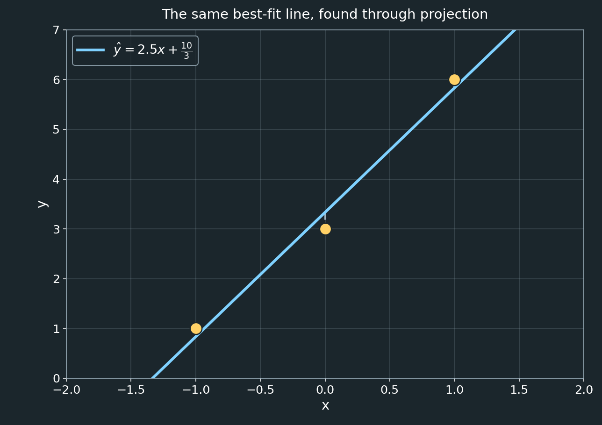

# Least Squares with Linear Algebra

This is the second document in the least-squares series. It assumes you've read the [Introduction to Least Squares](least_squares_introduction.md) and are comfortable with its vocabulary — a **residual** (the gap between a data point and a line) and the **sum of squared errors** (the total we're trying to make as small as possible).

That document solved everything with plain algebra: averages, sums, and a formula for a slope and an intercept. This one solves the *exact same problem* again, but writes it using **vectors** and **matrices** instead. That might sound like unnecessary extra machinery for a problem we've already solved — and for a single line through a handful of points, it is. But the matrix version scales to problems with thousands of unknowns, and it is exactly the machinery used by the GraphSLAM documents elsewhere in this repository. Understanding it here, on a tiny example you can check by hand, makes everything in those later documents make sense. (This document follows the same path as the excellent [Khan Academy video on least squares approximation](https://www.youtube.com/watch?v=MC7l96tW8V8), with a concrete numeric example and a closer look at what "column space" means along the way.)

A quick notation note before we start: the line we're fitting is $y=mt+c$, using $t$ for the input and $c$ for the intercept — not $x$ and $b$, as in the first document — because in this document $\mathbf{x}$ and $\mathbf{b}$ are about to mean something else entirely: a vector of unknowns, and a vector of measurements.

---

## Writing the Problem as a Matrix Equation

Suppose we measure something three times, once each at $t=-1$, $t=0$, and $t=1$, and get the results $y=1$, $y=3$, and $y=6$. We want the line $y=mt+c$ that best fits these three points.

If that line fit every point exactly, it would need to satisfy three equations at once:

```math
\begin{aligned}
m(-1)+c&=1\\
m(0)+c&=3\\
m(1)+c&=6
\end{aligned}
```

Three equations, but only two unknowns, $m$ and $c$. We can write all three at once as a single matrix equation. Collect the coefficients of $m$ and $c$ into a matrix $A$, the unknowns into a vector $\mathbf{x}$, and the right-hand sides into a vector $\mathbf{b}$:

```math
\boxed{
A\mathbf{x}=\mathbf{b}
\qquad\text{where}\qquad
A=
\begin{bmatrix}
-1&1\\
0&1\\
1&1
\end{bmatrix},
\quad
\mathbf{x}=
\begin{bmatrix}
m\\
c
\end{bmatrix},
\quad
\mathbf{b}=
\begin{bmatrix}
1\\
3\\
6
\end{bmatrix}
}
```

If you multiply $A$ by $\mathbf{x}$ using the ordinary rule for matrix-vector multiplication, you get back exactly the three equations above. This is just a compact way of writing a system of equations — nothing new has happened yet.

---

## A Concrete Case With No Solution

Here's the question this document is really about: does some $m$ and $c$ exist that satisfies *all three* equations at once? Let's check, directly, with no hand-waving.

Take the first two equations only — two equations, two unknowns, so we can solve them exactly:

```math
\begin{aligned}
-m+c&=1\\
c&=3
\end{aligned}
```

The second equation gives $c=3$ immediately. Substituting into the first, $-m+3=1$, so $m=2$.

Now check whether this same $m=2,\ c=3$ also satisfies the third equation:

```math
m(1)+c=2(1)+3=5.
```

But the third equation requires this to equal $6$, not $5$. The only $m,c$ that satisfy the first two equations exactly give $5$, not $6$, for the third. **There is no $m$ and $c$ that satisfies all three equations simultaneously.** The matrix equation $A\mathbf{x}=\mathbf{b}$ has no solution.

This shouldn't be surprising — it's the same fact from the first document, that three points rarely sit exactly on one line, just now stated as a fact about a matrix equation instead of a picture of dots and a line.

---

## A Matrix Is Just a List of Vectors

To see why $A\mathbf{x}=\mathbf{b}$ has no solution *geometrically*, it helps to look at $A$ differently: not as a grid of six numbers, but as two columns side by side, each one a vector:

```math
A=
\begin{bmatrix}
-1&1\\
0&1\\
1&1
\end{bmatrix}
=
\begin{bmatrix}
\big|&\big|\\
a_1&a_2\\
\big|&\big|
\end{bmatrix},
\qquad
a_1=\begin{bmatrix}-1\\0\\1\end{bmatrix},
\qquad
a_2=\begin{bmatrix}1\\1\\1\end{bmatrix}.
```

Matrix-vector multiplication has a second meaning that becomes useful here: $A\mathbf{x}$ is exactly the same as $m\,a_1+c\,a_2$ — take $m$ copies of the vector $a_1$, $c$ copies of the vector $a_2$, and add them together.

```math
\boxed{A\mathbf{x}=m\,a_1+c\,a_2}
```


This is what it means to say "a matrix is a list of vectors": every output $A\mathbf{x}$ you could ever produce, for any choice of $m$ and $c$, is just some combination of stretching and adding together the columns of $A$. There is no other way to produce an output. This single idea is the key to understanding why $A\mathbf{x}=\mathbf{b}$ can fail to have a solution.

Each of these vectors lives in three numbers, one per data point — not two numbers, like the $(t,y)$ graph from the first document. This is a different, more abstract space: one axis per *measurement*, not one axis per *variable*. We only have three measurements here so that we can still draw it; the same idea works identically with a million measurements, we simply can't sketch a million-dimensional picture.

---

## The Column Space: Everywhere A Can Reach

Now imagine trying *every* possible value of $m$ and $c$ — not just the two we found, but every real number, including negatives, fractions, and zero. For each pair $(m,c)$, the combination $m\,a_1+c\,a_2$ lands somewhere. The set of every single point you could possibly land on this way is called the **column space** of $A$.

Since $a_1$ and $a_2$ point in different directions, stretching and combining them can reach any point on a flat, infinite sheet that passes through the origin and contains both vectors — a plane, sitting inside our three-dimensional measurement space. No matter how hard you try, you can never reach a point that is off of this sheet using only combinations of $a_1$ and $a_2$. The column space is, quite literally, **everywhere $A$ can reach**.


This picture explains, geometrically, exactly why $A\mathbf{x}=\mathbf{b}$ had no solution: solving it means finding some $m,c$ with $m\,a_1+c\,a_2=\mathbf{b}$ — in other words, finding a point *on the sheet* that lands exactly on $\mathbf{b}$. The figure shows $\mathbf{b}=(1,3,6)$ floating above the sheet, not on it. **$A\mathbf{x}=\mathbf{b}$ has a solution exactly when $\mathbf{b}$ lies in the column space of $A$ — and in our example, it doesn't.**

---

## If We Can't Hit b, Get as Close as Possible

We already proved $\mathbf{b}$ is unreachable exactly. But we don't have to give up — we can still ask for the closest we can get.

Here is the connection back to the first document that makes this whole detour worthwhile: for any choice of $m,c$, the vector $\mathbf{b}-A\mathbf{x}$ is exactly the vector of residuals — $(y_1-\widehat y_1,\ y_2-\widehat y_2,\ y_3-\widehat y_3)$, the same leftover errors from before. And the ordinary squared length of a vector, $\|\mathbf{b}-A\mathbf{x}\|^2$, adds up the square of each of its entries — which is exactly the **sum of squared errors** from the first document.

```math
\|\mathbf{b}-A\mathbf{x}\|^2=(y_1-\widehat y_1)^2+(y_2-\widehat y_2)^2+(y_3-\widehat y_3)^2=\text{sum of squared errors}
```

So "find the $m,c$ that minimizes the sum of squared errors" and "find the point in the column space of $A$ that is closest to $\mathbf{b}$, in ordinary straight-line distance" are the same question, just described two different ways. Geometry has a name for finding the closest point in a flat space to a point outside of it: **projection**.

---

## Projecting b Onto the Plane

Picture shining a flashlight straight down onto the sheet, perpendicular to it, with $\mathbf{b}$ floating above. The shadow it casts — the point on the sheet directly "below" $\mathbf{b}$ — is the closest point on the sheet to $\mathbf{b}$. That shadow point is called the **projection** of $\mathbf{b}$ onto the column space, written $\hat{\mathbf{b}}$ ("b-hat"). Since $\hat{\mathbf{b}}$ is on the sheet, it is automatically reachable: $\hat{\mathbf{b}}=A\hat{\mathbf{x}}$ for some unknowns $\hat m,\hat c$, and that $\hat{\mathbf{x}}$ is exactly the best-fit answer we're looking for.

The leftover gap, $e=\mathbf{b}-\hat{\mathbf{b}}$, is called the **error vector**. Because it's the straight-down path from $\mathbf{b}$ to its shadow, it is **perpendicular to the entire sheet** — this is just the ordinary geometric fact that the shortest path from a point to a flat surface is always perpendicular to that surface.


---

## From Perpendicularity to the Normal Equations

This perpendicularity is the key that unlocks an actual formula for $\hat{\mathbf{x}}$.

Two vectors are perpendicular exactly when their **dot product** is zero. The dot product of two vectors multiplies their matching entries and adds up the results:

```math
\begin{bmatrix}p_1\\p_2\\p_3\end{bmatrix}\cdot\begin{bmatrix}q_1\\q_2\\q_3\end{bmatrix}=p_1q_1+p_2q_2+p_3q_3.
```

Since $e$ is perpendicular to the *whole* sheet, it is perpendicular to every vector lying in that sheet — in particular, to $a_1$ and $a_2$ themselves, since they are literally part of it:

```math
a_1\cdot e=0,\qquad a_2\cdot e=0.
```

These two conditions can be written together as one matrix equation using the **transpose** of $A$, written $A^\top$ — just $A$ with its rows and columns swapped, so its rows are $a_1$ and $a_2$ instead of its columns:

```math
A^\top=
\begin{bmatrix}
-1&0&1\\
1&1&1
\end{bmatrix}.
```

Multiplying $A^\top$ by $e$ computes exactly $a_1\cdot e$ and $a_2\cdot e$, stacked into one vector. So both conditions at once are simply:

```math
A^\top e=\mathbf{0}.
```

Now substitute $e=\mathbf{b}-A\hat{\mathbf{x}}$ and expand:

```math
A^\top(\mathbf{b}-A\hat{\mathbf{x}})=\mathbf{0}
\quad\Longrightarrow\quad
A^\top\mathbf{b}-A^\top A\hat{\mathbf{x}}=\mathbf{0}
\quad\Longrightarrow\quad
\boxed{A^\top A\,\hat{\mathbf{x}}=A^\top\mathbf{b}.}
```

These are called the **normal equations** ("normal" here means perpendicular — the same root as a "normal vector"). This is a brand-new matrix equation, with $A^\top A$ and $A^\top\mathbf{b}$ built entirely from numbers we already have, and it can be solved directly for $\hat{\mathbf{x}}$ whenever $A^\top A$ is invertible — which is true here, since $a_1$ and $a_2$ point in genuinely different directions.

---

## Solving the Normal Equations for Our Example

Let's compute both sides for our numbers.

```math
A^\top A=
\begin{bmatrix}
-1&0&1\\
1&1&1
\end{bmatrix}
\begin{bmatrix}
-1&1\\
0&1\\
1&1
\end{bmatrix}
=
\begin{bmatrix}
2&0\\
0&3
\end{bmatrix},
\qquad
A^\top\mathbf{b}=
\begin{bmatrix}
-1&0&1\\
1&1&1
\end{bmatrix}
\begin{bmatrix}
1\\3\\6
\end{bmatrix}
=
\begin{bmatrix}
5\\10
\end{bmatrix}.
```

$A^\top A$ came out **diagonal** — zero in its off-diagonal entries. That happened because $a_1\cdot a_2=(-1)(1)+(0)(1)+(1)(1)=0$: our two columns happen to be exactly perpendicular to each other (we chose the inputs $t=-1,0,1$ specifically so that this would happen and the picture would be easy to draw). That's a convenient special case, not something that happens in general — but it means the normal equations split into two completely independent one-line divisions instead of a system we'd need to solve together:

```math
2\hat m=5\ \Longrightarrow\ \hat m=\frac{5}{2}=2.5,
\qquad\qquad
3\hat c=10\ \Longrightarrow\ \hat c=\frac{10}{3}\approx3.33.
```

So the best-fit line is $\hat y=2.5t+\frac{10}{3}$. Let's verify this really is the closest point in the column space to $\mathbf{b}$:

```math
\hat{\mathbf{b}}=A\hat{\mathbf{x}}=2.5\,a_1+\frac{10}{3}\,a_2=\left(\frac{5}{6},\ \frac{10}{3},\ \frac{35}{6}\right)\approx(0.83,\ 3.33,\ 5.83),
```

```math
e=\mathbf{b}-\hat{\mathbf{b}}=\left(\frac{1}{6},\ -\frac{1}{3},\ \frac{1}{6}\right).
```

Checking the perpendicularity we relied on: $a_1\cdot e=(-1)\!\left(\frac16\right)+0\!\left(-\frac13\right)+1\!\left(\frac16\right)=0$, and $a_2\cdot e=\frac16-\frac13+\frac16=0$. Both exactly zero, as the whole derivation promised. The sum of squared errors is $\|e\|^2=\left(\frac16\right)^2+\left(\frac13\right)^2+\left(\frac16\right)^2=\frac16\approx0.167$ — tiny, confirming this line fits very well.



This is the same kind of picture the first document ended on: a line through scattered points, with small gaps left over. We arrived at the identical kind of answer — a best-fit line minimizing the sum of squared errors — by an entirely different route: not by averaging and a slope formula, but by projecting a vector onto a plane.

---

## Why Bother With All This Machinery?

For three points and one line, the algebra-only approach from the first document is faster by hand. The payoff of the matrix version is that it doesn't care how big the problem gets. Whether $A$ has $3$ rows or $3$ million, $2$ columns or $200$, the recipe is always the same:

```math
A^\top A\,\hat{\mathbf{x}}=A^\top\mathbf{b}
```

A computer can build $A^\top A$ and $A^\top\mathbf{b}$ and solve this equation in a fraction of a second, no matter how large $A$ is, using the exact same handful of lines of code every time. That is the entire reason to bother with vectors, column spaces, and projections: they turn "find the best-fitting answer to an enormous pile of inconsistent measurements" into "solve one matrix equation."

That is, in fact, exactly what the [GraphSLAM](../../Graph_SLAM) documents elsewhere in this repository do. GraphSLAM's information matrix $\Omega$ and information vector $\xi$, and the equation $\Omega\mu=\xi$, are built from this very same $A^\top A$ and $A^\top\mathbf{b}$ recipe — just with one small addition: a weight on each measurement, so a precise sensor counts for more than a noisy one. That addition, **weighted least squares**, is the next document in this series.

---

## What's Next in This Series

This document rewrote the same line-fitting problem from the first document using vectors and matrices, and along the way introduced:

- Writing a system of measurements as $A\mathbf{x}=\mathbf{b}$.
- Reading a matrix as a list of column vectors, and $A\mathbf{x}$ as a combination of them.
- The **column space**: everywhere a matrix can reach.
- **Projection**: finding the closest reachable point when $\mathbf{b}$ isn't reachable exactly.
- The **normal equations**, $A^\top A\,\hat{\mathbf{x}}=A^\top\mathbf{b}$, derived from the fact that the error vector is perpendicular to the column space.

Still to come in this series:

- **Weighted least squares** — trusting some measurements more than others, the way real sensors (and GraphSLAM) do.
- Seeing the normal equations reappear directly inside GraphSLAM's $\Omega\mu=\xi$.
