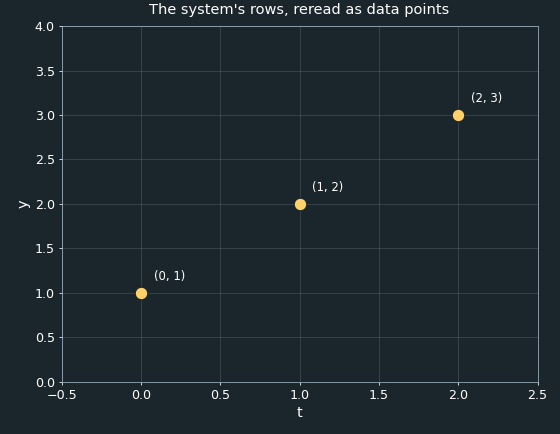
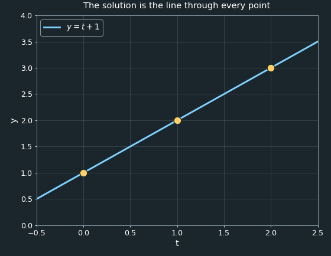
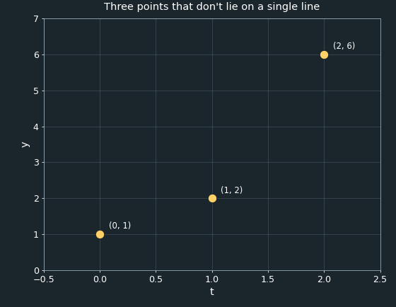
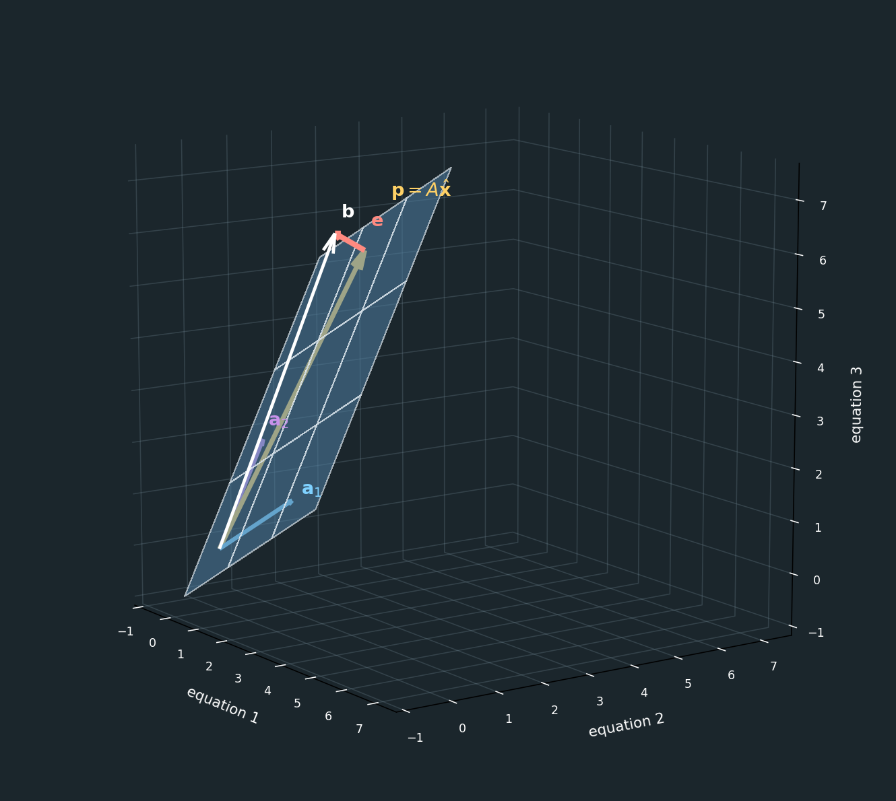
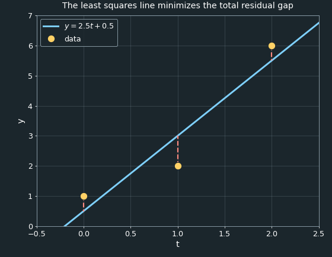

# Linear Least Squares

Least squares is a method for fitting an equation to a set of data points. There are several ways to approach this problem; the one we'll explore here is the linear algebra approach.

## Preliminary Information

Before describing the least squares problem itself, we'll first recap some background material that it depends on.

### Linear Systems of Equations

Suppose we have the following system of equations relating two variables, $x_1$ and $x_2$:

```math
\begin{aligned}
x_1 &= 1,\\
x_1 + x_2 &= 2,\\
x_1 + 2x_2 &= 3.
\end{aligned}
```

Notice that not every equation includes both $x_1$ and $x_2$. We can rewrite them so that every term appears explicitly, using a coefficient of zero wherever a variable is missing:

```math
\begin{aligned}
x_1 + 0x_2 &= 1,\\
x_1 + x_2 &= 2,\\
x_1 + 2x_2 &= 3.
\end{aligned}
```

We could solve this system directly — by substitution — to find $x_1$ and $x_2$. But there's a more useful way to look at it, one that uses matrices and vectors instead.

We can collect the coefficients of $x_1$ and $x_2$ into a matrix, and the two variables themselves into a vector:

```math
\begin{bmatrix}
1 & 0\\
1 & 1\\
1 & 2
\end{bmatrix}
\begin{bmatrix}
x_1\\
x_2
\end{bmatrix}
=
\begin{bmatrix}
1\\
2\\
3
\end{bmatrix}
```

Multiplying the matrix by the vector of variables — taking the dot product of each row with the vector — reproduces exactly the system of equations we started with. Writing that out explicitly:

```math
\begin{bmatrix}
1 & 0\\
1 & 1\\
1 & 2
\end{bmatrix}
\begin{bmatrix}
x_1\\
x_2
\end{bmatrix}
=
\begin{bmatrix}
1x_1+0x_2\\
1x_1+1x_2\\
1x_1+2x_2
\end{bmatrix}
=
\begin{bmatrix}
1\\
2\\
3
\end{bmatrix}
```

Each row of the product is just the sum of that row's entries multiplied by the matching entries of $\mathbf{x}$ — and reading each row of the result as its own equation gives back exactly the three equations we started with.

This is called a **linear system of equations**, and it's usually written in the compact form

```math
\boxed{A\mathbf{x}=\mathbf{b}}
```

where $A$ is the **coefficient matrix**, $\mathbf{x}$ is the vector of unknowns, and $\mathbf{b}$ is the vector on the right-hand side.

Now let's set aside the right-hand side vector $\mathbf{b}$ entirely, and ask a different question: what vectors *can* the coefficient matrix $A$ produce? We're free to choose any values we like for $x_1$ and $x_2$, and $A$ will turn them into some vector.

For example, choosing $x_1=2$ and $x_2=3$ gives

```math
\begin{bmatrix}
1 & 0\\
1 & 1\\
1 & 2
\end{bmatrix}
\begin{bmatrix}
2\\
3
\end{bmatrix}
=
\begin{bmatrix}
2\\
5\\
8
\end{bmatrix}.
```

There are infinitely many combinations of $x_1$ and $x_2$ we could choose, each producing a different vector. But these vectors aren't arbitrary — every one of them is built from the same two columns of $A$, so they all share a common structure, as a few more examples show:

| $x_1$ | $x_2$ | $A\mathbf{x}$ |
|---|---|---|
| $2$ | $3$ | $(2,5,8)$ |
| $1$ | $1$ | $(1,2,3)$ |
| $0$ | $2$ | $(0,2,4)$ |
| $3$ | $0$ | $(3,3,3)$ |

Notice that choosing $x_1=1$ and $x_2=1$ reproduces $(1,2,3)$ — exactly the right-hand side from our very first example, since that's the solution we found there.

If we plot each of these resulting vectors as a point in three-dimensional space — one axis per equation — every single one lands on a flat plane that passes through the origin, no matter which $x_1$ and $x_2$ we picked:


This plane — everywhere the matrix $A$ can reach — is called the **column space** of $A$, because it's made up of every possible linear combination of $A$'s two columns, $\mathbf{a}_1$ and $\mathbf{a}_2$:

```math
A=
\begin{bmatrix}
1 & 0\\
1 & 1\\
1 & 2
\end{bmatrix},
\qquad
\mathbf{a}_1=
\begin{bmatrix}
1\\
1\\
1
\end{bmatrix},
\qquad
\mathbf{a}_2=
\begin{bmatrix}
0\\
1\\
2
\end{bmatrix}
```

```math
\boxed{
\mathrm{Col}(A)=\{x_1\mathbf{a}_1+x_2\mathbf{a}_2 \mid x_1,x_2\in\mathbb{R}\}
}
```

## Reframing as a Data-Fitting Problem

The same linear system we've been using can be read in a completely different way: as fitting a line to a small set of data points.

Look again at the second column of $A$, which is $(0,1,2)$, and the vector $\mathbf{b}$, which is $(1,2,3)$. If we treat each row of the system as its own data point — using the entry from $A$'s second column as an input $t$, and the matching entry of $\mathbf{b}$ as an output $y$ — we get three points:

| Row | Input ($t$) | Output ($y$) |
|---|---|---|
| 1 | $0$ | $1$ |
| 2 | $1$ | $2$ |
| 3 | $2$ | $3$ |



Written this way, each row of the system is really an equation for a line. The first column of $A$ is always $1$, so row $i$ says $x_1+x_2t_i=y_i$ — in other words, $y=x_2t+x_1$: a line with slope $x_2$ and intercept $x_1$. Those are the exact same $x_1$ and $x_2$ we solved for earlier. To avoid confusing this intercept with the vector $\mathbf{b}$, we'll call it $c$ instead, and write the line in the more familiar form

```math
\boxed{y=mt+c}
```

with $m=x_2$ and $c=x_1$.

We already solved this system and found $x_1=1$ and $x_2=1$, so $m=1$ and $c=1$. The solution to our linear system is really just the line $y=t+1$:



Every one of our three points lies exactly on this line, because the original system had an exact solution — there was an $x_1$ and $x_2$ that satisfied all three equations at once. Solving a linear system and fitting a line through data turn out to be the very same problem.

## When the Data Doesn't Fit a Line

Real measurements are rarely this clean. Suppose that instead of measuring $y=3$ at $t=2$, we had measured $y=6$, giving us three points that don't lie on a single line:



In terms of the linear system, this means our right-hand side became $\mathbf{b}=(1,2,6)$ instead of $(1,2,3)$.

The first two equations are unchanged, so solving them still gives $x_1=1$ and $x_2=1$, exactly as before. But checking these same values against the third equation:

```math
x_1+2x_2=1+2(1)=3,
```

which doesn't match the measured value of $6$. There is no single $x_1$ and $x_2$ that satisfies all three equations at once — **this system of equations has no solution.**

We already know that $A\mathbf{x}$ can only ever produce a vector somewhere on the plane $\mathrm{Col}(A)$, no matter what $x_1$ and $x_2$ we choose. If no $\mathbf{x}$ reaches $\mathbf{b}=(1,2,6)$, that can only mean one thing: $\mathbf{b}$ itself does not lie on that plane.


We can't reach $\mathbf{b}$ exactly — but we don't have to give up entirely. We can still ask for the closest point to $\mathbf{b}$ that the column space *does* contain. This point would represent the line that minimizes the error between the data points and the line. It gives us the best fit line.


So how do we find the point in the column space that best fits the data? We will **project** the vector onto the column space.

## Projecting onto the Column Space

Call the closest point in $\mathrm{Col}(A)$ to $\mathbf{b}$ the vector $\mathbf{p}$. Since $\mathbf{p}$ lies in the column space, it's reachable by *some* choice of variables — call them $\hat{\mathbf{x}}$ — so that $\mathbf{p}=A\hat{\mathbf{x}}$. The hat on $\hat{\mathbf{x}}$ is just a reminder that this is no longer an exact solution to $A\mathbf{x}=\mathbf{b}$, but rather the best approximation we can get.

Define the **error** as the leftover piece that $\mathbf{p}$ fails to capture:

```math
\mathbf{e}=\mathbf{b}-\mathbf{p}=\mathbf{b}-A\hat{\mathbf{x}}.
```

What makes $\mathbf{p}$ the *closest* point in the plane to $\mathbf{b}$, rather than just some point in the plane? Picture sliding a candidate point around on the plane: as long as the line from that point up to $\mathbf{b}$ is slanted, you could always slide a little further and shorten it. The shortest possible connecting line — the one that can't be shortened by sliding — is the one that meets the plane at a perfect right angle. So the error vector $\mathbf{e}$ must be **orthogonal to the entire column space**.



Being orthogonal to the whole plane is the same as being orthogonal to every vector that spans it — and since $\mathrm{Col}(A)$ is spanned by the columns of $A$, that means $\mathbf{e}$ must be orthogonal to both $\mathbf{a}_1$ and $\mathbf{a}_2$ individually. Recall that two vectors are orthogonal exactly when their dot product is zero, and that the dot product of a vector with each column of $A$ is exactly what $A^{\mathsf{T}}$ computes. So requiring $\mathbf{e}$ to be orthogonal to every column of $A$ is the same as requiring

```math
\boxed{A^{\mathsf{T}}\mathbf{e}=\mathbf{0}}
```

Substituting in $\mathbf{e}=\mathbf{b}-A\hat{\mathbf{x}}$ gives

```math
A^{\mathsf{T}}(\mathbf{b}-A\hat{\mathbf{x}})=\mathbf{0},
```

and distributing $A^{\mathsf{T}}$ across the subtraction gives

```math
A^{\mathsf{T}}\mathbf{b}-A^{\mathsf{T}}A\hat{\mathbf{x}}=\mathbf{0}.
```

Rearranging puts all the unknowns on one side, in what's called the **normal equations**:

```math
\boxed{A^{\mathsf{T}}A\hat{\mathbf{x}}=A^{\mathsf{T}}\mathbf{b}}
```

This is just another linear system, except now the coefficient matrix is $A^{\mathsf{T}}A$ and the right-hand side is $A^{\mathsf{T}}\mathbf{b}$ — both of which we can compute directly from the original $A$ and $\mathbf{b}$. As long as $A^{\mathsf{T}}A$ is invertible (which it will be whenever $A$'s columns are linearly independent, as ours are), we can solve for $\hat{\mathbf{x}}$ by multiplying both sides by $(A^{\mathsf{T}}A)^{-1}$:

```math
\boxed{\hat{\mathbf{x}}=(A^{\mathsf{T}}A)^{-1}A^{\mathsf{T}}\mathbf{b}}
```

This is the **least squares solution**. It's called that because, out of every possible $\hat{\mathbf{x}}$, it's the one that makes $\mathbf{e}$ as short as possible — and minimizing the length of $\mathbf{e}$ turns out to be the same as minimizing the *sum of the squares* of its entries, $\lVert\mathbf{e}\rVert^2=e_1^2+e_2^2+e_3^2$. That's where the method gets its name.

## Solving the Example

Let's apply this to the inconsistent system from before, with $A$ unchanged and $\mathbf{b}=(1,2,6)$:

```math
A=
\begin{bmatrix}
1 & 0\\
1 & 1\\
1 & 2
\end{bmatrix},
\qquad
\mathbf{b}=
\begin{bmatrix}
1\\2\\6
\end{bmatrix}
```

First compute $A^{\mathsf{T}}A$ and $A^{\mathsf{T}}\mathbf{b}$:

```math
A^{\mathsf{T}}A=
\begin{bmatrix}
1&1&1\\
0&1&2
\end{bmatrix}
\begin{bmatrix}
1&0\\1&1\\1&2
\end{bmatrix}
=
\begin{bmatrix}
3&3\\3&5
\end{bmatrix},
\qquad
A^{\mathsf{T}}\mathbf{b}=
\begin{bmatrix}
1&1&1\\
0&1&2
\end{bmatrix}
\begin{bmatrix}
1\\2\\6
\end{bmatrix}
=
\begin{bmatrix}
9\\14
\end{bmatrix}
```

So the normal equations are

```math
\begin{bmatrix}
3&3\\3&5
\end{bmatrix}
\begin{bmatrix}
\hat{x}_1\\\hat{x}_2
\end{bmatrix}
=
\begin{bmatrix}
9\\14
\end{bmatrix}
```

which is just a $2\times2$ linear system — easy to solve directly. The first row says $3\hat{x}_1+3\hat{x}_2=9$, or $\hat{x}_1+\hat{x}_2=3$. Subtracting three times that from the second row, $3\hat{x}_1+5\hat{x}_2=14$, leaves $2\hat{x}_2=5$, so

```math
\hat{x}_2=2.5,\qquad \hat{x}_1=3-\hat{x}_2=0.5.
```

Translating back into slope-intercept form, $m=\hat{x}_2=2.5$ and $c=\hat{x}_1=0.5$, giving the **best fit line**

```math
\boxed{y=2.5t+0.5}
```

We can check this answer by computing the projection $\mathbf{p}=A\hat{\mathbf{x}}$ and confirming the error really is orthogonal to both columns of $A$:

```math
\mathbf{p}=
\begin{bmatrix}
1&0\\1&1\\1&2
\end{bmatrix}
\begin{bmatrix}
0.5\\2.5
\end{bmatrix}
=
\begin{bmatrix}
0.5\\3\\5.5
\end{bmatrix},
\qquad
\mathbf{e}=\mathbf{b}-\mathbf{p}=
\begin{bmatrix}
1\\2\\6
\end{bmatrix}
-
\begin{bmatrix}
0.5\\3\\5.5
\end{bmatrix}
=
\begin{bmatrix}
0.5\\-1\\0.5
\end{bmatrix}
```

Taking the dot product of $\mathbf{e}$ with each column confirms orthogonality: $\mathbf{e}\cdot\mathbf{a}_1=0.5-1+0.5=0$, and $\mathbf{e}\cdot\mathbf{a}_2=0(0.5)+1(-1)+2(0.5)=0$. Since $\mathbf{e}$ is orthogonal to the whole column space, $\mathbf{p}$ really is the closest point in it to $\mathbf{b}$, exactly as the theory predicted.

Plotting this line against the original three points shows it passing as close as it can to all of them at once — not through any single one exactly, but balancing the leftover gap, or **residual**, at each point:



Notice that the residuals don't all have the same sign or size — the line passes below the first point, above the second, and below the third — but it's positioned so that the *sum of squared residuals* across all three points is as small as it can possibly be. No other line through this data would produce a smaller total squared error, which is exactly what makes it the least squares solution. 


